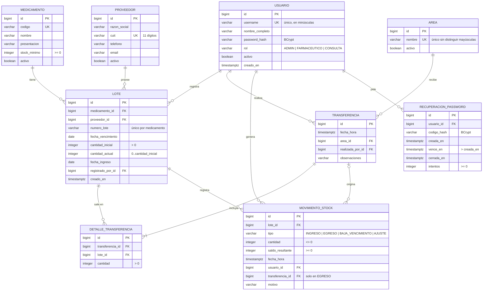

# Modelo de datos

Base PostgreSQL 16 versionada con Flyway (`backend/src/main/resources/db/migration`). Hibernate
solo valida el esquema (`ddl-auto: validate`): las tablas, las claves y las restricciones salen
de las migraciones, nunca del código.

| Migración | Contenido |
|---|---|
| `V1__esquema.sql` | Las ocho tablas del negocio con sus claves, restricciones e índices. |
| `V2__datos_base.sql` | Las áreas del hospital. |
| `V3__recuperacion_password.sql` | Pedidos de recuperación de contraseña. |

## Diagrama entidad-relación

## Claves primarias y foráneas

- Todas las tablas usan una clave primaria sustituta `id bigint generated by default as identity`.
  Los datos que identifican al negocio (`username`, `cuit`, `codigo`, nombre del área y el par
  medicamento + número de lote) tienen además una restricción `unique`: la clave natural queda
  protegida sin usarla como clave primaria, así se puede corregir sin romper las relaciones.
- Toda relación es una clave foránea declarada con `references`. Ninguna borra en cascada: las
  bajas son lógicas (`activo = false`) y el historial de lotes, movimientos y transferencias nunca
  se pierde.

| Clave foránea | Relación | Cardinalidad |
|---|---|---|
| `lote.medicamento_id → medicamento.id` | El lote es de un medicamento. | 1 medicamento : N lotes |
| `lote.proveedor_id → proveedor.id` | El lote lo entregó un proveedor. | 1 proveedor : N lotes |
| `lote.registrado_por_id → usuario.id` | Quién cargó el ingreso. | 1 usuario : N lotes |
| `transferencia.area_id → area.id` | Área que recibe. | 1 área : N transferencias |
| `transferencia.realizada_por_id → usuario.id` | Quién entregó. | 1 usuario : N transferencias |
| `detalle_transferencia.transferencia_id → transferencia.id` | Renglón del comprobante. | 1 transferencia : 1..N detalles |
| `detalle_transferencia.lote_id → lote.id` | De qué lote salió. | 1 lote : N detalles |
| `movimiento_stock.lote_id → lote.id` | Movimiento del lote. | 1 lote : N movimientos |
| `movimiento_stock.usuario_id → usuario.id` | Quién lo generó. | 1 usuario : N movimientos |
| `movimiento_stock.transferencia_id → transferencia.id` | Transferencia que originó un egreso (opcional). | 0..1 transferencia : N movimientos |
| `recuperacion_password.usuario_id → usuario.id` | Pedido de código. | 1 usuario : N pedidos |

`detalle_transferencia` resuelve la relación muchos a muchos entre transferencias y lotes: una
transferencia toma varios lotes (FEFO) y un lote puede repartirse en varias transferencias.

## Validaciones de integridad

La regla se valida en tres capas: el DTO (Bean Validation, para dar un mensaje claro), la entidad
(invariantes en Java) y la base (la última barrera, que no se puede saltear).

| Regla | Base de datos | Código |
|---|---|---|
| El stock nunca es negativo ni supera lo ingresado. | `ck_lote_cantidad_actual` (`0 <= cantidad_actual <= cantidad_inicial`) | `Lote.descontar` / `Lote.ajustar` lanzan excepción; bloqueo pesimista ordenado por id en las transferencias. |
| Un ingreso trae al menos una unidad. | `ck_lote_cantidad_inicial` (`> 0`) | `@Positive` en `IngresoRequest`. |
| No se repite un lote del mismo medicamento. | `uq_lote_medicamento_numero` | `LoteService` responde 409 `LOTE_DUPLICADO`. |
| Usuario, CUIT, código y nombre de área únicos. | `uq_usuario_username`, `uq_proveedor_cuit`, `uq_medicamento_codigo`, `ux_area_nombre` (sobre `lower(nombre)`) | Los servicios lo controlan antes; `ManejadorErrores` traduce la violación si dos pedidos llegan juntos. |
| El CUIT tiene 11 dígitos. | `ck_proveedor_cuit` (regex) | `@Cuit` valida además el dígito verificador. |
| Rol y tipo de movimiento solo con valores conocidos. | `ck_usuario_rol`, `ck_movimiento_tipo` | Enums `Rol` y `TipoMovimiento`. |
| Cantidades de detalle y movimientos válidas. | `ck_detalle_cantidad` (`> 0`), `ck_movimiento_cantidad` (`<> 0`), `ck_movimiento_saldo` (`>= 0`) | Los movimientos los crea solo el servicio. |
| Stock mínimo no negativo. | `ck_medicamento_stock_minimo` | `@PositiveOrZero` en `MedicamentoRequest`. |
| El código de recuperación vence después de crearse. | `ck_recuperacion_vencimiento`, `ck_recuperacion_intentos` | Constructor de `RecuperacionPassword`. |

## Normalización (3FN)

**Primera forma normal.** Todos los atributos son atómicos y no hay grupos repetidos: los renglones
de una transferencia no son columnas `medicamento1`, `medicamento2`…, sino filas de
`detalle_transferencia`; los movimientos de un lote son filas de `movimiento_stock`. Cada tabla
tiene clave primaria.

**Segunda forma normal.** Todas las claves primarias son simples (`id`), así que no puede haber
dependencias parciales de una parte de la clave. En las tablas con clave natural compuesta
(`lote`: medicamento + número de lote), los demás atributos dependen del lote entero, no del
medicamento solo: el vencimiento y la cantidad son del lote.

**Tercera forma normal.** Ningún atributo no clave depende de otro atributo no clave:

- `lote` no repite el nombre del medicamento ni la razón social del proveedor: guarda sus claves
  foráneas y el nombre se obtiene por join.
- `transferencia` no guarda el nombre del área ni del usuario, ni totales: las unidades e ítems se
  calculan sumando `detalle_transferencia`.
- El **número de comprobante** (`TR-000123`) no se guarda: se deriva del `id`
  (`Transferencia.numero`). El **stock total**, el **estado de stock** y el **próximo vencimiento**
  de un medicamento tampoco: se calculan con una consulta agregada sobre `lote`. Guardarlos
  crearía una dependencia transitiva y el riesgo de que no coincidan con los lotes.
- El **estado de un lote** (vigente, por vencer, vencido, agotado) depende de la fecha de hoy y se
  calcula, no se almacena.

**Redundancia controlada, con justificación.** `movimiento_stock.saldo_resultante` guarda el saldo
del lote después de cada movimiento. Se podría calcular sumando los movimientos anteriores, pero se
guarda a propósito como dato de auditoría: es el saldo que vio el usuario en ese momento y permite
detectar una inconsistencia si alguna vez la suma no coincide con `lote.cantidad_actual`
(`FlujoCompletoIT` verifica que coincidan). Es un registro histórico inmutable, no un dato que se
actualice, así que no genera anomalías de actualización.
