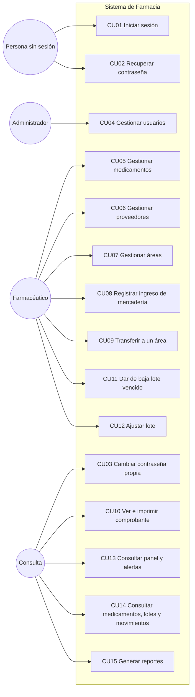
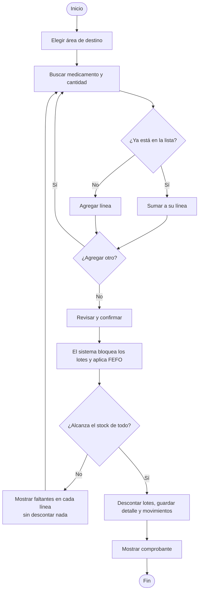
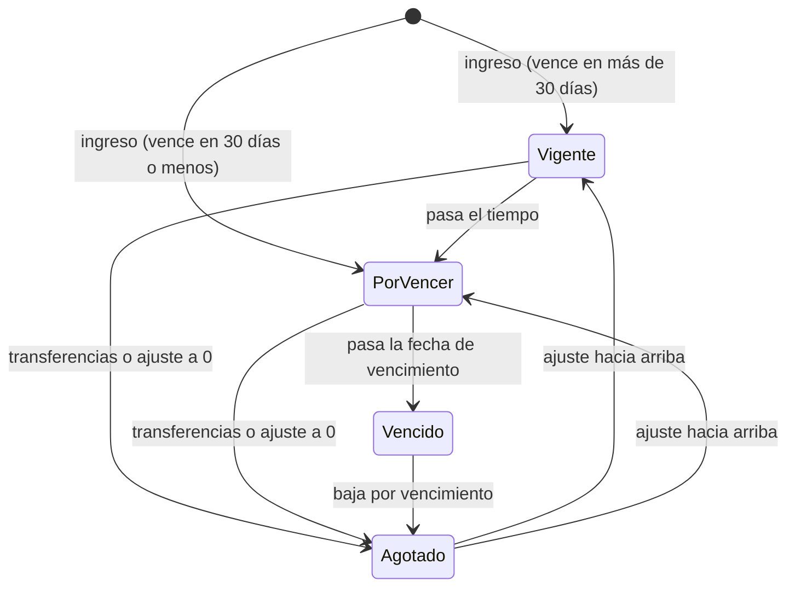

# 2. Casos de uso

## 2.1 Diagrama general

El Farmacéutico puede hacer todo lo que hace Consulta, y el Administrador todo lo que hace el
Farmacéutico (herencia de actores: cada rol tiene los permisos del anterior más los suyos).

## 2.2 Casos de uso detallados

### CU01 — Iniciar sesión

| | |
|---|---|
| Actor | Persona sin sesión |
| Precondición | Tiene un usuario activo. |
| Disparador | Abre el sistema o su sesión venció. |

**Flujo principal**
1. El sistema muestra el formulario con el foco en "Usuario".
2. La persona ingresa usuario y contraseña y presiona "Ingresar" (o Enter).
3. El sistema muestra "Ingresando…" y deshabilita el botón.
4. El sistema verifica las credenciales, emite un token por 8 horas y muestra el Panel (o la
   pantalla que la persona quería abrir antes de ingresar).

**Flujos alternativos**
- 4a. Usuario inexistente, inactivo o contraseña incorrecta: el sistema muestra "Usuario o
  contraseña incorrectos." sin indicar cuál de los tres casos es.
- 1a. Si llegó porque la sesión venció, el sistema muestra "Tu sesión expiró. Volvé a ingresar."

**Postcondición:** sesión iniciada; el menú muestra solo las opciones de su rol.

### CU02 — Recuperar contraseña

| | |
|---|---|
| Actor | Persona sin sesión |
| Precondición | Tiene un usuario activo. |

**Flujo principal**
1. En el ingreso, la persona elige "¿Olvidaste tu contraseña?".
2. Ingresa su nombre de usuario y pide el código.
3. El sistema genera un código de 6 números que vence en 15 minutos, anula los anteriores y
   "envía" el código (simulado: en el modo demostración lo muestra en pantalla).
4. La persona ingresa el código y la contraseña nueva dos veces.
5. El sistema verifica el código y guarda la contraseña nueva. Muestra "Listo, ya podés ingresar
   con tu contraseña nueva."

**Flujos alternativos**
- 3a. Si el usuario no existe, el sistema responde exactamente lo mismo (para no revelar qué
  usuarios existen), pero no genera código.
- 5a. Código incorrecto, vencido o ya usado: error en el campo "Código". Después de 5 intentos
  fallidos el código se anula; hay que pedir otro ("Pedir otro código").

### CU03 — Cambiar la contraseña propia

Actor: cualquier usuario con sesión. En **Mi cuenta** ingresa la contraseña actual, la nueva y la
repetición (8 a 72 caracteres). Si la actual es incorrecta, el error aparece en ese campo.

### CU04 — Gestionar usuarios

| | |
|---|---|
| Actor | Administrador |
| Precondición | Sesión con permiso `USUARIO_GESTIONAR`. |

**Flujo principal (alta)**
1. En **Usuarios** elige "Nuevo usuario".
2. Completa usuario, nombre completo, rol y contraseña inicial.
3. El sistema crea el usuario y lo muestra en la lista.

**Otros flujos**
- **Editar:** cambia nombre completo y rol.
- **Desactivar / reactivar:** con confirmación. No se ofrece sobre el propio usuario.
- **Restablecer contraseña:** ingresa una contraseña nueva para el usuario.

**Excepciones**
- Usuario repetido (sin distinguir mayúsculas): "Ya existe…" (`USERNAME_DUPLICADO`).
- Desactivar o quitar el rol al último administrador activo: rechazado (`ULTIMO_ADMIN`).
- Un usuario desactivado pierde el acceso en su siguiente acción, aunque tenga un token vigente.

### CU05 — Gestionar medicamentos

Actor: Administrador o Farmacéutico (`CATALOGO_EDITAR`).

1. En **Medicamentos** elige "Nuevo medicamento" o "Editar" en el detalle.
2. Completa código, nombre, presentación y stock mínimo.
3. El sistema guarda. El código se normaliza a mayúsculas.

Excepciones: código repetido (`CODIGO_DUPLICADO`); stock mínimo negativo (error de campo);
desactivar con stock no vencido (`MEDICAMENTO_CON_STOCK`, el diálogo muestra el motivo).

### CU06 — Gestionar proveedores

Actor: Administrador o Farmacéutico. Alta y edición con razón social, CUIT (con máscara
`XX-XXXXXXXX-X`), teléfono y correo. El CUIT se valida con su dígito verificador; repetido →
`CUIT_DUPLICADO`. Al desactivar uno con lotes con stock, el sistema avisa: "Tiene N lotes con
stock. Van a seguir disponibles, pero no vas a poder elegir este proveedor en ingresos nuevos."

### CU07 — Gestionar áreas

Actor: Administrador o Farmacéutico. Alta y edición del nombre (único sin distinguir mayúsculas).
Desactivar y reactivar con confirmación. Un área inactiva no aparece para transferir.

### CU08 — Registrar ingreso de mercadería

| | |
|---|---|
| Actor | Administrador o Farmacéutico (`STOCK_INGRESAR`) |
| Precondición | Existen el medicamento y el proveedor, activos. |

**Flujo principal**
1. En **Ingreso de mercadería** (o "Registrar ingreso" desde el detalle de un medicamento), elige
   el medicamento (buscador por código o nombre) y el proveedor.
2. Ingresa número de lote, fecha de vencimiento y cantidad.
3. El sistema crea el lote, registra un movimiento de **Ingreso** y muestra "Se registró el lote
   L2345. Stock de <medicamento>: 340."
4. "Registrar otro lote" deja el formulario listo conservando el proveedor.

**Flujos alternativos**
- 2a. Si vence dentro de los próximos 30 días, el sistema avisa ("Podés registrarlo igual.") sin
  bloquear.
- 3a. Vencimiento anterior a hoy: error en el campo. Lote repetido para ese medicamento:
  `LOTE_DUPLICADO`. Medicamento o proveedor inactivo: rechazado.

### CU09 — Transferir medicamentos a un área

| | |
|---|---|
| Actor | Administrador o Farmacéutico (`TRANSFERENCIA_CREAR`) |
| Precondición | Hay stock no vencido de los medicamentos pedidos. |

**Flujo principal**
1. En **Nueva transferencia** elige el área de destino.
2. Busca un medicamento, indica la cantidad y presiona "Agregar". El sistema muestra el stock
   disponible y cuánto va a quedar.
3. Repite el paso 2 para cada medicamento. Puede editar cantidades o quitar líneas.
4. Opcionalmente escribe observaciones (hasta 500 caracteres).
5. Presiona "Revisar y confirmar". El sistema muestra un resumen con el stock que va a quedar.
6. Confirma. El sistema muestra "Registrando…", aplica FEFO, descuenta los lotes y muestra el
   **comprobante**.

**Flujos alternativos**
- 2a. Si agrega un medicamento que ya está en la lista, se suma a su línea: "Se sumó a la línea
  de <medicamento>."
- 6a. Si mientras tanto otra persona usó el stock y ya no alcanza (`STOCK_INSUFICIENTE`), el
  sistema cierra el resumen, marca cada línea con problema ("Disponible: X (pediste Y)"),
  actualiza el stock y **conserva todo lo cargado** para corregir.
- En cualquier momento puede "Descartar" la transferencia (con confirmación).
- Si la sesión vence, el borrador queda guardado en la pestaña y se recupera al volver a ingresar.

**Postcondición:** el stock de los lotes bajó; hay una transferencia con un renglón por lote y un
movimiento de **Egreso** por lote.

### CU10 — Ver e imprimir el comprobante

Actor: cualquier usuario. Desde **Transferencias** abre un número `TR-…`. Ve número, fecha y hora,
área, quién la hizo, observaciones y el detalle por lote. "Imprimir" muestra solo el comprobante,
legible en blanco y negro, con espacio para la firma de quien entrega y quien recibe. También se
descarga en PDF.

### CU11 — Dar de baja un lote vencido

Actor: Administrador o Farmacéutico (`STOCK_BAJA_AJUSTE`). En **Lotes y vencimientos** filtra
"Vencidos", elige "Dar de baja", escribe el motivo (5 a 200 caracteres) y confirma. El lote queda
en 0 y se registra un movimiento de **Baja por vencimiento**. Si el lote no está vencido o ya está
en 0, la operación se rechaza.

### CU12 — Ajustar un lote

Actor: Administrador o Farmacéutico. En **Lotes y vencimientos** elige "Ajustar", indica la
cantidad nueva (entre 0 y la inicial, distinta de la actual) y el motivo (rotura, diferencia de
conteo…). Se registra un movimiento de **Ajuste** con la diferencia (positiva o negativa).

### CU13 — Consultar panel y alertas

Actor: cualquier usuario. El **Panel** muestra cuatro indicadores (Vencidos, Sin stock, Por vencer,
Stock bajo) que llevan a la lista filtrada, las alertas agrupadas, las últimas 5 transferencias y
las unidades entregadas por área en los últimos 30 días con una barra proporcional.

### CU14 — Consultar medicamentos, lotes y movimientos

Actor: cualquier usuario. Listados con búsqueda, filtros, orden y paginación; el detalle de un
medicamento muestra sus lotes en orden FEFO y su historial de movimientos.

### CU15 — Generar reportes

Actor: cualquier usuario. En **Reportes** elige el reporte (stock de medicamentos, lotes y
vencimientos, transferencias a áreas), aplica filtros y elige "Ver en pantalla", "Excel" o "PDF".
El reporte incluye todo lo filtrado, no solo una página.

## 2.3 Diagrama de actividad: transferencia

## 2.4 Diagrama de estados de un lote

El estado **no se guarda**: se calcula cada vez a partir de la cantidad actual, la fecha de
vencimiento y la fecha de hoy.
