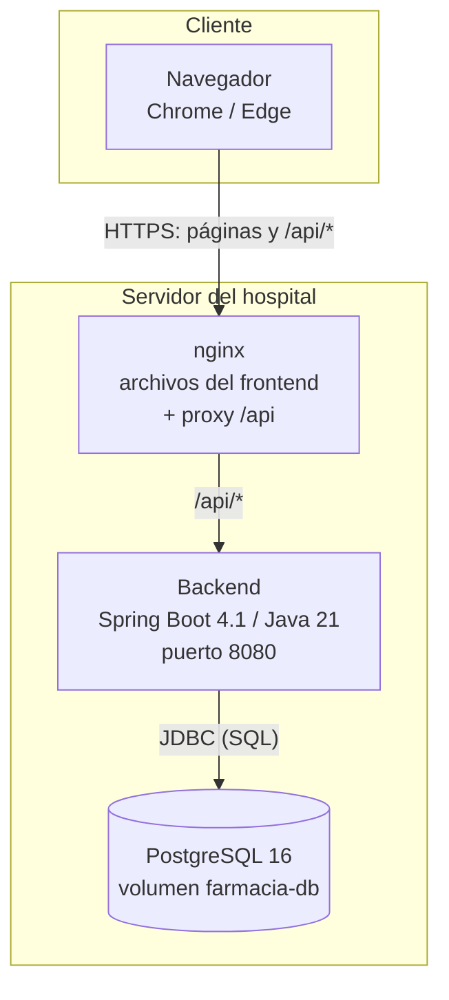
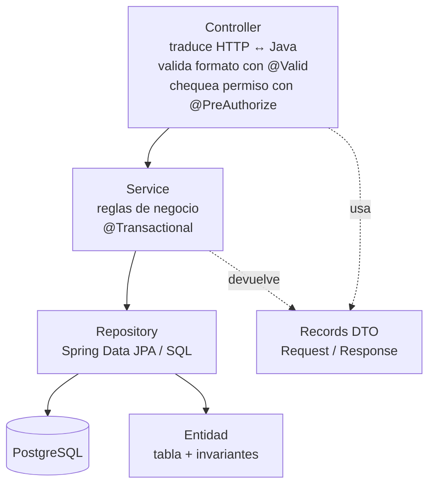
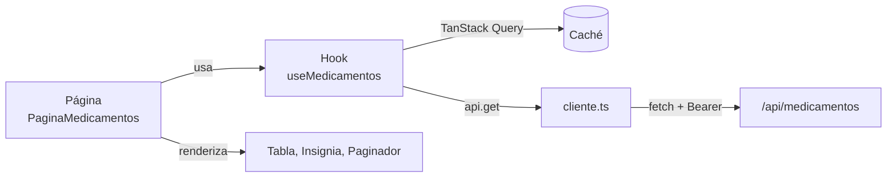
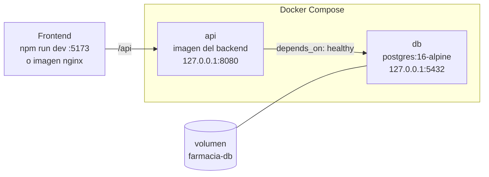

# 3. Arquitectura

## 3.1 Vista general



- **Cliente:** una aplicación de una sola página (SPA) en React. Se descarga una vez; después solo
  pide datos en JSON.
- **nginx:** sirve los archivos compilados del frontend y reenvía `/api/` al backend. Así el
  navegador ve **un solo origen** y no hace falta CORS. Agrega las cabeceras de seguridad (CSP y
  otras).
- **Backend:** API REST sin estado (no guarda sesiones: cada pedido trae su token).
- **Base de datos:** PostgreSQL con el esquema versionado por Flyway.

En desarrollo, nginx se reemplaza por el servidor de Vite (`npm run dev`, puerto 5173), que hace el
mismo reenvío de `/api`.

## 3.2 Estilo arquitectónico

- **Cliente-servidor** con **API REST**.
- **Monolito modular**: un solo backend organizado por funcionalidad. Se descartaron los
  microservicios por ser sobreingeniería para una sola farmacia.
- **Arquitectura en capas** dentro de cada módulo.
- **Sin estado (stateless):** la identidad viaja en un JWT; el servidor no guarda sesiones, lo que
  simplifica y permite reiniciar el servidor sin cerrar las sesiones.

## 3.3 Backend

### Capas



| Capa | Responsabilidad | Prohibido |
|---|---|---|
| Controller | Recibir el pedido, validar el formato, verificar el permiso, devolver el código HTTP. | Lógica de negocio; usar repositorios. |
| Service | Reglas de negocio, coordinación entre entidades, transacciones. | Conocer HTTP. |
| Repository | Consultas a la base. | Reglas de negocio. |
| Entidad | Representar una tabla y proteger sus invariantes (por ejemplo `Lote.descontar`). | Salir por la API. |
| DTO (`record`) | Forma de los datos de entrada y salida. Método `desde(...)` para convertir. | Contener el hash de la contraseña. |

### Paquetes

| Paquete | Contenido principal |
|---|---|
| `auth` | `AuthController`, `AuthService`, `TokenService`, `SeguridadConfig`, `UsuarioJwtConverter`, `Rol`, `Permiso`, `PermisosDeUsuario`, recuperación de contraseña (`RecuperacionService`, `RecuperacionPassword`, `NotificadorRecuperacion`, `CorreoSimulado`), `AdminInicial`. |
| `usuario` | `Usuario`, `UsuarioController`, `UsuarioService`, `UsuarioRepository` y sus DTO. |
| `proveedor` | `Proveedor`, controlador, servicio, repositorio, anotación `@Cuit` y `CuitValidator`. |
| `area` | `Area` y su ABM. |
| `medicamento` | `Medicamento`, consultas de stock calculado (`MedicamentoConsultasImpl` con SQL), `EstadoStock`, reporte de stock. |
| `lote` | `Lote`, `MovimientoStock`, `TipoMovimiento`, `EstadoLote`, ingreso, baja, ajuste, movimientos, reporte de lotes. |
| `transferencia` | `Transferencia`, `DetalleTransferencia`, `TransferenciaService` (FEFO), comprobante PDF, reporte. |
| `alerta` | `AlertaService` (alertas) y `ResumenService` (panel). |
| `common` | `ManejadorErrores`, excepciones de dominio, `RelojConfig` (`Clock`), `Ordenamiento` (lista blanca), `Reporte`, `Exportador`, `Csv`, `ReporteXlsx`, `ReportePdf`, `OpenApiConfig`, `FarmaciaProperties`. |
| `demo` | `DemoDataLoader` (datos de ejemplo), `RelojDemo`, `PerfilesIncompatibles`. |

### Perfiles de configuración

| Perfil | Para qué |
|---|---|
| `dev` | Desarrollo local: valores por defecto de conexión, SQL en el log, Swagger activo. |
| `demo` | Carga datos de ejemplo al arrancar y muestra el código de recuperación en pantalla. Swagger activo. |
| `prod` | Producción: Swagger apagado, sin datos de ejemplo. No puede combinarse con `demo` (la aplicación no arranca). |
| `test` | Pruebas automáticas (reloj fijo, base en Testcontainers). |

## 3.4 Frontend

```
frontend/src/
├── main.tsx            punto de entrada: monta <App/> e importa los estilos
├── App.tsx             rutas (React Router) y proveedores (sesión, consultas, avisos)
├── api/                comunicación con el backend
│   ├── cliente.ts      ÚNICO lugar con fetch: token, errores, tiempo máximo
│   ├── errores.ts      lectura del ProblemDetail y mensajes
│   ├── consultas.ts    configuración de TanStack Query
│   ├── esquema.ts      tipos generados del OpenAPI (no se edita a mano)
│   ├── tipos.ts        nombres cortos de esos tipos
│   └── <recurso>.ts    hooks por recurso: medicamentos, lotes, transferencias…
├── auth/               sesión, ingreso, recuperación, rutas protegidas
├── components/         piezas reutilizables: Tabla, Modal, Avisos, Menu, Layout, Insignia…
├── hooks/              useFormulario, useFiltrosUrl, useDebounce, useDescarga
├── pages/              una carpeta por pantalla
├── utils/              fechas, números, CUIT, estado de stock, validaciones
└── styles/             tokens (colores, espacios), base, componentes, animaciones, impresión
```

Flujo de datos de una pantalla:



| Decisión | Motivo |
|---|---|
| Sin librerías de componentes ni de estilos (sin Bootstrap/Tailwind) | Control total del diseño y la accesibilidad; menos dependencias. |
| TanStack Query para datos del servidor | Caché, carga, error e invalidación en un solo lugar. |
| Tipos generados del OpenAPI del backend | Si el contrato cambia, el frontend no compila: el error aparece antes de llegar al usuario. |
| Filtros en la URL | Recargar, compartir el enlace o volver atrás conserva la vista. |
| `<dialog>` nativo para los modales | Bloquea el fondo, cierra con Escape y maneja el foco sin librerías. |

## 3.5 Vista de despliegue



- Los puertos se publican solo en `127.0.0.1` (la máquina local). Para exponer el sistema en la red
  del hospital se pone delante el nginx del frontend (o un proxy del hospital con HTTPS).
- El backend espera a que la base esté "sana" (`pg_isready`) antes de arrancar.
- Los datos viven en el volumen `farmacia-db` y sobreviven a reinicios de los contenedores.

## 3.6 Integración continua

`.github/workflows/ci.yml` corre en cada `push` y *pull request*: instala Java 21, ejecuta
`./mvnw -B verify` (formato, pruebas unitarias y de integración con PostgreSQL en Testcontainers) y
guarda el reporte de cobertura de JaCoCo.

## 3.7 Decisiones de arquitectura

El registro completo, con alternativas y motivos, está en `docs/decisiones.md` y
`docs/decisiones-frontend.md`. Las más importantes:

| Decisión | Alternativa descartada | Por qué |
|---|---|---|
| Spring Boot 4.1 | Spring Boot 3.5 | La 3.5 perdió el soporte gratuito en junio de 2026. |
| JWT con el soporte oficial de Spring Security | Librería JWT externa o filtro escrito a mano | Menos código propio; Spring valida firma, vencimiento y emisor. |
| Permisos leídos de la base en cada pedido | Rol dentro del token | Una baja o un cambio de rol tienen efecto inmediato. |
| Bajas lógicas (`activo = false`) | `DELETE` | No se pierde historial; se puede reactivar. |
| Stock calculado | Columna `stock_total` | Nunca se contradice con los lotes (3FN). |
| Bloqueo pesimista ordenado por id | Bloqueo optimista con reintentos | Con stock escaso el optimista fallaría seguido; el orden fijo evita deadlocks. |
| Monorepo | Repositorios separados | Un `docker compose up` levanta todo; un solo historial. |
