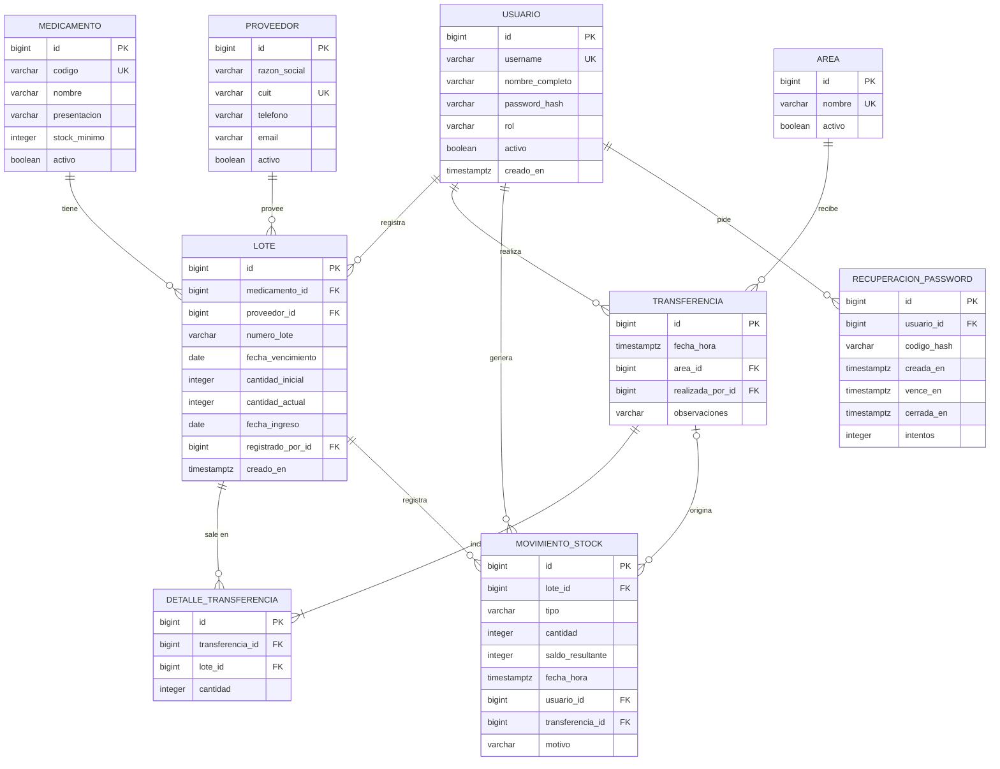

# 4. Modelo de datos y diccionario de datos

Base: **PostgreSQL 16**. El esquema lo crean las migraciones de Flyway en
`backend/src/main/resources/db/migration/`; Hibernate solo **valida** que las clases coincidan con
las tablas (`ddl-auto: validate`), nunca las modifica.

| Migración | Contenido |
|---|---|
| `V1__esquema.sql` | Las ocho tablas del negocio con claves, restricciones e índices. |
| `V2__datos_base.sql` | Las ocho áreas iniciales del hospital. |
| `V3__recuperacion_password.sql` | Tabla de pedidos de recuperación de contraseña. |

Una migración aplicada **no se edita nunca**: cualquier cambio va en una versión nueva (`V4__…`).

## 4.1 Diagrama entidad-relación



**Cómo leer las patas del diagrama:** `||` = exactamente uno; `o{` = cero o muchos; `|{` = uno o
muchos; `|o` = cero o uno. Por ejemplo, `MEDICAMENTO ||--o{ LOTE` se lee "un medicamento tiene
cero o muchos lotes; cada lote es de exactamente un medicamento".

## 4.2 Diccionario de datos

Convenciones: **PK** clave primaria, **FK** clave foránea, **UK** valor único, **NN** no nulo.
Todas las PK son `bigint generated by default as identity` (número que la base asigna sola).

### usuario

Personas que usan el sistema.

| Columna | Tipo | Restricciones | Descripción |
|---|---|---|---|
| id | bigint | PK | Identificador interno. |
| username | varchar(50) | NN, UK `uq_usuario_username` | Nombre de usuario, guardado en minúsculas. |
| nombre_completo | varchar(100) | NN | Nombre y apellido. |
| password_hash | varchar(100) | NN | Hash BCrypt de la contraseña. Nunca sale por la API. |
| rol | varchar(20) | NN, CHECK `ck_usuario_rol` ∈ {ADMIN, FARMACEUTICO, CONSULTA} | Rol que define los permisos. |
| activo | boolean | NN, por defecto `true` | Baja lógica. |
| creado_en | timestamptz | NN | Fecha y hora de alta. |

### proveedor

Droguerías o laboratorios que entregan mercadería.

| Columna | Tipo | Restricciones | Descripción |
|---|---|---|---|
| id | bigint | PK | |
| razon_social | varchar(150) | NN | Nombre legal. |
| cuit | varchar(11) | NN, UK `uq_proveedor_cuit`, CHECK `ck_proveedor_cuit` (11 dígitos) | CUIT sin guiones. El dígito verificador se valida en el código. |
| telefono | varchar(30) | opcional | |
| email | varchar(120) | opcional | Validado con formato de correo. |
| activo | boolean | NN, por defecto `true` | Baja lógica. |

### area

Servicios del hospital que reciben medicamentos.

| Columna | Tipo | Restricciones | Descripción |
|---|---|---|---|
| id | bigint | PK | |
| nombre | varchar(80) | NN, índice único `ux_area_nombre` sobre `lower(nombre)` | Único sin distinguir mayúsculas ("UTI" = "uti"). |
| activo | boolean | NN, por defecto `true` | Un área inactiva no recibe transferencias. |

### medicamento

Catálogo. **No guarda el stock**: se calcula sumando sus lotes.

| Columna | Tipo | Restricciones | Descripción |
|---|---|---|---|
| id | bigint | PK | |
| codigo | varchar(30) | NN, UK `uq_medicamento_codigo` | Código interno, en mayúsculas (`AMOX-500`). |
| nombre | varchar(120) | NN | Nombre genérico (`Amoxicilina`). |
| presentacion | varchar(120) | NN | Forma y concentración (`comprimidos 500 mg`). |
| stock_minimo | integer | NN, CHECK `ck_medicamento_stock_minimo` (≥ 0) | Umbral para la alerta de stock bajo. |
| activo | boolean | NN, por defecto `true` | Baja lógica (solo sin stock no vencido). |

### lote

Cada partida recibida de un medicamento.

| Columna | Tipo | Restricciones | Descripción |
|---|---|---|---|
| id | bigint | PK | |
| medicamento_id | bigint | NN, FK → medicamento | De qué medicamento es. |
| proveedor_id | bigint | NN, FK → proveedor | Quién lo entregó. |
| numero_lote | varchar(50) | NN; UK compuesta `uq_lote_medicamento_numero` (medicamento_id, numero_lote) | Número impreso en el envase. |
| fecha_vencimiento | date | NN | Último día en que se puede usar. |
| cantidad_inicial | integer | NN, CHECK `ck_lote_cantidad_inicial` (> 0) | Unidades recibidas. |
| cantidad_actual | integer | NN, CHECK `ck_lote_cantidad_actual` (0 ≤ actual ≤ inicial) | Unidades que quedan. |
| fecha_ingreso | date | NN | Día del ingreso (de Argentina). |
| registrado_por_id | bigint | NN, FK → usuario | Quién cargó el ingreso. |
| creado_en | timestamptz | NN | Instante exacto del registro. |

Índices: `(medicamento_id, fecha_vencimiento)` para el FEFO; `(fecha_vencimiento) WHERE
cantidad_actual > 0` (índice **parcial**: solo lotes con stock, que son los que interesan para las
alertas); `(proveedor_id)`.

### transferencia

Cabecera de una entrega a un área. Inmutable.

| Columna | Tipo | Restricciones | Descripción |
|---|---|---|---|
| id | bigint | PK | El número visible `TR-000123` se deriva de este id. |
| fecha_hora | timestamptz | NN | Momento de la entrega. |
| area_id | bigint | NN, FK → area | Área que recibe. |
| realizada_por_id | bigint | NN, FK → usuario | Quién entregó (sale del token). |
| observaciones | varchar(500) | opcional | Texto libre. |

Índices: `(fecha_hora)`, `(area_id)`.

### detalle_transferencia

Renglón del comprobante: cuántas unidades salieron de **cada lote**.

| Columna | Tipo | Restricciones | Descripción |
|---|---|---|---|
| id | bigint | PK | |
| transferencia_id | bigint | NN, FK → transferencia | |
| lote_id | bigint | NN, FK → lote | |
| cantidad | integer | NN, CHECK `ck_detalle_cantidad` (> 0) | |

Si se piden 150 unidades de un medicamento y el FEFO toma 100 de un lote y 50 de otro, hay **dos**
renglones.

### movimiento_stock

Registro de auditoría: cada cambio de stock de cada lote.

| Columna | Tipo | Restricciones | Descripción |
|---|---|---|---|
| id | bigint | PK | |
| lote_id | bigint | NN, FK → lote | |
| tipo | varchar(20) | NN, CHECK `ck_movimiento_tipo` ∈ {INGRESO, EGRESO, BAJA_VENCIMIENTO, AJUSTE} | |
| cantidad | integer | NN, CHECK `ck_movimiento_cantidad` (≠ 0) | Variación **con signo**: +100 en un ingreso, −20 en un egreso. |
| saldo_resultante | integer | NN, CHECK `ck_movimiento_saldo` (≥ 0) | Stock del lote después del movimiento. |
| fecha_hora | timestamptz | NN | |
| usuario_id | bigint | NN, FK → usuario | Quién lo generó. |
| transferencia_id | bigint | FK → transferencia, opcional | Solo en los EGRESO. |
| motivo | varchar(200) | opcional | Obligatorio (en el código) para BAJA_VENCIMIENTO y AJUSTE. |

**Invariante:** la suma de `cantidad` de los movimientos de un lote es igual a su
`cantidad_actual`. La prueba `FlujoCompletoIT` lo verifica.

| Tipo | Signo | Cuándo |
|---|---|---|
| INGRESO | + | Al registrar el lote (igual a la cantidad inicial). |
| EGRESO | − | En cada transferencia, uno por lote tocado. |
| BAJA_VENCIMIENTO | − | Baja de un lote vencido (toda su cantidad). |
| AJUSTE | ± | Corrección de inventario (diferencia entre la cantidad nueva y la anterior). |

### recuperacion_password

Pedidos de código para recuperar la contraseña.

| Columna | Tipo | Restricciones | Descripción |
|---|---|---|---|
| id | bigint | PK | |
| usuario_id | bigint | NN, FK → usuario | |
| codigo_hash | varchar(100) | NN | Hash BCrypt del código (nunca el código en texto). |
| creada_en | timestamptz | NN | |
| vence_en | timestamptz | NN, CHECK `ck_recuperacion_vencimiento` (> creada_en) | 15 minutos después. |
| cerrada_en | timestamptz | opcional | Se completa al usarse, anularse o agotar los intentos. |
| intentos | integer | NN, por defecto 0, CHECK `ck_recuperacion_intentos` (≥ 0) | Intentos fallidos (máximo 5). |

Índice parcial: `(usuario_id) WHERE cerrada_en IS NULL` (solo los pedidos abiertos).

## 4.3 Relaciones y cardinalidades

| Clave foránea | Relación | Cardinalidad |
|---|---|---|
| `lote.medicamento_id → medicamento.id` | El lote es de un medicamento. | 1 : N |
| `lote.proveedor_id → proveedor.id` | El lote lo entregó un proveedor. | 1 : N |
| `lote.registrado_por_id → usuario.id` | Quién cargó el ingreso. | 1 : N |
| `transferencia.area_id → area.id` | Área que recibe. | 1 : N |
| `transferencia.realizada_por_id → usuario.id` | Quién entregó. | 1 : N |
| `detalle_transferencia.transferencia_id → transferencia.id` | Renglón del comprobante. | 1 : 1..N |
| `detalle_transferencia.lote_id → lote.id` | De qué lote salió. | 1 : N |
| `movimiento_stock.lote_id → lote.id` | Movimiento del lote. | 1 : N |
| `movimiento_stock.usuario_id → usuario.id` | Quién lo generó. | 1 : N |
| `movimiento_stock.transferencia_id → transferencia.id` | Transferencia que originó un egreso. | 0..1 : N |
| `recuperacion_password.usuario_id → usuario.id` | Pedido de código. | 1 : N |

`detalle_transferencia` es una **tabla intermedia** que resuelve la relación **muchos a muchos**
entre `transferencia` y `lote`: una transferencia toma varios lotes y un lote se reparte en varias
transferencias.

Ninguna clave foránea tiene `ON DELETE CASCADE`. Si alguien intentara borrar un medicamento con
lotes, la base lo impediría. Las bajas son lógicas.

## 4.4 Integridad en tres capas

| Regla | Base de datos (última barrera) | Entidad Java | DTO de entrada |
|---|---|---|---|
| Stock entre 0 y la cantidad inicial | `ck_lote_cantidad_actual` | `Lote.descontar`, `Lote.ajustar` lanzan excepción | `@Positive` en cantidades |
| Ingreso con al menos 1 unidad | `ck_lote_cantidad_inicial` | Constructor de `Lote` | `@Positive` en `IngresoRequest` |
| Lote no repetido por medicamento | `uq_lote_medicamento_numero` | — | `LoteService` responde 409 `LOTE_DUPLICADO` |
| Únicos (usuario, CUIT, código, área) | `UNIQUE` / índice único | — | Servicios controlan antes; `ManejadorErrores` traduce la violación si llegan dos pedidos juntos |
| CUIT de 11 dígitos | `ck_proveedor_cuit` | — | `@Cuit` (también el dígito verificador) |
| Roles y tipos válidos | `ck_usuario_rol`, `ck_movimiento_tipo` | Enums `Rol`, `TipoMovimiento` | — |
| Stock mínimo ≥ 0 | `ck_medicamento_stock_minimo` | — | `@PositiveOrZero` |

## 4.5 Normalización

**1FN — valores atómicos, sin grupos repetidos.** Cada celda tiene un solo valor. Los renglones de
una transferencia no son columnas `medicamento1`, `medicamento2`… sino filas de
`detalle_transferencia`. Los movimientos de un lote son filas de `movimiento_stock`.

**2FN — sin dependencias parciales.** Todas las claves primarias son simples (`id`), así que
ningún atributo puede depender de "parte" de la clave. En `lote`, cuya clave natural es compuesta
(medicamento + número de lote), el vencimiento y las cantidades dependen del lote entero, no del
medicamento solo.

**3FN — sin dependencias transitivas.** Ningún atributo no clave depende de otro atributo no clave:

| Dato que NO se guarda | Por qué | Cómo se obtiene |
|---|---|---|
| Nombre del medicamento en `lote` | Dependería de `medicamento_id`, no del lote. | JOIN con `medicamento`. |
| Razón social del proveedor en `lote` | Ídem con `proveedor_id`. | JOIN. |
| Nombre del área o del usuario en `transferencia` | Ídem. | JOIN. |
| Stock total del medicamento | Depende de los lotes; se desactualizaría. | `SUM(cantidad_actual)` de lotes no vencidos. |
| Estado del lote (vigente, por vencer…) | Depende de la fecha de hoy. | Se calcula al consultar. |
| Total de unidades de una transferencia | Depende de los detalles. | `SUM(detalle.cantidad)`. |
| Número `TR-000123` | Depende del `id`. | Se formatea desde el id. |

**Redundancia controlada:** `movimiento_stock.saldo_resultante` se podría calcular sumando los
movimientos anteriores, pero se guarda a propósito: es el saldo que vio el usuario en ese momento,
es un dato histórico que nunca se actualiza (no genera anomalías) y permite detectar
inconsistencias.

## 4.6 Consultas representativas

Stock total y próximo vencimiento por medicamento (de `MedicamentoConsultasImpl`). La subconsulta
agrupa los lotes con stock y no vencidos por medicamento; el `left join` conserva los
medicamentos que no tienen ninguno (stock 0):

```sql
select m.id, m.codigo, m.nombre, m.presentacion, m.stock_minimo, m.activo,
       coalesce(s.stock, 0) as stock_total, s.proximo as proximo_vencimiento
from medicamento m
left join (
    select l.medicamento_id,
           sum(l.cantidad_actual) as stock,
           min(l.fecha_vencimiento) as proximo
    from lote l
    where l.cantidad_actual > 0 and l.fecha_vencimiento >= :hoy
    group by l.medicamento_id
) s on s.medicamento_id = m.id
-- + filtros (búsqueda, estado, activo) + order by de una lista blanca + limit/offset
```

Lotes candidatos de una transferencia, bloqueados. En el código es una consulta JPQL con
`@Lock(PESSIMISTIC_WRITE)` (`LoteRepository.bloquearDisponibles`); Hibernate la traduce a este
SQL:

```sql
select * from lote
where medicamento_id in (:ids) and cantidad_actual > 0 and fecha_vencimiento >= :hoy
order by id
for update;
```
