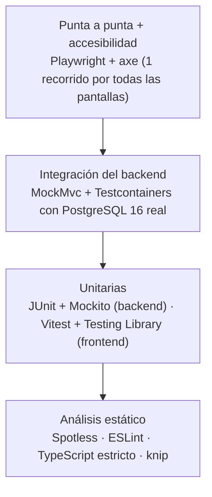

# 7. Plan de pruebas

## 7.1 Objetivo

Demostrar que el sistema cumple los requisitos y las reglas de negocio, que ninguno de los problemas
del prototipo se repite y que un cambio futuro no rompe lo que ya funciona.

## 7.2 Niveles y herramientas

Pirámide de pruebas: muchas pruebas chicas y rápidas abajo, pocas grandes arriba.

| Nivel | Cantidad | Cómo se corre | Tiempo aprox. |
|---|---|---|---|
| Backend (unitarias `*Test` + integración `*IT`) | 94 | `cd backend && ./mvnw verify` (necesita Docker) | 1–3 min |
| Frontend (Vitest) | 97 | `cd frontend && npm test` | 15 s |
| Punta a punta + axe | 1 recorrido, 16 pantallas | `cd frontend && npm run capturas` (con la app levantada) | 25 s |

**Reloj fijo:** en las pruebas del backend, "hoy" es una fecha fija (bean `Clock` `@Primary`), así
los casos de vencimiento dan siempre el mismo resultado.

**Base real:** las pruebas de integración usan un PostgreSQL 16 en un contenedor (Testcontainers),
igual al de producción, para probar las restricciones `CHECK`, los bloqueos y el SQL de verdad. Un
solo contenedor y un solo contexto de Spring para todas (`IntegracionBase`).

## 7.3 Pruebas del backend

| Clase | Tipo | Qué verifica |
|---|---|---|
| `TransferenciaServiceTest` | Unitaria | FEFO con 3 lotes; desempate por ingreso e id; todo o nada; todos los faltantes; ítems repetidos se suman; cantidad 0 o negativa; lote vencido ayer ignorado y lote que vence hoy usado; área y medicamento inactivos; usuario del contexto de seguridad. |
| `AlertaServiceTest` | Unitaria | Los cuatro tipos de alerta y los bordes: vence hoy, vence en N, vence en N+1, venció ayer, medicamento inactivo con lote vencido, stock igual al mínimo, mínimo 0 con stock 0, lotes en 0. |
| `LoteTest` | Unitaria | `descontar` de más lanza excepción; ajuste fuera de rango también. |
| `CuitValidatorTest` | Unitaria | Válidos: `20-12345678-6`, `30-71234567-1`, `27-33333333-9`. Inválidos: `20-12345678-5`, `20-99999999-0`, `2012345678`, `20-1234567A-6`. |
| `IngresoServiceTest` | Unitaria | Vencimiento de ayer rechazado; de hoy aceptado; lote duplicado 409. |
| `ProveedorServiceTest` | Unitaria | Baja con lotes con stock permitida y lotes disponibles; proveedor inactivo rechazado en ingresos; ninguna baja borra filas. |
| `CsvTest` | Unitaria | Inyección de fórmulas, comillas y `;` en los valores. |
| `RecuperacionPasswordTest` | Unitaria | Vencimiento, intentos máximos, cierre del pedido. |
| `ConfiguracionTest` | Arranque | No arranca sin `JWT_SECRET`, con clave < 32 bytes ni con `demo` + `prod`. |
| `MedicamentoRepositoryIT` | Integración | Stock excluye vencidos; filtro por estado; orden por stock y próximo vencimiento; total con paginación. |
| `FlujoCompletoIT` | Integración | Login → área, proveedor, medicamento → dos lotes → transferencia → stock, detalle FEFO, movimientos; suma de movimientos = stock; exportación. |
| `TransferenciaConcurrenciaIT` | Integración | Dos hilos piden 60 de un lote de 100 a la vez: uno 201, otro 409, stock final 40. Con dos medicamentos en orden inverso: sin deadlock. |
| `SeguridadIT` | Integración | `sinTokenDevuelve401EnJsonSinRedirigir`, `tokenConFirmaInvalidaDevuelve401`, `tokenVencidoDevuelve401`, `tokenDeUnUsuarioDesactivadoDevuelve401` (crea y desactiva un usuario por la API), `consultaNoPuedeCrearMedicamentos`, `farmaceuticoNoPuedeGestionarUsuarios`, `laCabeceraXUserIdNoCambiaLaIdentidad`, `contrasenaIncorrectaYUsuarioInexistenteRespondenIgual`, `ningunaRespuestaExponeLaContrasenaNiElHash`. |
| `ErroresIT` | Integración | 400 con los campos con error, JSON mal formado sin detalles internos, orden no permitido, 404, duplicado 409 con `codigo` y 500 con `errorId` sin stacktrace. |
| `RecuperacionIT` | Integración | Flujo completo de recuperación; misma respuesta exista o no el usuario; 5 intentos. |
| `ReportesIT` | Integración | Stock de medicamentos en CSV (respetando filtros), Excel y PDF; lotes vencidos y por vencer en CSV y PDF; comprobante y reporte de transferencias en PDF; el rol CONSULTA puede exportar y sin token no. |

## 7.4 Pruebas del frontend

| Archivo | Qué verifica |
|---|---|
| `cliente.test.ts` | Cabecera Bearer; 401 cierra la sesión (menos en el login); 403; 5xx con `errorId`; error de red; tiempo máximo 15 s; 204. |
| `consultas.test.ts` | Reintento solo ante red caída o 5xx, una sola vez. |
| `SesionProvider.test.tsx` | Validación con `/me` al iniciar; aviso 5 minutos antes del vencimiento. |
| `RutaProtegida.test.tsx` | Sin sesión → ingreso y vuelta a la ruta pedida; sin permiso → "Sin permiso". |
| `PaginaIngreso.test.tsx` | Foco, "Ingresando…", mensaje de credenciales, sesión expirada. |
| `PaginaRecuperacion.test.tsx` | Los dos pasos de la recuperación y sus errores. |
| `NuevaTransferencia.test.tsx` | Agregar, sumar repetidos, validar cantidades, resumen, 409 con faltantes por línea, borrador. |
| `PaginaReportes.test.tsx` | Ver en pantalla y descargas con los filtros. |
| `Tabla`, `Modal`, `Paginador`, `Estados`, `Insignia` | Componentes reutilizables: orden con `aria-sort`, foco del modal, estados de carga, vacío y error, insignias con texto. |
| `seguridad.test.tsx` | Un texto con HTML malicioso se muestra como texto. |
| `useFormulario`, `useFiltrosUrl`, `useDebounce` | Validación al salir y al enviar; filtros en la URL; espera de 300 ms en la búsqueda. |
| `cuit`, `fechas`, `numeros`, `estadoStock`, `validaciones` | Utilidades: los mismos vectores de CUIT que el backend; fechas sin corrimiento de zona horaria; formato `es-AR`. |

## 7.5 Prueba punta a punta y accesibilidad

`frontend/e2e/capturas.spec.ts` recorre como administrador: recuperar contraseña, ingreso, panel,
medicamentos, detalle, nuevo medicamento, ingreso de mercadería, nueva transferencia (con un ítem),
historial, comprobante, lotes vencidos, proveedores, áreas, usuarios, mi cuenta y reportes. En cada
pantalla espera que terminen las cargas y las animaciones, corre **axe-core** con las reglas WCAG
2.0/2.1 A y AA y **falla si hay violaciones serias o críticas**; después guarda la captura en
`docs/capturas/`. También falla si aparece algún error en la consola del navegador.

## 7.6 Matriz de trazabilidad

| Requisito | Pruebas |
|---|---|
| RF01 Iniciar sesión | `SeguridadIT`, `PaginaIngreso.test.tsx`, e2e |
| RF04 Recuperar contraseña | `RecuperacionIT`, `RecuperacionPasswordTest`, `PaginaRecuperacion.test.tsx` |
| RF06–RF10 Usuarios | `SeguridadIT` (alta y desactivación por la API, permisos), e2e (pantalla Usuarios) |
| RF11 Medicamentos | `MedicamentoRepositoryIT`, `ErroresIT`, e2e |
| RF13 Proveedores | `ProveedorServiceTest`, `CuitValidatorTest`, `cuit.test.ts` |
| RF15 Ingreso | `IngresoServiceTest`, `FlujoCompletoIT` |
| RF16 Transferir (FEFO) | `TransferenciaServiceTest`, `FlujoCompletoIT`, `TransferenciaConcurrenciaIT`, `NuevaTransferencia.test.tsx` |
| RF17 Comprobante | `ReportesIT` (PDF), e2e |
| RF20–RF21 Baja y ajuste | `LoteTest` (reglas de la entidad); prueba manual de aceptación 6. *Pendiente: una prueba de integración de los endpoints `/baja` y `/ajuste`.* |
| RF22 Movimientos | `FlujoCompletoIT` |
| RF23–RF24 Alertas y panel | `AlertaServiceTest`, e2e |
| RF25–RF27 Reportes | `ReportesIT`, `CsvTest`, `PaginaReportes.test.tsx` |
| RNF01–RNF04 Seguridad | `SeguridadIT`, `ConfiguracionTest`, `seguridad.test.tsx` |
| RNF05 Stock nunca negativo | `LoteTest`, `TransferenciaServiceTest`, `TransferenciaConcurrenciaIT` |
| RNF07 Trazabilidad | `FlujoCompletoIT` |
| RNF08 Zona horaria | `AlertaServiceTest`, `fechas.test.ts` |
| RNF10 Accesibilidad | e2e con axe |

## 7.7 Pruebas manuales de aceptación

Para la demostración o una validación con usuarios reales (con el perfil `demo`):

| # | Paso | Resultado esperado |
|---|---|---|
| 1 | Ingresar como `consulta`. | El menú no muestra Nueva transferencia, Ingreso de mercadería ni Usuarios. No hay botones de alta ni de baja. |
| 2 | Como `consulta`, escribir `/usuarios` en la barra de direcciones. | "No tenés permiso para ver esta página." |
| 3 | Ingresar como `farmaceutico`, registrar un lote que vence en 10 días. | Aviso de que vence pronto; se registra igual. El panel suma uno a "Por vencer". |
| 4 | Transferir 150 unidades de un medicamento con dos lotes (100 que vence antes y 200 que vence después). | El comprobante muestra 100 del primero y 50 del segundo. |
| 5 | Pedir más de lo disponible. | Se marca la línea con "Disponible: X (pediste Y)"; nada se descuenta. |
| 6 | Dar de baja un lote vencido. | Queda en 0, aparece el movimiento "Baja por vencimiento". |
| 7 | Intentar dar de baja un medicamento con stock. | El diálogo muestra que no se puede porque tiene stock. |
| 8 | Descargar el reporte de transferencias en Excel y en PDF. | Los dos archivos abren y muestran las mismas filas. |
| 9 | Como `admin`, desactivar a `farmaceutico` mientras está con sesión abierta en otra ventana. | En su próxima acción, `farmaceutico` vuelve al ingreso. |
| 10 | Recuperar la contraseña de `consulta`. | Se muestra el código (modo demo); con el código se cambia la contraseña. |

## 7.8 Criterios de aceptación de la entrega

- `./mvnw verify` en verde, sin pruebas salteadas, con el formato aplicado.
- `npm run lint`, `npm run typecheck`, `npm test` y `npm run build` en verde.
- `npm run capturas` sin violaciones de accesibilidad serias o críticas.
- `docker compose up --build` desde cero funciona y `/actuator/health` responde `UP`.
