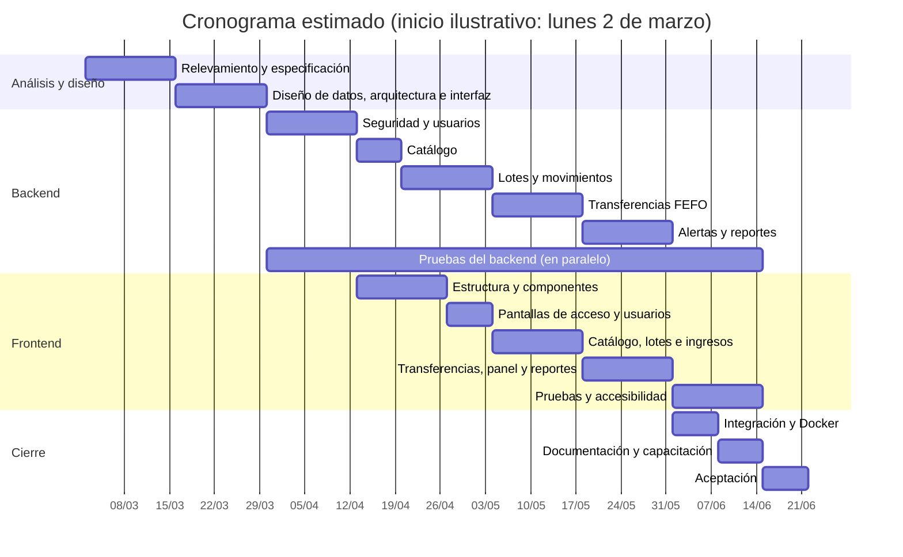

# 9. Planificación, riesgos y presupuesto

## 9.1 Etapas y estimación del sistema original

| # | Etapa | Horas |
|---|---|---:|
| 1 | Relevamiento, análisis y especificación funcional | 24 |
| 2 | Diseño: modelo de datos, arquitectura y diseño visual | 28 |
| 3 | Backend: seguridad (JWT, roles, permisos), usuarios y recuperación de contraseña | 32 |
| 4 | Backend: catálogo de medicamentos, proveedores y áreas | 24 |
| 5 | Backend: lotes, ingresos, bajas por vencimiento, ajustes y movimientos | 28 |
| 6 | Backend: transferencias FEFO con bloqueo y control de concurrencia | 32 |
| 7 | Backend: alertas, panel y reportes en CSV, Excel y PDF | 28 |
| 8 | Backend: pruebas unitarias y de integración (Testcontainers) | 32 |
| 9 | Frontend: estructura, componentes reutilizables y diseño visual | 36 |
| 10 | Frontend: ingreso, recuperación de contraseña, mi cuenta y usuarios | 20 |
| 11 | Frontend: medicamentos, proveedores, áreas, lotes e ingresos | 40 |
| 12 | Frontend: transferencias, comprobante, panel y reportes | 40 |
| 13 | Frontend: pruebas y accesibilidad (WCAG AA) | 24 |
| 14 | Integración, Docker y puesta en marcha | 16 |
| 15 | Documentación y capacitación de usuarios | 16 |
| 16 | Gestión del proyecto y pruebas de aceptación | 24 |
| | **Total** | **444** |

## 9.2 Cronograma estimado

Suponiendo **una persona a 20 horas semanales** (≈ 22 semanas). Las etapas de backend y frontend
se pueden solapar porque el contrato de la API se define antes.

Hitos: (1) especificación aprobada; (2) API de seguridad y catálogo funcionando; (3) transferencias
FEFO con prueba de concurrencia en verde; (4) todas las pantallas; (5) aceptación.

## 9.3 Riesgos

| Riesgo | Probabilidad | Impacto | Mitigación |
|---|:-:|:-:|---|
| Dos transferencias simultáneas dejan stock negativo | Media | Alto | Bloqueo pesimista ordenado + `CHECK` en la base + prueba de concurrencia. |
| Lotes vistos como vencidos por la zona horaria | Alta (contenedores en UTC) | Medio | `Clock` con zona de Buenos Aires; fechas del front sin `new Date`. |
| Cambios en Spring Boot 4 respecto de la versión 3 | Media | Medio | Verificar cada API contra la guía oficial de migración. |
| Diferencias entre el contrato y lo implementado | Media | Medio | Tipos del frontend generados del OpenAPI del backend. |
| Pérdida de datos | Baja | Alto | Bajas lógicas, sin cascadas, respaldos diarios (`pg_dump`). |
| Usuarios con poca experiencia informática | Media | Medio | Interfaz simple, mensajes claros, confirmaciones, manual de usuario y capacitación. |
| Inflación que desactualiza el presupuesto | Alta | Medio | Valor hora con fecha; actualizar antes de presentar. |
| Falta de correo institucional para la recuperación | Alta | Bajo | Recuperación simulada + restablecimiento por el administrador; interfaz lista para un envío real. |

## 9.4 Valor hora

**$25.000 por hora** (pesos argentinos, noviembre de 2026):

1. Sueldo de referencia: mediana de un desarrollador semi senior que cobra en pesos, $2.500.000
   por mes (encuesta de sueldos de Sysarmy 2026.1).
2. Por hora como empleado: $2.500.000 / 160 h ≈ $15.600.
3. Ajuste por trabajo independiente (× 1,6): sin aguinaldo ni vacaciones pagas, con monotributo,
   equipo propio y meses sin trabajo. $15.600 × 1,6 ≈ **$25.000**.

## 9.5 Presupuesto

| Concepto | Horas | Costo |
|---|---:|---:|
| Sistema original | 444 | $11.100.000 |
| Mejora: órdenes de compra y reposición automática | 128 | $3.200.000 |
| **Total** | **572** | **$14.300.000** |

Desglose de la mejora:

| Tarea | Horas |
|---|---:|
| Análisis, casos de uso y diseño del modelo (migración `V4`) | 10 |
| Backend: entidades, servicios y estados de la orden | 18 |
| Backend: cálculo de sugerencias por consumo promedio | 10 |
| Backend: vínculo de los ingresos con la orden y recepción parcial | 8 |
| Backend: PDF de la orden y envío por correo (SMTP) | 10 |
| Backend: permisos y pruebas de integración | 14 |
| Frontend: listado de órdenes con filtros | 8 |
| Frontend: armado y edición de la orden con las sugerencias | 14 |
| Frontend: aprobación, envío y recepción | 8 |
| Frontend: reportes nuevos, pruebas y accesibilidad | 8 |
| Documentación, pruebas de aceptación y capacitación | 8 |
| Subtotal | 116 |
| Contingencia (10 %) por la integración con el correo del hospital | 12 |
| **Total de la mejora** | **128** |

### Condiciones

- Todo el software es libre y gratuito (Java, Spring Boot, PostgreSQL, React, Docker, OpenPDF,
  fastexcel): **sin costo de licencias**.
- No incluye hardware ni hosting: corre con Docker en un servidor del hospital.
- La mejora necesita una cuenta de correo SMTP del hospital.
- Forma de pago sugerida: 40 % al inicio, 30 % al entregar el backend y 30 % a la aceptación final.
- Validez: 30 días (por la inflación, el valor hora debe actualizarse después).

### Costos de operación (orientativos, a cargo del hospital)

| Concepto | Comentario |
|---|---|
| Servidor | Puede ser una máquina existente del hospital (2 núcleos, 4 GB RAM). |
| Respaldos | Disco externo o almacenamiento de red del hospital. |
| Mantenimiento correctivo y evolutivo | A convenir, por hora al mismo valor. |

## 9.6 Detalle de la mejora propuesta

Ver el informe final, sección 12, y `docs/presupuesto.md`. Resumen: sugerencia automática de
compras según el consumo de los últimos 90 días, circuito de aprobación (Borrador → Aprobada →
Enviada → Recibida / Anulada), orden en PDF enviada por correo, recepción vinculada a los ingresos y
reportes de órdenes pendientes y cumplimiento de proveedores. Agrega las tablas `orden_compra` y
`detalle_orden_compra` y una FK opcional en `lote`, manteniendo la 3FN.
