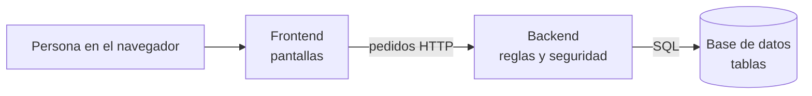

# 01 — El proyecto en un vistazo

## La historia en 2 minutos

Un hospital público tiene una **farmacia** con un depósito lleno de medicamentos. Cada día pasan
dos cosas:

1. **Entra mercadería**: una droguería (proveedor) trae cajas. Cada caja dice un **número de lote**
   (por ejemplo `L2345`) y una **fecha de vencimiento**.
2. **Sale mercadería**: las áreas del hospital (Guardia, Terapia Intensiva, Pediatría…) piden
   medicamentos y la farmacia se los entrega.

El problema: si no se controla bien, los medicamentos **se vencen** en el estante (plata tirada) o
**faltan** cuando se necesitan (problema para un paciente). Y si un laboratorio avisa "retiren el
lote L2345 porque salió fallado", hay que saber **dónde está cada unidad** de ese lote.

Este sistema resuelve eso. Es una **página web** que usan los farmacéuticos para:

- **Registrar lo que entra**, lote por lote, con su vencimiento.
- **Registrar lo que sale** a cada área. El sistema elige solo de qué lote sacar: **del que vence
  primero** (eso se llama **FEFO**).
- **Avisar** qué está vencido, qué está por vencer y qué se está terminando.
- **Dar de baja** lo vencido y **corregir** diferencias de inventario.
- **Sacar reportes** en Excel y PDF.
- Todo **con usuario y contraseña**, y cada persona puede hacer solo lo que su rol le permite.

## Las piezas

Imaginá un restaurante:

| Restaurante | Sistema | Tecnología |
|---|---|---|
| El salón y el menú que ve el cliente | **Frontend**: las pantallas en el navegador | React + TypeScript |
| El mozo que lleva los pedidos a la cocina | **HTTP**: los mensajes entre el navegador y el servidor | JSON por HTTP |
| La cocina, que sigue las recetas y las reglas | **Backend**: el servidor que aplica las reglas | Java + Spring Boot |
| La despensa, donde se guarda todo ordenado | **Base de datos** | PostgreSQL |
| El edificio donde funciona todo | **Contenedores** | Docker |



**Regla de oro:** el frontend **muestra** y el backend **decide**. Aunque el frontend esconda un
botón, la verdadera seguridad y las reglas están en el backend, porque el frontend corre en la
computadora del usuario y cualquiera podría modificarlo.

## Quién usa el sistema (roles)

| Rol | Quién es | Qué puede hacer |
|---|---|---|
| **ADMIN** | Jefe/a de farmacia | Todo, incluido crear usuarios. |
| **FARMACEUTICO** | Farmacéutico/a o técnico/a | Cargar ingresos, hacer transferencias, dar de baja, ajustar y editar el catálogo. |
| **CONSULTA** | Dirección, auditoría | Solo mirar y sacar reportes. |

## Las cosas que guarda (entidades)

| Cosa | Ejemplo | Qué datos tiene |
|---|---|---|
| **Usuario** | `farmaceutico` | Nombre, contraseña (cifrada), rol, si está activo. |
| **Proveedor** | Droguería del Sur S.A. | Razón social, CUIT, teléfono, correo. |
| **Área** | Guardia | Nombre. |
| **Medicamento** | Amoxicilina, comprimidos 500 mg | Código, nombre, presentación, stock mínimo. |
| **Lote** | L2345 de Amoxicilina, vence 30/11/2026, 200 unidades | Medicamento, proveedor, número, vencimiento, cantidad inicial y actual. |
| **Transferencia** | TR-000042 a Guardia | Fecha, área, quién la hizo, observaciones. |
| **Detalle de transferencia** | 100 unidades del lote L2345 | Qué lote y cuánto. |
| **Movimiento de stock** | −100 del lote L2345 por TR-000042 | Cada cambio de cantidad de un lote: ingreso, egreso, baja o ajuste. |
| **Recuperación de contraseña** | Código para `consulta` | Código (cifrado), vencimiento, intentos. |

## Las 10 reglas que tenés que saber de memoria

1. **Vencido** = vence **antes de hoy**. El día del vencimiento todavía se usa.
2. **Por vencer** = vence entre hoy y dentro de 30 días.
3. **Stock total** de un medicamento = suma de sus lotes **no vencidos**. No se guarda: se calcula.
4. **Sin stock** = 0. **Stock bajo** = más de 0 pero ≤ stock mínimo.
5. **FEFO**: al transferir, sale primero el lote que vence primero.
6. **Todo o nada**: si falta stock de algún ítem, no se descuenta nada.
7. Un lote vencido **nunca** se transfiere.
8. **Nada se borra**: se desactiva (baja lógica).
9. El stock **nunca** queda negativo, ni siquiera si dos personas transfieren al mismo tiempo.
10. Cada cambio de stock deja un **movimiento** con quién, cuándo y por qué (**trazabilidad**).

## Un día en el sistema

1. **8:00** — La farmacéutica ingresa. El **Panel** muestra: 3 lotes vencidos, 2 medicamentos sin
   stock, 5 por vencer.
2. **8:05** — Da de baja los 3 lotes vencidos, con el motivo "retirado para destrucción". El
   sistema deja cada lote en 0 y registra un movimiento de **baja**.
3. **9:30** — Llega la droguería con Paracetamol. Registra un **ingreso**: lote L2350, vence en
   marzo, 500 unidades. Se crea el lote y un movimiento de **ingreso** (+500).
4. **10:00** — Guardia pide 150 Paracetamol. Hace una **transferencia**. Hay dos lotes: uno de 100
   que vence en diciembre y el nuevo de 500 que vence en marzo. El sistema saca **100 del de
   diciembre y 50 del de marzo** (FEFO). Se crean dos renglones de detalle y dos movimientos de
   **egreso**. Imprime el comprobante y lo firman.
5. **12:00** — Al contar, ve que se rompieron 2 ampollas de Adrenalina. Hace un **ajuste** del lote
   con el motivo "rotura". Movimiento de ajuste (−2).
6. **17:00** — La directora (rol CONSULTA) descarga el **reporte** de transferencias del mes en
   Excel para ver cuánto consumió cada área.

## Qué tecnologías hay y para qué (sin detalle todavía)

| Tecnología | Para qué, en una línea |
|---|---|
| **Java 21** | Lenguaje en el que está escrito el backend. |
| **Spring Boot 4.1** | "Kit" que le da al backend servidor web, seguridad y acceso a la base, sin escribirlo a mano. |
| **PostgreSQL 16** | La base de datos. |
| **Flyway** | Crea y actualiza las tablas a partir de archivos `.sql` numerados. |
| **TypeScript** | Lenguaje del frontend (JavaScript con tipos). |
| **React 19** | Biblioteca para armar las pantallas con piezas reutilizables. |
| **Vite** | Herramienta que compila el frontend y lo sirve mientras se desarrolla. |
| **Docker** | Empaqueta la base y el backend para levantarlos con un comando. |
| **JUnit, Testcontainers, Vitest, Playwright** | Herramientas de pruebas automáticas. |
| **Git / GitHub** | Guardan el historial de cambios del código. |

## Dónde está cada cosa en el repositorio

```
Farmacia/
├── backend/          el servidor (Java)
│   └── src/main/java/ar/edu/utn/farmacia/   el código, una carpeta por tema
│   └── src/main/resources/db/migration/     los .sql que crean las tablas
│   └── src/test/                            las pruebas
├── frontend/         las pantallas (TypeScript + React)
│   └── src/pages/    una carpeta por pantalla
├── docs/             documentación de trabajo y capturas
├── documentos/       esta carpeta: tesis, manual, defensa, estudio
├── docker-compose.yml  cómo levantar base + backend
└── .env.example      ejemplo de la configuración secreta
```

> **Para la defensa:** "Es un sistema web de gestión de stock por lote para la farmacia de un
> hospital público. Registra ingresos y transferencias a las áreas aplicando FEFO automáticamente,
> avisa vencimientos y faltantes, deja trazabilidad de cada movimiento y genera reportes. Está
> hecho con un backend en Java con Spring Boot, una base PostgreSQL normalizada y un frontend en
> React, con seguridad por roles y pruebas automáticas."
