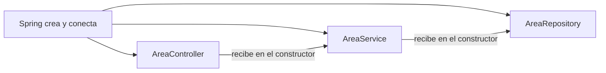

# 06 — Spring Boot

## 1. Qué es un framework y qué es Spring Boot

Un **framework** es un esqueleto ya armado: vos completás las partes de tu negocio y él se encarga
del resto. **Spring** es el framework más usado en Java para aplicaciones de servidor. **Spring
Boot** es Spring "listo para usar": con poca configuración arranca un servidor web, se conecta a la
base, maneja la seguridad, convierte JSON, etc.

Usamos **Spring Boot 4.1** (y no 3.x porque la 3.5 dejó de tener soporte gratuito en junio de 2026).

Sin Spring tendríamos que escribir a mano: abrir un puerto y leer pedidos HTTP, convertir JSON,
abrir conexiones a la base, manejar transacciones, validar tokens… Con Spring escribimos solo las
reglas de la farmacia.

## 2. Arranque

```java
@SpringBootApplication
public class FarmaciaApplication {
    public static void main(String[] args) {
        SpringApplication.run(FarmaciaApplication.class, args);
    }
}
```

`main` es donde empieza todo programa Java. `SpringApplication.run` hace la magia:

1. Lee la configuración (`application.yml` + el perfil activo).
2. **Escanea** el paquete `ar.edu.utn.farmacia` buscando clases con anotaciones (`@Service`,
   `@RestController`…).
3. Crea un objeto de cada una (**beans**) y los conecta entre sí (**inyección de dependencias**).
4. Ejecuta Flyway (crea o actualiza las tablas).
5. Levanta el servidor web en el puerto 8080.

## 3. Inyección de dependencias (lo más importante de Spring)

### El problema

`AreaService` necesita un `AreaRepository`. Podría crearlo él:

```java
public class AreaService {
    private final AreaRepository repo = new AreaRepositoryImpl(conexion, ...);  // ❌
}
```

Pero entonces `AreaService` tiene que saber cómo se construye un repositorio, y en las pruebas no
podés reemplazarlo por uno falso.

### La solución

`AreaService` **pide** lo que necesita en el constructor, y **Spring se lo pasa**:

```java
@Service                         // "Spring: creá un objeto de esta clase y administralo"
@RequiredArgsConstructor         // Lombok: constructor con los atributos final
public class AreaService {
    private final AreaRepository areaRepository;   // ← Spring lo inyecta
    ...
}
```

Spring ve que el constructor pide un `AreaRepository`, busca el bean de ese tipo y lo pasa. Eso es
**inyección de dependencias**. A Spring, que crea y conecta los objetos, se le dice **contenedor**
(o contexto de aplicación), y a los objetos que administra, **beans**.



> **Para la defensa:** "Las clases no crean sus dependencias: las reciben en el constructor y
> Spring se las inyecta. Así cada parte se puede probar sola, reemplazando las demás por
> simulaciones."

> **Ojo:** la regla del proyecto es inyección **por constructor**, nunca `@Autowired` en un
> atributo.

### Estereotipos (qué tipo de bean es cada clase)

| Anotación | Capa | Ejemplo |
|---|---|---|
| `@RestController` | Recibe pedidos HTTP y devuelve JSON. | `AreaController` |
| `@Service` | Lógica de negocio. | `AreaService` |
| `@Repository` (implícito en las interfaces de Spring Data) | Acceso a datos. | `AreaRepository` |
| `@Component` | Cualquier otro bean. | `UsuarioJwtConverter`, `CorreoSimulado` |
| `@Configuration` + `@Bean` | Clase que fabrica beans "a mano". | `SeguridadConfig`, `RelojConfig` |

```java
@Configuration
public class RelojConfig {
    @Bean
    Clock clock(FarmaciaProperties propiedades) {
        return Clock.system(ZoneId.of(propiedades.zonaHoraria()));   // el reloj con zona de Argentina
    }
}
```

Desde ahí, cualquier clase que pida un `Clock` en su constructor recibe este.

## 4. Controladores: de HTTP a Java

```java
@RestController
@RequestMapping("/api/areas")                         // todas las rutas empiezan así
@RequiredArgsConstructor
public class AreaController {

    private final AreaService areaService;

    @GetMapping                                       // GET /api/areas
    @PreAuthorize("hasAuthority('LECTURA')")          // permiso requerido
    public Page<AreaResponse> listar(
            @RequestParam(required = false) String q,          // ?q=guar
            @RequestParam(required = false) Boolean activo,    // ?activo=true
            @PageableDefault(size = 20, sort = "nombre") Pageable pagina) {   // ?page=0&size=20&sort=nombre
        return areaService.listar(q, activo, pagina);
    }

    @PostMapping                                      // POST /api/areas
    @PreAuthorize("hasAuthority('CATALOGO_EDITAR')")
    public ResponseEntity<AreaResponse> crear(@Valid @RequestBody AreaRequest pedido) {   // cuerpo JSON → record
        AreaResponse creada = areaService.crear(pedido);
        return ResponseEntity.created(URI.create("/api/areas/" + creada.id())).body(creada);  // 201 + Location
    }

    @PatchMapping("/{id}/estado")                     // PATCH /api/areas/3/estado
    @PreAuthorize("hasAuthority('CATALOGO_EDITAR')")
    public ResponseEntity<Void> cambiarEstado(@PathVariable Long id,      // el 3 de la URL
                                              @Valid @RequestBody EstadoRequest pedido) {
        areaService.cambiarEstado(id, pedido.activo());
        return ResponseEntity.noContent().build();    // 204
    }
}
```

| Anotación | Qué hace |
|---|---|
| `@GetMapping`, `@PostMapping`, `@PutMapping`, `@PatchMapping` | Asocian el método a un método HTTP y una ruta. |
| `@PathVariable` | Toma un valor de la ruta (`/{id}`). |
| `@RequestParam` | Toma un parámetro de la URL (`?q=...`). |
| `@RequestBody` | Convierte el cuerpo JSON en un objeto Java (record). |
| `@Valid` | Valida ese objeto con sus anotaciones (`@NotBlank`…); si falla, 400. |
| `@PreAuthorize` | Exige un permiso; si no lo tiene, 403. |
| `ResponseEntity` | Permite elegir el código de estado y las cabeceras. |

**El controlador no tiene lógica:** traduce HTTP ↔ Java y llama al servicio.

## 5. Servicios y transacciones

```java
@Transactional                      // todo el método es una transacción
public AreaResponse crear(AreaRequest pedido) {
    if (areaRepository.existsByNombreIgnoreCase(pedido.nombre())) {
        throw new ReglaNegocioException("NOMBRE_DUPLICADO", "Ya existe un área llamada '" + pedido.nombre() + "'.");
    }
    return AreaResponse.desde(areaRepository.save(new Area(pedido.nombre())));
}

@Transactional(readOnly = true)     // consulta: transacción de solo lectura (más eficiente)
public Page<AreaResponse> listar(...) { ... }
```

`@Transactional`: Spring abre una transacción antes de entrar al método y la confirma al salir. Si
el método lanza una excepción, **revierte todo**.

Detalle útil: dentro de una transacción, si modificás un objeto que vino de la base
(`area.setActivo(false)`), **no hace falta llamar a `save`**: al confirmar, JPA detecta el cambio y
hace el `UPDATE` solo. Por eso `cambiarEstado` es una línea: `buscar(id).setActivo(activo);`.

## 6. JPA, Hibernate y Spring Data: Java ↔ tablas

- **JPA** (*Jakarta Persistence API*): estándar para mapear clases a tablas.
- **Hibernate**: la biblioteca que implementa JPA (genera el SQL).
- **Spring Data JPA**: genera los repositorios.

Esto se llama **ORM** (*Object-Relational Mapping*): trabajar con objetos y que la biblioteca
traduzca a SQL.

### Entidades

```java
@Entity                                         // es una tabla
@Table(name = "lote")                           // se llama lote
public class Lote {
    @Id                                         // clave primaria
    @GeneratedValue(strategy = GenerationType.IDENTITY)   // la asigna la base
    private Long id;

    @ManyToOne(fetch = FetchType.LAZY, optional = false)  // muchos lotes → un medicamento
    @JoinColumn(name = "medicamento_id")                  // la FK
    private Medicamento medicamento;

    @Column(name = "fecha_vencimiento", nullable = false)
    private LocalDate fechaVencimiento;
    ...
    protected Lote() {}    // JPA necesita un constructor vacío para crear el objeto al leer de la base
}
```

- `@ManyToOne`: relación muchos a uno. `LAZY` = no trae el medicamento de la base hasta que se lo
  usa (más eficiente).
- El nombre Java (`fechaVencimiento`, camelCase) se asocia al de la columna (`fecha_vencimiento`,
  snake_case).

### Repositorios

```java
public interface AreaRepository extends JpaRepository<Area, Long>, JpaSpecificationExecutor<Area> {

    boolean existsByNombreIgnoreCase(String nombre);   // Spring genera la consulta a partir del nombre
}
```

Solo con extender `JpaRepository<Area, Long>` ya tenés, sin escribir nada: `findById`, `findAll`,
`save`, `count`… Y Spring entiende nombres de método: `existsByNombreIgnoreCase` se traduce a
`select count(*) > 0 from area where lower(nombre) = lower(?)`.

Para consultas más complejas:

```java
@Lock(LockModeType.PESSIMISTIC_WRITE)     // → SELECT ... FOR UPDATE
@Query("""
    select l from Lote l
    where l.medicamento.id in :medicamentoIds and l.cantidadActual > 0 and l.fechaVencimiento >= :hoy
    order by l.id
    """)
List<Lote> bloquearDisponibles(Collection<Long> medicamentoIds, LocalDate hoy);
```

Esa consulta está en **JPQL**: parecido a SQL pero con nombres de clases y atributos Java (`Lote`,
`cantidadActual`) en lugar de tablas y columnas.

Para el listado de medicamentos con stock calculado se usa **SQL directo** con `JdbcClient`
(`MedicamentoConsultasImpl`), porque necesita agrupar y ordenar por valores calculados.

### Specifications (filtros opcionales)

```java
List<Specification<Area>> filtros = new ArrayList<>();
if (q != null && !q.isBlank()) {
    filtros.add((raiz, consulta, cb) -> cb.like(cb.lower(raiz.get("nombre")), "%" + q.toLowerCase() + "%"));
}
if (activo != null) {
    filtros.add((raiz, consulta, cb) -> cb.equal(raiz.get("activo"), activo));
}
areaRepository.findAll(Specification.allOf(filtros), pagina);
```

Permite armar el `WHERE` según qué filtros mandó el usuario.

### `open-in-view: false`

Configuración que obliga a armar los DTO **dentro** del servicio (dentro de la transacción). Evita
consultas escondidas al convertir a JSON.

## 7. Validación (Bean Validation)

```java
public record AreaRequest(
    @NotBlank(message = "Ingresá el nombre del área.")
    @Size(max = 80, message = "El nombre admite hasta 80 caracteres.")
    String nombre) {}
```

| Anotación | Regla |
|---|---|
| `@NotNull` | No puede ser `null`. |
| `@NotBlank` | Texto no vacío ni solo espacios. |
| `@Size(min, max)` | Largo del texto o de la lista. |
| `@Positive` / `@PositiveOrZero` | > 0 / ≥ 0. |
| `@Email` | Formato de correo. |
| `@Cuit` | **Propia del proyecto**: CUIT con dígito verificador válido (`CuitValidator`). |

Con `@Valid` en el controlador, si algo falla Spring lanza una excepción que `ManejadorErrores`
convierte en 400 con `errors: { "nombre": "Ingresá el nombre del área." }`. El frontend muestra
ese mensaje debajo del campo.

## 8. Manejo de errores centralizado

```java
@RestControllerAdvice                               // "atrapa" excepciones de todos los controladores
public class ManejadorErrores extends ResponseEntityExceptionHandler {

    @ExceptionHandler(RecursoNoEncontradoException.class)
    ProblemDetail noEncontrado(RecursoNoEncontradoException ex) {
        return Problemas.crear(HttpStatus.NOT_FOUND, "No encontrado", ex.getMessage(), "NO_ENCONTRADO");
    }

    @ExceptionHandler(Exception.class)              // cualquier otro error
    ProblemDetail inesperado(Exception ex) {
        String errorId = UUID.randomUUID().toString();
        log.error("Error inesperado {}", errorId, ex);  // el detalle va al log
        // al cliente: solo "Ocurrió un error inesperado." + errorId
    }
}
```

Los servicios lanzan excepciones con nombre de negocio y **un solo lugar** las traduce a HTTP.

## 9. Configuración y perfiles

`application.yml` (extracto):

```yaml
spring:
  datasource:
    url: ${DB_URL:}             # ${VARIABLE:valor-por-defecto} → se lee de las variables de entorno
  jpa:
    open-in-view: false
    hibernate:
      ddl-auto: validate        # Hibernate solo valida; las tablas las crea Flyway
farmacia:
  zona-horaria: America/Argentina/Buenos_Aires
  jwt:
    secret: ${JWT_SECRET:}
    duracion: 8h
  alertas:
    dias-por-vencer: 30
```

Las propiedades propias (`farmacia.*`) se leen con un record validado:

```java
@Validated
@ConfigurationProperties("farmacia.jwt")
public record JwtProperties(String secret, @DefaultValue("8h") @NotNull Duration duracion) {
    public static final int BYTES_MINIMOS = 32;

    // El mensaje nunca incluye el valor de la clave.
    public JwtProperties {
        if (secret == null || secret.getBytes(StandardCharsets.UTF_8).length < BYTES_MINIMOS) {
            throw new IllegalArgumentException(
                "Falta JWT_SECRET (farmacia.jwt.secret) o tiene menos de 32 bytes. Generá una con: openssl rand -base64 48");
        }
    }
}
```

Si `secret` falta o es corto, el constructor compacto lanza la excepción y **la aplicación no
arranca**.

**Perfiles:** archivos `application-dev.yml`, `application-demo.yml`, `application-prod.yml` que se
suman al común según `SPRING_PROFILES_ACTIVE`. Una clase puede activarse solo en un perfil:

```java
@Component
@Profile("demo")
public class DemoDataLoader implements ApplicationRunner { ... }   // carga datos de ejemplo al arrancar
```

## 10. Spring Security (resumen; detalle en el archivo 08)

- Una **cadena de filtros** revisa cada pedido antes de que llegue al controlador.
- Configurada en `SeguridadConfig`: login, recuperación y `/actuator/health` son públicos; el resto
  requiere token.
- El token JWT se valida con el soporte oficial (**OAuth2 Resource Server**).
- `UsuarioJwtConverter` busca al usuario en la base y le asigna los permisos de su rol.
- `@EnableMethodSecurity` activa `@PreAuthorize` en los controladores.

## 11. Otras piezas

| Pieza | Para qué |
|---|---|
| **Jackson** | Convierte objetos ↔ JSON (en Boot 4, Jackson 3). |
| **springdoc-openapi** | Genera la documentación OpenAPI y Swagger UI a partir de los controladores. |
| **Actuator** | Endpoints de monitoreo; solo se expone `/actuator/health`. |
| **SLF4J** | Logs (`log.info(...)`). Nunca se loguean contraseñas ni tokens. |
| **Maven** (`pom.xml`) | Descarga las bibliotecas y compila. Ver archivo 15. |

## 12. Glosario rápido de anotaciones del proyecto

| Anotación | De | Significado |
|---|---|---|
| `@SpringBootApplication` | Spring | Punto de entrada. |
| `@RestController`, `@RequestMapping` | Spring Web | Controlador REST y su ruta base. |
| `@GetMapping`… | Spring Web | Método HTTP + ruta. |
| `@PathVariable`, `@RequestParam`, `@RequestBody` | Spring Web | De dónde sale cada dato del pedido. |
| `@Valid` | Validación | Validar el objeto recibido. |
| `@PreAuthorize` | Spring Security | Permiso requerido. |
| `@Service`, `@Component`, `@Configuration`, `@Bean` | Spring | Beans. |
| `@Transactional` | Spring | Transacción. |
| `@Profile` | Spring | Solo en un perfil. |
| `@ConfigurationProperties`, `@Validated` | Spring | Leer y validar configuración. |
| `@RestControllerAdvice`, `@ExceptionHandler` | Spring Web | Manejo central de errores. |
| `@Entity`, `@Table`, `@Id`, `@GeneratedValue`, `@Column` | JPA | Clase ↔ tabla. |
| `@ManyToOne`, `@OneToMany`, `@JoinColumn` | JPA | Relaciones. |
| `@Query`, `@Lock` | Spring Data | Consulta propia y bloqueo. |
| `@NotNull`, `@NotBlank`, `@Size`, `@Positive`… | Validación | Reglas de campos. |
| `@Getter`, `@Setter`, `@RequiredArgsConstructor` | Lombok | Código generado. |
| `@Test`, `@ParameterizedTest`, `@BeforeEach` | JUnit | Pruebas (archivo 14). |
