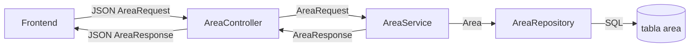
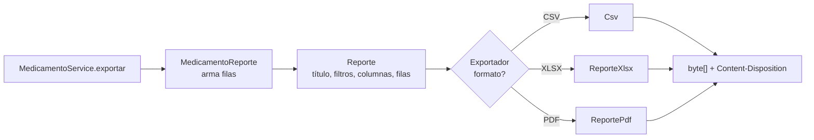

# 07 — Recorrido del backend

Este archivo es una **visita guiada** por el código del backend. Primero el mapa, después tres
"viajes" de un pedido de punta a punta.

Todo el código está en `backend/src/main/java/ar/edu/utn/farmacia/`.

## 1. Mapa de carpetas (paquetes)

```
farmacia/
├── FarmaciaApplication.java    arranque
├── auth/            login, token, roles, permisos, recuperación, admin inicial, configuración de seguridad
├── usuario/         ABM de usuarios
├── proveedor/       ABM de proveedores + validación de CUIT
├── area/            ABM de áreas                         ← el más simple: empezá por acá
├── medicamento/     catálogo + stock calculado con SQL
├── lote/            lotes, ingreso, baja, ajuste, movimientos
├── transferencia/   transferencias FEFO, comprobante PDF, reporte
├── alerta/          alertas y resumen del panel
├── common/          errores, reloj, reportes (CSV/Excel/PDF), utilidades
└── demo/            datos de ejemplo (solo perfil demo)
```

**Organización por funcionalidad:** cada carpeta es un tema del negocio y adentro tiene todas sus
capas. Si hay que cambiar algo de áreas, está todo en `area/`.

### El patrón que se repite en cada carpeta

| Archivo | Capa | Rol |
|---|---|---|
| `Area.java` | Entidad | La tabla `area` como clase. |
| `AreaRepository.java` | Repositorio | Consultas a la tabla. |
| `AreaService.java` | Servicio | Reglas: "no dos áreas con el mismo nombre". |
| `AreaController.java` | Controlador | Endpoints `/api/areas`. |
| `AreaRequest.java` | DTO de entrada | Lo que manda el frontend (con validaciones). |
| `AreaResponse.java` | DTO de salida | Lo que se devuelve (con `desde(...)`). |



## 2. Viaje 1: crear un área (lo más simple)

El frontend manda:

```http
POST /api/areas
Authorization: Bearer eyJ...
Content-Type: application/json

{ "nombre": "  Hemodiálisis " }
```

**Paso 1 — Filtros de seguridad.** Antes de llegar a ningún controlador, Spring Security valida el
token (firma, vencimiento), busca al usuario y carga sus permisos. Si falla → 401. (Detalle en el
archivo 08.)

**Paso 2 — Controlador** (`AreaController.crear`):

```java
@PostMapping
@PreAuthorize("hasAuthority('CATALOGO_EDITAR')")       // ¿tiene el permiso? si no → 403
public ResponseEntity<AreaResponse> crear(@Valid @RequestBody AreaRequest pedido) {
    AreaResponse creada = areaService.crear(pedido);
    return ResponseEntity.created(URI.create("/api/areas/" + creada.id())).body(creada);
}
```

- `@RequestBody`: Jackson convierte el JSON en un `AreaRequest`.
- En el **constructor compacto** del record, `Textos.limpiar` saca los espacios: queda
  `"Hemodiálisis"`.
- `@Valid`: `@NotBlank` y `@Size(max = 80)`. Si estuviera vacío → 400 con
  `errors.nombre = "Ingresá el nombre del área."`.

**Paso 3 — Servicio** (`AreaService.crear`):

```java
@Transactional
public AreaResponse crear(AreaRequest pedido) {
    if (areaRepository.existsByNombreIgnoreCase(pedido.nombre())) {        // regla: nombre único
        throw nombreDuplicado(pedido.nombre());                             // → 409 NOMBRE_DUPLICADO
    }
    return AreaResponse.desde(areaRepository.save(new Area(pedido.nombre())));
}
```

**Paso 4 — Repositorio y base.** `save` hace el `INSERT`; la base asigna el `id` (9). Además, la
base tiene un índice único sobre `lower(nombre)`: si dos personas crearan "Hemodiálisis" al mismo
tiempo y las dos pasaran el `exists`, la base rechaza la segunda y `ManejadorErrores` la traduce
igual a 409.

**Paso 5 — Respuesta.** `AreaResponse.desde(area)` arma el DTO; el controlador responde **201** con
`Location: /api/areas/9` y el JSON `{ "id": 9, "nombre": "Hemodiálisis", "activo": true }`.

## 3. Viaje 2: registrar un ingreso de mercadería

```http
POST /api/medicamentos/5/lotes
{ "proveedorId": 2, "numeroLote": "L2350", "fechaVencimiento": "2027-03-15", "cantidad": 500 }
```

`LoteController` → `LoteService.ingresar(5, pedido)`:

```java
@Transactional
public IngresoResponse ingresar(Long medicamentoId, IngresoRequest pedido) {
    LocalDate hoy = LocalDate.now(clock);                         // hoy, en Argentina
    Medicamento medicamento = buscarMedicamento(medicamentoId);   // 404 si no existe
    if (!medicamento.isActivo()) throw ...MEDICAMENTO_INACTIVO;   // 409
    Proveedor proveedor = buscarProveedor(pedido.proveedorId());
    if (!proveedor.isActivo()) throw ...PROVEEDOR_INACTIVO;       // 409
    if (pedido.fechaVencimiento().isBefore(hoy))                  // vencimiento pasado
        throw new ErrorDeCampoException("fechaVencimiento", "La fecha de vencimiento no puede ser anterior a hoy.");  // 400
    if (loteRepository.existsByMedicamentoIdAndNumeroLote(...))   // lote repetido
        throw ...LOTE_DUPLICADO;                                  // 409

    Usuario usuario = usuarioActual.obtener();                    // quién: sale del TOKEN
    OffsetDateTime ahora = OffsetDateTime.now(clock);
    Lote lote = loteRepository.save(new Lote(medicamento, proveedor, ..., pedido.cantidad(), hoy, usuario, ahora));
    movimientoRepository.save(MovimientoStock.ingreso(lote, ahora, usuario));   // movimiento +500
    long stockTotal = loteRepository.stockDisponible(medicamentoId, hoy);
    return new IngresoResponse(respuesta(lote, hoy), stockTotal);               // 201
}
```

Para notar:

- Las validaciones van **antes** de modificar nada.
- La fecha se valida **en el servicio con el reloj**, no con la anotación `@FutureOrPresent`,
  porque esa anotación usa el reloj del sistema (UTC), no el de Argentina.
- El usuario sale de `UsuarioActual` (del token), **nunca** del JSON.
- Se crean **dos filas**: el lote y su movimiento `INGRESO`. Las dos en la misma transacción.

## 4. Viaje 3: una transferencia (el más importante)

```http
POST /api/transferencias
{ "areaId": 1, "observaciones": "Pedido de la mañana",
  "items": [ { "medicamentoId": 5, "cantidad": 100 }, { "medicamentoId": 5, "cantidad": 50 } ] }
```

`TransferenciaController` → `TransferenciaService.transferir(pedido)`. Paso a paso (el ejemplo
numérico completo está en el archivo 09):

```java
@Transactional
public TransferenciaResponse transferir(TransferenciaRequest pedido) {
    // 1. Sumar repetidos: {5 → 150}
    Map<Long, Integer> cantidades = sumarItems(pedido.items());

    // 2. Validar área y medicamentos activos (404 / 409)
    Area area = buscarAreaActiva(pedido.areaId());
    Map<Long, Medicamento> medicamentos = buscarMedicamentosActivos(cantidades);

    // 3. Bloquear los lotes candidatos (SELECT ... FOR UPDATE ORDER BY id)
    //    y ordenarlos FEFO en memoria, agrupados por medicamento
    LocalDate hoy = LocalDate.now(clock);
    Map<Long, List<Lote>> lotes = loteRepository.bloquearDisponibles(cantidades.keySet(), hoy).stream()
        .filter(lote -> lote.tieneStock() && !lote.estaVencido(hoy))
        .sorted(ORDEN_FEFO)
        .collect(Collectors.groupingBy(lote -> lote.getMedicamento().getId()));

    // 4. Todo o nada: calcular TODOS los faltantes; si hay alguno, excepción → rollback → 409
    List<Faltante> faltantes = faltantes(cantidades, medicamentos, lotes);
    if (!faltantes.isEmpty()) throw new StockInsuficienteException(faltantes);

    // 5. Descontar lote por lote, creando detalle y movimiento por cada lote tocado
    Usuario usuario = usuarioActual.obtener();
    Transferencia transferencia = new Transferencia(ahora, area, usuario, pedido.observaciones());
    cantidades.forEach((medicamentoId, cantidad) -> {
        int restante = cantidad;
        for (Lote lote : lotes.get(medicamentoId)) {
            if (restante == 0) break;
            int tomada = Math.min(restante, lote.getCantidadActual());
            lote.descontar(tomada);                                   // la entidad protege la regla
            transferencia.agregarDetalle(new DetalleTransferencia(transferencia, lote, tomada));
            movimientos.add(MovimientoStock.egreso(lote, tomada, ahora, usuario, transferencia));
            restante -= tomada;
        }
    });

    // 6. Guardar y responder el comprobante (201)
    Transferencia guardada = transferenciaRepository.save(transferencia);
    movimientoRepository.saveAll(movimientos);
    log.info("Transferencia {} creada: ...", guardada.getId(), ...);
    return TransferenciaResponse.desde(guardada);
}
```

Fijate que **no hay un `save` de cada lote**: los lotes vinieron de la base dentro de la
transacción, así que al terminar JPA detecta que cambió su `cantidadActual` y hace el `UPDATE`
solo.

## 5. Las piezas de `common/`

| Clase | Para qué |
|---|---|
| `ManejadorErrores` | Convierte cualquier excepción en una respuesta ProblemDetail con `codigo`. |
| `Problemas` | Ayuda a crear los ProblemDetail. |
| `RecursoNoEncontradoException`, `ReglaNegocioException`, `ErrorDeCampoException`, `ParametroInvalidoException` | Excepciones del dominio. |
| `RelojConfig` | Crea el `Clock` con la zona de Buenos Aires. |
| `FarmaciaProperties` | Lee la configuración `farmacia.*` (zona horaria, alertas, CORS). |
| `Ordenamiento` | Valida que el `sort` pedido esté en la lista blanca (si no, 400 `ORDEN_INVALIDO`). |
| `Textos` | Limpia textos (espacios). |
| `Reporte` | Modelo de un reporte: título, filtros, columnas, filas. |
| `Exportador` | Convierte un `Reporte` a CSV, XLSX o PDF y arma la descarga. |
| `Csv`, `ReporteXlsx`, `ReportePdf` | Cada formato. `Csv` protege contra inyección de fórmulas. |
| `OpenApiConfig` | Configura Swagger con el esquema de seguridad Bearer. |
| `EstadoRequest` | DTO `{activo}` que comparten todos los `PATCH /estado`. |

### Cómo se genera un reporte



Un solo modelo, tres formatos: siempre muestran lo mismo.

## 6. `alerta/`: alertas y panel

`AlertaService.calcular()`:

1. `hoy` del reloj; `limite = hoy + 30 días`.
2. Medicamentos activos con su stock (la misma consulta SQL del listado) → filtra **sin stock** y
   **stock bajo**. El stock bajo se ordena "más crítico primero" (stock / mínimo).
3. Lotes con stock que vencen hasta el límite → separa **vencidos** (fecha < hoy) y **por vencer**.
4. Devuelve todo junto. **Nada se guarda**: se calcula en cada pedido.

`ResumenService` arma el panel: totales de cada alerta, medicamentos activos, transferencias de
hoy, últimas 5 transferencias y unidades por área en los últimos 30 días.

## 7. `auth/`: seguridad (vista rápida)

| Clase | Para qué |
|---|---|
| `SeguridadConfig` | Qué rutas son públicas, BCrypt, cómo se firma y valida el JWT, CORS. |
| `AuthController` / `AuthService` | Login, `/me`, cambio de contraseña. |
| `TokenService` | Emite el JWT. |
| `UsuarioJwtConverter` | En cada pedido: token → usuario de la base → permisos. |
| `UsuarioActual` | Da el `Usuario` del pedido actual a los servicios. |
| `Rol`, `Permiso`, `PermisosDeUsuario` | Qué puede hacer cada rol. |
| `ErroresSeguridad` | Escribe los 401 y 403 en JSON. |
| `RecuperacionService`, `RecuperacionPassword`, `NotificadorRecuperacion`, `CorreoSimulado` | Recuperación de contraseña. |
| `AdminInicial` | Crea `admin` al arrancar si no hay ningún ADMIN. |
| `UsuarioDetailsService` | Le dice a Spring cómo buscar un usuario por nombre para el login. |

## 8. `demo/`: datos de ejemplo

`DemoDataLoader` corre al arrancar solo con el perfil `demo`. Si ya hay medicamentos, no hace nada
(es **idempotente**). Si no, crea unos 25 medicamentos reales por nombre genérico, 4 proveedores
inventados con CUIT válido, lotes con vencimientos relativos a hoy (algunos vencidos, otros por
vencer), usuarios `farmaceutico` y `consulta`, y transferencias de los últimos 30 días **usando los
servicios**, para que los movimientos y el stock cierren.

`RelojDemo` permite que esas transferencias queden con fechas del pasado. `PerfilesIncompatibles`
impide arrancar con `demo` y `prod` juntos.

## 9. Recursos (`src/main/resources/`)

| Archivo | Contenido |
|---|---|
| `application.yml` | Configuración común. |
| `application-dev.yml`, `-demo.yml`, `-prod.yml` | Lo que cambia por perfil. |
| `db/migration/V1__esquema.sql`, `V2__…`, `V3__…` | Migraciones de Flyway. |

## 10. Ejercicio para fijar

Abrí `proveedor/ProveedorService.java` y respondé:

1. ¿Qué excepción lanza si el CUIT ya existe? ¿Qué código HTTP termina devolviendo?
2. ¿Dónde se valida el dígito verificador del CUIT? (Pista: buscá `@Cuit`.)
3. ¿Qué pasa con los lotes de un proveedor cuando se lo desactiva?

Respuestas en la [autoevaluación](17-autoevaluacion.md).
