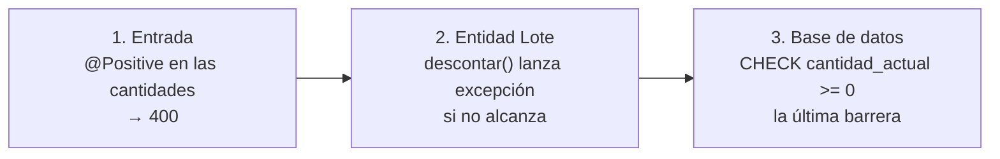

# 09 — Reglas de negocio: FEFO, stock y concurrencia

Este es **el corazón del sistema**. Si entendés este archivo, entendés por qué el sistema existe.

## 1. Estados de un lote

Supongamos que **hoy es 12/11/2026** y "por vencer" son 30 días (hasta el 12/12/2026).

| Lote | Vence | Cantidad | Estado | Por qué |
|---|---|---:|---|---|
| A | 11/11/2026 | 20 | **VENCIDO** | Venció ayer (fecha < hoy). |
| B | 12/11/2026 | 50 | **POR_VENCER** | Vence **hoy**: todavía se puede usar. |
| C | 12/12/2026 | 80 | **POR_VENCER** | Vence justo en 30 días (incluido). |
| D | 13/12/2026 | 100 | **VIGENTE** | Vence en 31 días: fuera del rango. |
| E | 01/06/2027 | 0 | **AGOTADO** | No tiene unidades (se mira primero). |

El código (`Lote.estado`):

```java
public EstadoLote estado(LocalDate hoy, int diasPorVencer) {
    if (cantidadActual == 0)                                      return EstadoLote.AGOTADO;
    if (estaVencido(hoy))                                         return EstadoLote.VENCIDO;    // fecha < hoy
    if (!fechaVencimiento.isAfter(hoy.plusDays(diasPorVencer)))   return EstadoLote.POR_VENCER; // fecha <= hoy + 30
    return EstadoLote.VIGENTE;
}
```

> **Ojo con los bordes:** "vence hoy" es POR_VENCER, no VENCIDO. "Vence en exactamente 30 días" es
> POR_VENCER. "En 31" no genera alerta. Estos casos tienen pruebas propias (`AlertaServiceTest`)
> con un **reloj fijo**, porque si la prueba usara la fecha real, daría distinto cada día.

El estado **no se guarda** en la base: cambia solo con el paso del tiempo, así que se calcula cada
vez.

## 2. Stock total y estado de un medicamento

**Stock total** = suma de los lotes **no vencidos**.

Con los lotes de arriba (todos del mismo medicamento): B + C + D + E = 50 + 80 + 100 + 0 = **230**.
El lote A (vencido, 20) **no cuenta**: está en el depósito pero no se puede entregar.

**Estado de stock** (con stock mínimo = 300):

| Stock total | Estado |
|---|---|
| 0 | SIN_STOCK |
| 1 a 300 | STOCK_BAJO (230 cae acá) |
| más de 300 | OK |

**Próximo vencimiento** = el menor vencimiento entre los lotes con stock y no vencidos = 12/11/2026
(lote B).

## 3. FEFO: primero vence, primero sale

### Por qué FEFO y no FIFO

| Lote | Ingresó | Vence |
|---|---|---|
| X | 01/09 | 01/06/2027 |
| Y | 01/10 | 15/12/2026 |

- **FIFO** (primero entra, primero sale) entregaría X primero. Y quedaría en el estante y **se
  vencería** en diciembre.
- **FEFO** entrega Y primero, porque vence antes. ✅

### Desempates

Si dos lotes vencen el mismo día, decide la **fecha de ingreso** (el más viejo primero), y si
también coincide, el **id** (el número interno, que nunca se repite). Así el resultado es siempre el
mismo (**determinístico**), y las pruebas son estables.

```java
static final Comparator<Lote> ORDEN_FEFO =
    Comparator.comparing(Lote::getFechaVencimiento)
        .thenComparing(Lote::getFechaIngreso)
        .thenComparing(Lote::getId);
```

### Ejemplo completo

Paracetamol tiene estos lotes (hoy 12/11/2026):

| Lote | Vence | Cantidad |
|---|---|---:|
| L2290 | 10/11/2026 | 30 ← **vencido**, se ignora |
| L2301 | 01/12/2026 | 100 |
| L2340 | 15/03/2027 | 410 |
| L2350 | 15/03/2027 | 500 (ingresó después que L2340) |

Guardia pide **150**.

1. Se descartan los vencidos (L2290).
2. Se ordena FEFO: L2301 (dic) → L2340 (mar, ingresó antes) → L2350 (mar).
3. Disponible total: 100 + 410 + 500 = 1010 ≥ 150. Alcanza.
4. Se descuenta:
   - L2301: toma min(150, 100) = **100** → queda 0. Faltan 50.
   - L2340: toma min(50, 410) = **50** → queda 360. Faltan 0. Fin.
5. Resultado:

**Detalle de la transferencia (comprobante)**

| Medicamento | Lote | Vence | Cantidad |
|---|---|---|---:|
| Paracetamol | L2301 | 01/12/2026 | 100 |
| Paracetamol | L2340 | 15/03/2027 | 50 |

**Movimientos generados**

| Lote | Tipo | Cantidad | Saldo resultante |
|---|---|---:|---:|
| L2301 | EGRESO | −100 | 0 |
| L2340 | EGRESO | −50 | 360 |

## 4. Todo o nada

Pedido: Paracetamol 150 (hay 1010) y Amoxicilina 50 (hay 12) y Ceftriaxona 20 (hay 5).

El sistema **primero calcula todos los faltantes** y recién después toca algo:

| Medicamento | Disponible | Solicitado | ¿Falta? |
|---|---:|---:|---|
| Paracetamol | 1010 | 150 | No |
| Amoxicilina | 12 | 50 | **Sí** |
| Ceftriaxona | 5 | 20 | **Sí** |

Como hay faltantes, lanza `StockInsuficienteException` con **los dos** (no solo el primero), la
transacción se revierte y **no se descuenta nada, ni siquiera el Paracetamol**. Respuesta:

```json
{ "status": 409, "codigo": "STOCK_INSUFICIENTE",
  "detail": "Stock insuficiente de Amoxicilina comprimidos 500 mg: disponible 12, solicitado 50. ...",
  "faltantes": [
    { "medicamentoId": 1, "medicamento": "Amoxicilina comprimidos 500 mg", "disponible": 12, "solicitado": 50 },
    { "medicamentoId": 2, "medicamento": "Ceftriaxona frasco ampolla 1 g", "disponible": 5, "solicitado": 20 } ] }
```

El frontend marca cada línea: "Disponible: 12 (pediste 50)" y **conserva todo lo cargado** para que
la persona corrija.

**¿Por qué todo o nada?** Porque una entrega a medias genera confusión: el área cree que recibió
todo, el comprobante no coincide con lo físico, y hay que corregir a mano.

## 5. Ítems repetidos

Si la persona agrega Paracetamol 100 y después Paracetamol 50, el pedido se transforma en
Paracetamol **150** (`cantidades.merge(id, cantidad, Integer::sum)`). En la pantalla también se
suman en la misma línea ("Se sumó a la línea de Paracetamol").

## 6. Concurrencia: dos personas al mismo tiempo

### El problema

Lote L2301 con **100** unidades. Ana y Bruno transfieren **60** cada uno en el mismo segundo.

Sin protección:

```
Ana:   lee 100 ─── 100 ≥ 60 ✓ ─── guarda 40
Bruno: lee 100 ─── 100 ≥ 60 ✓ ─── guarda 40
Resultado: se entregaron 120 de un lote de 100. El sistema dice 40. ❌
```

### La solución: bloqueo pesimista

```java
@Lock(LockModeType.PESSIMISTIC_WRITE)      // SELECT ... FOR UPDATE
@Query("select l from Lote l where ... order by l.id")
List<Lote> bloquearDisponibles(...);
```

```
Ana:   BLOQUEA y lee 100 ── 100 ≥ 60 ✓ ── guarda 40 ── confirma (libera)
Bruno: quiere leer ── ESPERA ───────────────────────────────────────── lee 40 ── 40 < 60 ✗ ── 409
Resultado: Ana 201, Bruno 409, stock 40. ✅
```

### El deadlock y el orden por id

Ana pide Amoxicilina y Paracetamol; Bruno pide Paracetamol y Amoxicilina.

Si cada uno bloqueara en el orden en que pidió:

```
Ana:   bloquea Amoxicilina ── quiere Paracetamol → espera a Bruno
Bruno: bloquea Paracetamol ── quiere Amoxicilina → espera a Ana
Se esperan para siempre. ❌ (deadlock)
```

Por eso la consulta **ordena por id** y bloquea **todos los lotes en una sola consulta**. Los dos
intentan bloquear primero el lote de menor id: uno lo consigue y el otro espera **sin tener nada
bloqueado**. No hay ciclo. ✅

### Cómo se prueba

`TransferenciaConcurrenciaIT` (con PostgreSQL real):

```java
// Un lote de 100. Dos hilos arrancan a la vez (CountDownLatch) y piden 60 cada uno.
// Resultado esperado: exactamente un 201 y un 409, y stock final 40.
```

Y `pedidosEnOrdenInversoNoSeTraban`: dos medicamentos pedidos en orden inverso por cada hilo;
ninguno se traba.

> **Para la defensa:** "Bloqueo los lotes con `SELECT … FOR UPDATE` en una sola consulta ordenada
> por id. El bloqueo evita que dos transferencias usen el mismo stock y el orden fijo evita el
> deadlock. Lo demuestra una prueba que lanza dos transferencias simultáneas contra PostgreSQL."

## 7. El stock nunca negativo: tres barreras



Si una capa tuviera un error, la siguiente lo detiene. Es **defensa en profundidad**.

## 8. Trazabilidad: la suma de los movimientos

Cada cambio de stock de un lote genera **exactamente un movimiento**. Por eso siempre se cumple:

> **suma de los movimientos de un lote = cantidad actual del lote**

Ejemplo, lote L2340:

| Fecha | Tipo | Cantidad | Saldo |
|---|---|---:|---:|
| 01/10 | INGRESO | +410 | 410 |
| 12/11 | EGRESO (TR-000042) | −50 | 360 |
| 13/11 | AJUSTE ("rotura de 2 cajas") | −20 | 340 |
| **Suma** | | **340** | = cantidad actual ✅ |

`FlujoCompletoIT` verifica esta igualdad para cada lote. Si alguna vez no coincidiera, sabríamos
que algo modificó el stock sin dejar rastro.

## 9. Baja por vencimiento y ajuste

### Baja por vencimiento

Solo lotes **vencidos** y con stock. Deja el lote en 0 y registra `BAJA_VENCIMIENTO` con toda la
cantidad y el motivo.

| Situación | Resultado |
|---|---|
| Lote vencido con 20 | Queda en 0; movimiento −20 con motivo. |
| Lote que vence mañana | 409 `LOTE_NO_VENCIDO` ("todavía no venció"). |
| Lote vencido ya en 0 | 409 `LOTE_SIN_STOCK`. |

### Ajuste

Corrige la cantidad a un valor nuevo entre 0 y la cantidad inicial, distinto del actual, con
motivo. Registra la **diferencia**:

| Cantidad actual | Cantidad nueva | Movimiento |
|---:|---:|---|
| 360 | 340 | AJUSTE −20 |
| 0 | 5 | AJUSTE +5 (por ejemplo, se encontraron cajas) |
| 360 | 500 (inicial 410) | ✗ 400: no puede superar la inicial |
| 360 | 360 | ✗ 400: tiene que ser distinta |

El ajuste también usa bloqueo pesimista sobre el lote.

## 10. Alertas

Se calculan en el momento (`AlertaService`), nunca se guardan:

| Alerta | Condición | Orden |
|---|---|---|
| VENCIDO | Lote con stock y vence < hoy (aunque el medicamento esté inactivo: la mercadería sigue ahí). | Por fecha. |
| POR_VENCER | Lote con stock y hoy ≤ vence ≤ hoy + 30. | Por fecha. |
| SIN_STOCK | Medicamento **activo** con stock 0. | Por nombre. |
| STOCK_BAJO | Medicamento **activo** con 0 < stock ≤ mínimo. | El más crítico primero (stock ÷ mínimo). |

Ejemplo del orden de stock bajo: Amoxicilina 50/200 = 0,25; Ceftriaxona 70/80 = 0,875 → primero
Amoxicilina (le falta proporcionalmente más).

## 11. Otras reglas

| Regla | Por qué |
|---|---|
| Medicamento con stock no vencido no se puede desactivar (`MEDICAMENTO_CON_STOCK`). | Quedaría mercadería "invisible". |
| Proveedor con lotes con stock **sí** se puede desactivar. | Dejar de comprarle no hace desaparecer su mercadería; sus lotes siguen disponibles. |
| Área inactiva no recibe transferencias (`AREA_INACTIVA`). | Si el servicio cerró, no se le entrega. |
| Nadie se desactiva a sí mismo (`PROPIO_USUARIO`). | Evita quedarse afuera por error. |
| No se puede desactivar ni quitar el rol al último ADMIN activo (`ULTIMO_ADMIN`). | Siempre tiene que haber alguien que gestione usuarios. |
| Las transferencias no se editan ni se anulan. | El historial tiene que ser confiable; los errores se corrigen con ajustes. |
| Código de medicamento en mayúsculas. | Que `amox-500` y `AMOX-500` no convivan. |
| CUIT con dígito verificador. | Evita errores de tipeo. |

### El dígito verificador del CUIT

Para `20-12345678-?`:

| Dígito | 2 | 0 | 1 | 2 | 3 | 4 | 5 | 6 | 7 | 8 |
|---|---|---|---|---|---|---|---|---|---|---|
| Peso | 5 | 4 | 3 | 2 | 7 | 6 | 5 | 4 | 3 | 2 |
| Producto | 10 | 0 | 3 | 4 | 21 | 24 | 25 | 24 | 21 | 16 |

Suma = 148. 148 mod 11 = 5. DV = 11 − 5 = **6** → `20-12345678-6` ✅. (Si da 11, el DV es 0; si
da 10, el CUIT es inválido.)

## 12. La hora de Argentina

Los contenedores corren en **UTC** (3 horas adelante de Argentina). A las **21:00 del 12/11** en
Buenos Aires, en UTC ya son las **00:00 del 13/11**. Si el sistema usara la hora del servidor, a
esa hora un lote que vence el 12/11 aparecería **vencido**, tres horas antes de tiempo.

Solución: un `Clock` con zona `America/Argentina/Buenos_Aires`, y "hoy" siempre sale de ahí. En el
frontend pasa algo parecido: `new Date("2026-11-30")` se interpreta como medianoche UTC y en
Argentina mostraría **29/11**. Por eso las fechas sin hora se manejan como texto (`utils/fechas.ts`).
