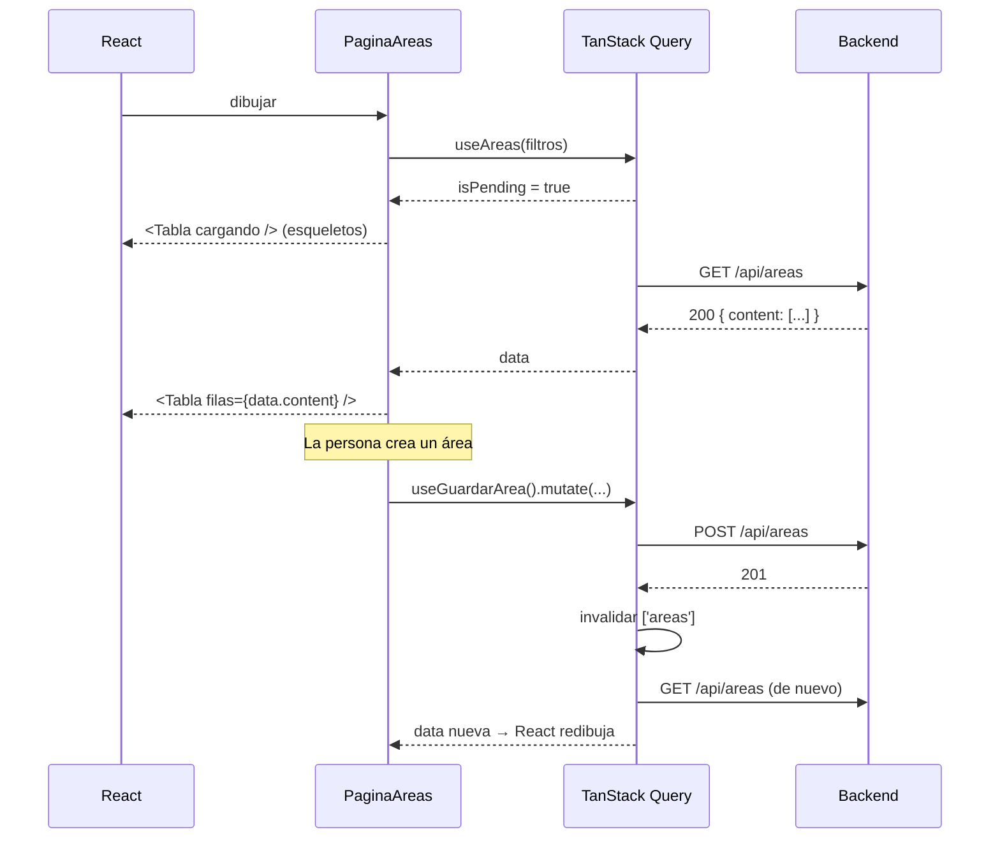

# 11 — React

## 1. Qué es y qué problema resuelve

**React** es una biblioteca para construir interfaces con **componentes**: piezas reutilizables
(un botón, una tabla, un formulario) que se combinan como bloques de Lego.

Sin React, para mostrar una lista de medicamentos habría que buscar elementos en la página,
borrarlos, crear nuevos, actualizar contadores… a mano, cada vez que algo cambia. Con React se
**describe cómo tiene que verse la pantalla según los datos**, y React se encarga de actualizarla
cuando los datos cambian.

> **Idea central:** pantalla = función(datos). Cambian los datos → React vuelve a dibujar lo
> necesario.

Usamos **React 19**.

## 2. Componentes

Un componente es una **función** que devuelve lo que se muestra. El nombre empieza con mayúscula.

```tsx
// components/EncabezadoPagina.tsx (simplificado)
export function EncabezadoPagina({ titulo, acciones }: { titulo: string; acciones?: ReactNode }) {
  return (
    <header className="encabezado-pagina">
      <title>{`${titulo} · Farmacia`}</title>   {/* React 19 lo lleva al <head>: título de la pestaña */}
      <h1>{titulo}</h1>
      {acciones && <div className="encabezado-pagina__acciones">{acciones}</div>}
    </header>
  );
}

// Se usa como una etiqueta HTML:
<EncabezadoPagina titulo="Medicamentos" acciones={<Link to="/medicamentos/nuevo">Nuevo medicamento</Link>} />
```

## 3. JSX

Esa mezcla de HTML dentro de TypeScript se llama **JSX** (archivos `.tsx`). Reglas:

```tsx
<div className="tarjeta">              {/* class → className */}
  <h2>{medicamento.nombre}</h2>         {/* {} = valor de TypeScript adentro */}
  {cargando && <Cargando />}            {/* mostrar solo si cargando es true */}
  {activo ? <span>Activo</span> : <span>Inactivo</span>}   {/* si / si no */}
  <ul>
    {lotes.map((lote) => (              /* repetir por cada elemento */
      <li key={lote.id}>{lote.numeroLote}</li>     /* key: identificador único para React */
    ))}
  </ul>
  <button onClick={() => guardar()}>Guardar</button>   {/* eventos: onClick, onChange, onSubmit */}
</div>
```

> **En el proyecto (seguridad):** todo lo que va entre `{}` se muestra **como texto**. Si un
> medicamento se llama `<script>…</script>`, se ve literalmente ese texto: React lo escapa. Por eso
> XSS es muy difícil, siempre que no se use `dangerouslySetInnerHTML` (prohibido por ESLint).

## 4. Props: datos que recibe un componente

Las **props** son los parámetros de un componente. Van de padre a hijo (de arriba hacia abajo).

```tsx
// components/Insignia.tsx
type PropsInsignia = {
  /** Siempre una palabra: el estado nunca se comunica solo con color. */
  texto: string;
  tono: Tono;            // 'ok' | 'aviso' | 'peligro' | 'neutro'
};

export function Insignia({ texto, tono }: PropsInsignia) {
  return <span className={`insignia insignia--${tono}`}>{texto}</span>;
}

<Insignia texto="Vencido" tono="peligro" />
```

Una prop especial es `children`: lo que va entre la etiqueta de apertura y la de cierre
(`<Modal>…contenido…</Modal>`).

## 5. Estado: datos que cambian

El **estado** es la memoria de un componente. Cuando cambia, React vuelve a dibujar el componente.

```tsx
import { useState } from 'react';

function Contador() {
  const [valor, setValor] = useState(0);        // valor actual + función para cambiarlo
  return <button onClick={() => setValor(valor + 1)}>Clics: {valor}</button>;
}
```

> **Ojo:** nunca se modifica el estado directo (`valor = 5` o `lista.push(x)`). Siempre con la
> función `setValor`, pasando un valor **nuevo**. Para listas: `setLineas([...lineas, nueva])`.

## 6. Hooks

Los **hooks** son funciones que empiezan con `use` y le dan "superpoderes" a un componente. Reglas:
solo se llaman en el nivel superior del componente (no dentro de `if` ni bucles).

| Hook | Para qué | Ejemplo del proyecto |
|---|---|---|
| `useState` | Guardar estado. | Qué modal está abierto. |
| `useEffect` | Hacer algo **después** de dibujar (sincronizar con algo externo). | `Modal`: llamar a `showModal()` del `<dialog>`; programar el aviso de vencimiento de la sesión. |
| `useRef` | Guardar algo que no provoca redibujo, o referenciar un elemento del DOM. | Referencia al `<dialog>`; evitar doble envío en la transferencia. |
| `useMemo` / `useCallback` | Recordar un cálculo o una función entre dibujos. | Valor del contexto de sesión. |
| `useContext` | Leer datos compartidos sin pasarlos por props. | `useSesion()`, `useAvisos()`. |
| `useId` | Generar ids únicos para accesibilidad. | Vincular el título del modal con `aria-labelledby`. |

### Hooks propios (custom hooks)

Se pueden escribir hooks propios para reutilizar lógica. En el proyecto:

| Hook | Qué hace |
|---|---|
| `useFormulario` | Valores, errores, validación al salir y al enviar, errores del servidor por campo. |
| `useFiltrosUrl` | Lee y escribe filtros en la URL (`?q=para&estado=OK&pagina=2`). |
| `useDebounce` | Espera 300 ms sin escribir antes de buscar (no pedir en cada tecla). |
| `useDescarga` | Descargar un archivo mostrando "Descargando…" y avisando si falla. |
| `useMedicamentos`, `useAreas`, … (en `api/`) | Pedir datos al backend con TanStack Query. |
| `useSesion` | Usuario actual, `puede(permiso)`, iniciar y cerrar sesión. |
| `useAvisos` | Mostrar avisos (toasts). |

## 7. Contexto: datos para toda la aplicación

Algunos datos los necesitan muchas pantallas: el usuario logueado, la función para mostrar avisos.
Pasarlos por props de componente en componente sería tedioso. Un **contexto** los pone a
disposición de todos los componentes de adentro:

```tsx
<SesionProvider>          {/* provee la sesión */}
  <Layout>
    <PaginaMedicamentos />   {/* adentro: const { usuario, puede } = useSesion(); */}
  </Layout>
</SesionProvider>
```

```tsx
const { puede } = useSesion();
{puede('CATALOGO_EDITAR') && <Link to="/medicamentos/nuevo">Nuevo medicamento</Link>}
```

## 8. TanStack Query: datos del servidor

Pedir datos al backend implica manejar: "¿está cargando?", "¿falló?", "¿ya lo tenía guardado?",
"cuando creo algo, ¿qué listas se desactualizaron?". **TanStack Query** resuelve todo eso.

### Leer (useQuery)

```ts
// api/areas.ts
export function useAreas(filtros: FiltrosAreas) {
  return useQuery({
    queryKey: ['areas', filtros],                                  // identificador en la caché
    queryFn: ({ signal }) => api.get<PaginaAreas>('/api/areas', filtros, signal),   // cómo pedirlo
    placeholderData: keepPreviousData,                             // mientras carga la página 2, mostrar la 1
  });
}
```

```tsx
// en la pantalla
const consulta = useAreas({ q, activo: true });
if (consulta.isPending) return <Cargando />;
if (consulta.isError) return <ErrorCarga error={consulta.error} alReintentar={consulta.refetch} />;
return <Tabla filas={consulta.data.content} ... />;
```

- **Caché:** si otra pantalla ya pidió `['areas', {...}]` hace menos de 30 segundos, se usa lo
  guardado y no se vuelve a pedir.
- **Reintento:** como máximo una vez y solo si falló la red o el servidor (5xx). Un 400 o 404 no
  se arregla reintentando.

### Modificar (useMutation) e invalidar

```ts
export function useGuardarArea() {
  const queryClient = useQueryClient();
  return useMutation({
    mutationFn: ({ id, datos }) => id ? api.put(`/api/areas/${id}`, datos) : api.post('/api/areas', datos),
    onSuccess: () => queryClient.invalidateQueries({ queryKey: ['areas'] }),   // "las áreas cambiaron"
  });
}
```

**Invalidar** = marcar como viejo. La próxima vez que se muestre la lista de áreas, se vuelve a
pedir. Para operaciones de stock hay una función que invalida todo lo afectado
(`api/invalidaciones.ts`):

```ts
// Un ingreso, transferencia, baja o ajuste afecta a todas estas vistas.
['medicamentos', 'lotes', 'movimientos', 'alertas', 'resumen', 'transferencias', 'proveedores']
```

## 9. React Router: varias pantallas en una SPA

```tsx
const router = createBrowserRouter([
  { path: 'ingresar', element: <PaginaIngreso /> },
  {
    element: <RutaProtegida />,                       // exige sesión
    children: [
      { index: true, element: <PaginaPanel /> },     // "/"
      { path: 'medicamentos', element: <PaginaMedicamentos /> },
      { path: 'medicamentos/:id', element: <PaginaDetalleMedicamento /> },   // :id = parámetro
      {
        path: 'usuarios',
        element: <RutaProtegida permiso="USUARIO_GESTIONAR"><PaginaUsuarios /></RutaProtegida>,
      },
    ],
  },
]);
```

| Pieza | Para qué |
|---|---|
| `<Link to="/medicamentos/5">` | Enlace sin recargar la página. |
| `useParams()` | Leer `:id` de la URL. |
| `useNavigate()` | Ir a otra pantalla desde el código (después de guardar). |
| `useSearchParams()` | Leer y escribir `?q=...` (lo usa `useFiltrosUrl`). |
| `<Outlet />` | Lugar donde se dibuja la ruta hija (por ejemplo, el contenido dentro del `Layout`). |
| `<Navigate to="...">` | Redirigir (lo usa `RutaProtegida`). |

## 10. Formularios

```tsx
const formulario = useFormulario({ nombre: '' }, { nombre: combinar(obligatorio, longitudEntre(1, 100)) });

<form onSubmit={(e) => { e.preventDefault(); if (formulario.validarTodo()) guardar(); }} noValidate>
  <CampoFormulario etiqueta="Nombre" obligatorio error={formulario.errores.nombre}>
    {(props) => <input {...props} className="control" {...formulario.registrar('nombre')} />}
  </CampoFormulario>
</form>
```

- `e.preventDefault()`: evita que el navegador recargue la página al enviar.
- `CampoFormulario` pone la etiqueta, el texto "(obligatorio)" y el mensaje de error, y le pasa al
  `<input>` (con `props`) el `id`, `aria-invalid` y `aria-describedby` para que los lectores de
  pantalla lean el error.
- `registrar('nombre')` conecta el campo: valor, `onChange` y validación al salir (`onBlur`).
- `noValidate`: desactiva la validación nativa del navegador (usamos la propia, con mensajes en
  español).
- Si el servidor responde 400 con `errors: { nombre: "Ya existe…" }`,
  `formulario.aplicarErrorServidor` pone ese mensaje debajo del campo.

## 11. Ciclo de vida de una pantalla (resumen visual)



## Resumen

| Concepto | En una frase |
|---|---|
| Componente | Función que devuelve un pedazo de pantalla. |
| JSX | HTML dentro de TypeScript, con `{}` para valores. |
| Props | Datos que un componente recibe de su padre. |
| Estado (`useState`) | Memoria del componente; al cambiar, se redibuja. |
| Hook | Función `useAlgo` que agrega capacidades a un componente. |
| Contexto | Datos compartidos por toda la app (sesión, avisos). |
| TanStack Query | Pide, guarda en caché e invalida los datos del servidor. |
| React Router | Muestra una pantalla u otra según la URL, sin recargar. |
