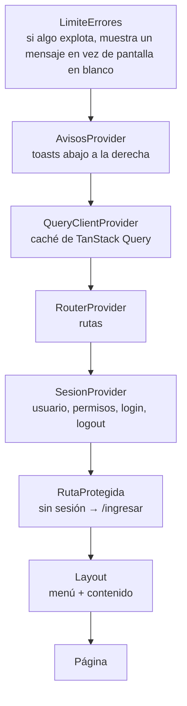

# 12 — Recorrido del frontend

Todo está en `frontend/src/`.

## 1. Mapa

```
src/
├── main.tsx           arranca React, importa fuentes y estilos
├── App.tsx            rutas + proveedores (sesión, avisos, consultas, límite de errores)
├── api/               hablar con el backend
├── auth/              sesión, ingreso, recuperación, rutas protegidas
├── components/        piezas reutilizables
├── hooks/             lógica reutilizable
├── pages/             una carpeta por pantalla
├── utils/             funciones puras (fechas, números, CUIT, validaciones)
├── styles/            CSS
└── test/              configuración de las pruebas
```

## 2. Arranque: `main.tsx` y `App.tsx`

```tsx
// main.tsx
import './styles/tokens.css';        // colores, espacios, tiempos
import './styles/base.css';          // estilos generales
import './styles/componentes.css';   // estilos de cada componente
import './styles/animaciones.css';   // entradas y salidas animadas
import './styles/impresion.css';     // cómo se imprime (comprobante)
createRoot(document.getElementById('root')).render(<StrictMode><App /></StrictMode>);
```

`App.tsx` arma las capas de "envoltorios" (proveedores) y las rutas:



## 3. `api/`: la única puerta al backend

### `cliente.ts` — el único `fetch` de toda la aplicación

Para cada pedido:

1. Arma la URL (`/api/...` + parámetros, ignorando los vacíos).
2. Agrega `Accept: application/json`, `Authorization: Bearer <token>` si hay sesión y
   `Content-Type` solo si hay cuerpo.
3. Pone un **tiempo máximo de 15 segundos** (`AbortController`).
4. Si la respuesta no es OK, la traduce a un `ErrorApi` con un mensaje en español:

| Respuesta | Qué hace |
|---|---|
| 401 en el login | "Usuario o contraseña incorrectos." |
| 401 en otro lado | Borra la sesión y avisa al `SesionProvider` → ingreso con "Tu sesión expiró". |
| 403 | "No tenés permiso para esta acción." y refresca los permisos. |
| 400 / 404 / 409 | El `detail` del backend, con `codigo`, `errors` y `faltantes` disponibles. |
| 5xx | "Ocurrió un error en el servidor. Código: {errorId}." |
| Sin conexión | "No se pudo conectar con el servidor." |
| 15 s sin respuesta | "El servidor tardó demasiado en responder." |

> **Por qué un solo lugar:** el token, los errores y el tiempo máximo se manejan igual en toda la
> app. En el prototipo cada pantalla hacía su propio `fetch` y cada una fallaba distinto.

El cliente **no importa React ni el router**: recibe dos funciones (`alExpirarSesion`,
`alProhibido`) del `SesionProvider`. Así se puede probar solo (`cliente.test.ts`).

### `errores.ts`

Lee el ProblemDetail del backend **sin confiar en su forma** (valida cada propiedad) y define los
mensajes fijos.

### `consultas.ts`

Configura TanStack Query: datos "frescos" por 30 segundos, reintento máximo 1 vez y solo ante red
caída o 5xx; los errores de red o servidor en acciones se avisan en un solo lugar.

### `esquema.ts` y `tipos.ts`

`esquema.ts` se **genera** con `npm run api:tipos` a partir del OpenAPI del backend: **no se edita
a mano**. `tipos.ts` les da nombres cortos (`Medicamento`, `Lote`, `PaginaAreas`…) y es el único
archivo que nombra los tipos generados.

### Un archivo por recurso

`medicamentos.ts`, `lotes.ts`, `transferencias.ts`, `areas.ts`, `proveedores.ts`, `usuarios.ts`,
`alertas.ts`, `reportes.ts`, `auth.ts`. Cada uno exporta **hooks**: `useMedicamentos`,
`useGuardarMedicamento`, `useTransferir`… Las pantallas solo usan estos hooks.

`invalidaciones.ts`: después de un cambio de stock invalida medicamentos, lotes, movimientos,
alertas, resumen, transferencias y proveedores.

## 4. `auth/`: sesión

| Archivo | Qué hace |
|---|---|
| `almacenSesion.ts` | Lee y escribe el token y su vencimiento en `sessionStorage`. |
| `SesionProvider.tsx` | Al iniciar, si hay token, pide `/api/auth/me` (pantalla "Cargando…" para que el login no parpadee). Expone `usuario`, `puede(permiso)`, `iniciarSesion`, `cerrarSesion`. Programa **un** `setTimeout` para avisar 5 minutos antes del vencimiento. |
| `RutaProtegida.tsx` | Sin sesión → `/ingresar` recordando a dónde ibas; sin permiso → `/sin-permiso`. |
| `PaginaIngreso.tsx` | Formulario de login. Después de ingresar, vuelve a la ruta pedida (solo rutas internas). |
| `PaginaRecuperacion.tsx` | Los dos pasos de la recuperación de contraseña. |
| `MarcoIngreso.tsx` | El marco centrado con logo de las pantallas de ingreso. |
| `PaginaSinPermiso.tsx` | "No tenés permiso para ver esta página." |

## 5. `components/`: piezas reutilizables

| Componente | Qué es |
|---|---|
| `Layout` | Barra superior (en pantallas chicas), menú y `<main>` con la página. |
| `Menu` | Menú lateral agrupado; cada enlace se muestra solo si `puede(permiso)`. |
| `Tabla` | Tabla genérica: columnas declarativas, orden con `aria-sort`, esqueletos al cargar, mensaje si está vacía. |
| `Paginador` | "Mostrando 1–20 de 57", Anterior / Siguiente. |
| `Modal` | Cuadro de diálogo con `<dialog>` nativo: Escape cierra, el foco vuelve al botón que lo abrió. |
| `Confirmacion` | Modal de "¿Seguro?" con botón rojo para acciones peligrosas. |
| `Avisos` | Toasts: éxito (`role="status"`, se van a los 5 s) y error (`role="alert"`, quedan). |
| `Estados` | `Cargando`, `Vacio`, `ErrorCarga` (con "Reintentar"). |
| `Insignia`, `InsigniaActivo` | Etiquetas de estado con palabra y color. |
| `CampoFormulario` | Etiqueta + "(obligatorio)" + ayuda + error, con `aria-invalid` y `aria-describedby`. |
| `CampoBusqueda` | Buscador con ícono y espera de 300 ms. |
| `BuscadorMedicamento` | Combobox accesible (flechas, Enter, Escape) para elegir un medicamento. |
| `CasillaInactivos` | "Incluir inactivos". |
| `EncabezadoPagina` | Título de la página + `<title>` de la pestaña + acciones. |
| `LimiteErrores` | Atrapa errores inesperados de React y muestra un mensaje. |
| `Logo` | Logo (cruz) y marca. |

## 6. `hooks/`

| Hook | Qué hace |
|---|---|
| `useFormulario` | Valores, errores por campo, `validarTodo`, `aplicarErrorServidor`, `registrar(campo)`. Valida al salir del campo y al enviar, nunca en cada tecla. |
| `useFiltrosUrl` | Filtros, orden y página en la URL. Cualquier cambio de filtro vuelve a la página 1. |
| `useDebounce` | Retrasa un valor 300 ms (búsquedas). |
| `useDescarga` | Descarga Excel/PDF con estado "Descargando…" por botón y aviso si falla. |

## 7. `utils/`: funciones puras (fáciles de probar)

| Archivo | Qué hace |
|---|---|
| `fechas.ts` | `formatearFecha('2026-11-30')` → `30/11/2026` sin `new Date`; "hoy" en Buenos Aires; diferencia de días. |
| `numeros.ts` | Formato `es-AR` (`1.234`). |
| `cuit.ts` | Máscara `XX-XXXXXXXX-X` y dígito verificador (mismos vectores que el backend). |
| `estadoStock.ts` | Estado → `{texto, tono}` (por ejemplo `VENCIDO` → "Vencido", peligro). |
| `validaciones.ts` | `obligatorio`, `longitudEntre`, `combinar`… para `useFormulario`. |
| `descargas.ts` | Guarda un Blob como archivo con el nombre de `Content-Disposition`. |
| `roles.ts` | Nombre legible de cada rol. |
| `medicamento.ts` | Nombre completo "Amoxicilina comprimidos 500 mg". |

## 8. `pages/`: las pantallas

| Carpeta | Pantallas |
|---|---|
| `panel/` | Panel: indicadores, alertas, últimas transferencias, unidades por área. |
| `medicamentos/` | Lista, detalle (lotes + movimientos), formulario de alta y edición. |
| `ingresos/` | Ingreso de mercadería. |
| `transferencias/` | Nueva transferencia, historial, comprobante; `borrador.ts` guarda el borrador. |
| `lotes/` | Lotes y vencimientos, con baja y ajuste. |
| `reportes/` | Los tres reportes. |
| `proveedores/`, `areas/`, `usuarios/` | ABM. |
| `cuenta/` | Mi cuenta y cambio de contraseña. |
| `PaginaNoEncontrada.tsx` | "No encontramos esta página." |

### Cómo se arma una pantalla de lista (ejemplo: Áreas)

```tsx
export function PaginaAreas() {
  const filtros = useFiltrosUrl();                          // 1. filtros, orden y página desde la URL
  const { puede } = useSesion();                            // 2. permisos
  const puedeEditar = puede('CATALOGO_EDITAR');
  const [editando, setEditando] = useState<Area | 'nueva' | null>(null);   // 3. qué modal está abierto

  const consulta = useAreas({                               // 4. datos (TanStack Query)
    q: filtros.leer('q') || undefined,
    activo: filtroActivo(filtros),
    page: filtros.pagina,
    sort: filtros.ordenApi,
  });

  const columnas: Columna<Area>[] = [                       // 5. columnas declarativas
    { clave: 'nombre', encabezado: 'Nombre', celda: (a) => a.nombre, campoOrden: 'nombre' },
    { clave: 'estado', encabezado: 'Estado', celda: (a) => <InsigniaActivo activo={a.activo} femenino /> },
  ];
  if (puedeEditar) columnas.push({ clave: 'acciones', /* Editar / Dar de baja */ ... });

  return (
    <>
      <EncabezadoPagina titulo="Áreas"
        acciones={puedeEditar && <button onClick={() => setEditando('nueva')}>Nueva área</button>} />
      <div className="filtros">
        <CampoBusqueda ... /> <CasillaInactivos ... />      {/* el buscador espera 300 ms antes de escribir en la URL */}
      </div>
      <Tabla columnas={columnas} ... />                      {/* 6. tabla con carga/vacío/error */}
      <Paginador ... />
      {editando && <FormularioArea area={...} alCerrar={() => setEditando(null)} />}   {/* 7. alta/edición en un modal */}
      <Confirmacion ... />                                   {/* 8. confirmar baja */}
    </>
  );
}
```

(Simplificado. Abrí `pages/areas/PaginaAreas.tsx` para ver el código completo.)

### La pantalla más compleja: Nueva transferencia

`pages/transferencias/PaginaNuevaTransferencia.tsx`:

- Estado: área, lista de líneas `{medicamentoId, cantidad, …}`, observaciones.
- **Borrador** en `sessionStorage` (`borrador.ts`): se guarda en cada cambio y se valida al leerlo
  (si tiene una forma inválida, se descarta).
- Al agregar un medicamento repetido, se **suma** a su línea.
- Valida que cada cantidad sea entera, > 0 y ≤ disponible.
- **Revisar y confirmar** abre un modal con el resumen.
- Al confirmar, un `useRef` bloquea el **doble clic** (el segundo clic puede llegar antes de que el
  botón se deshabilite).
- Si el backend responde 409 `STOCK_INSUFICIENTE`, cierra el modal, marca cada línea con
  "Disponible: X (pediste Y)", actualiza el stock y **conserva todo**.
- Si sale bien, borra el borrador, invalida las consultas de stock y navega al comprobante.

## 9. `styles/`: el CSS

| Archivo | Contenido |
|---|---|
| `tokens.css` | **Variables** de diseño: colores (con el contraste verificado al lado), espacios, radios, sombras, tipografía, tiempos y curvas de animación. Si querés cambiar un color, se cambia acá. |
| `base.css` | Estilos generales: fuente, títulos, enlaces, foco visible. |
| `componentes.css` | Un bloque por componente (`.boton`, `.tabla`, `.modal`, `.menu`…). |
| `animaciones.css` | Entrada de páginas, modal, avisos, menú móvil, esqueletos. Con "reducir movimiento" quedan como fundidos. |
| `impresion.css` | Al imprimir: oculta el menú y botones, muestra el comprobante en blanco y negro. |

Convención de nombres: `bloque__elemento--variante` (BEM), por ejemplo `.boton--primario`,
`.menu__enlace`. Sin Bootstrap ni Tailwind: CSS propio con variables.

## 10. Accesibilidad (cómo se cumple)

| Pauta | Cómo |
|---|---|
| Contraste | Colores verificados contra WCAG AA (anotados en `tokens.css`). |
| Teclado | Todo es usable con Tab, Enter y Escape; foco siempre visible. |
| Saltar al contenido | Enlace oculto al inicio. |
| Etiquetas | Todos los campos tienen `<label>`; errores con `aria-invalid` y `aria-describedby`. |
| No solo color | Estados con palabra. |
| Modales | `<dialog>` nativo con `aria-labelledby`. |
| Avisos | `role="status"` / `role="alert"` para lectores de pantalla. |
| Tablas | Orden con `aria-sort`. |
| Movimiento | Respeta `prefers-reduced-motion`. |
| Verificación | `eslint-plugin-jsx-a11y` + axe en la prueba punta a punta. |

## 11. Desarrollo sin backend: el mock

`frontend/mock/servidor.mjs` es un backend **simulado** con datos en memoria que respeta el mismo
contrato. Sirve para trabajar en las pantallas sin levantar Java ni la base. No entra en el build
ni en la imagen Docker.
