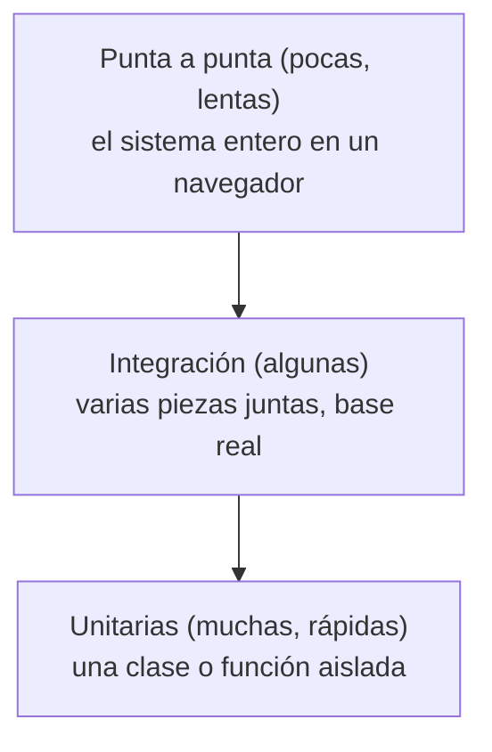

# 14 — Pruebas (tests)

## 1. Para qué sirven

Una **prueba automática** es código que usa tu código y verifica que dé el resultado esperado.
Probar a mano cada pantalla después de cada cambio es lento y se olvidan casos. Las pruebas:

- Detectan errores **antes** de que lleguen al usuario.
- Permiten **cambiar con confianza**: si rompiste algo, una prueba se pone en rojo en segundos.
- **Documentan** cómo se tiene que comportar el sistema ("vence hoy → POR_VENCER").
- **Demuestran** cosas difíciles de ver a mano (dos transferencias al mismo milisegundo).

## 2. Estructura de una prueba: Preparar, Actuar, Verificar

```java
@Test
void unLoteQueVenceHoyNoEstaVencido() {
    // Preparar (Arrange / Given)
    LocalDate hoy = LocalDate.of(2026, 11, 12);
    Lote lote = loteQueVence(hoy);

    // Actuar (Act / When)
    boolean vencido = lote.estaVencido(hoy);

    // Verificar (Assert / Then)
    assertThat(vencido).isFalse();
}
```

El nombre de la prueba dice **qué comportamiento** se espera. Si falla, el nombre ya explica qué se
rompió.

## 3. Tipos de prueba



| Tipo | Qué prueba | Velocidad | Ejemplo del proyecto |
|---|---|---|---|
| **Unitaria** | Una clase o función sola. Lo demás se reemplaza por simulaciones. | Milisegundos. | `LoteTest`, `TransferenciaServiceTest`, `fechas.test.ts` |
| **Integración** | Varias piezas juntas: controlador + servicio + base real. | Segundos. | `FlujoCompletoIT`, `SeguridadIT` |
| **Punta a punta (e2e)** | El sistema completo como lo usa una persona, en un navegador. | Decenas de segundos. | `e2e/capturas.spec.ts` |

## 4. Herramientas del backend

| Herramienta | Para qué |
|---|---|
| **JUnit 5** | Marca y ejecuta las pruebas (`@Test`, `@ParameterizedTest`, `@BeforeEach`). |
| **AssertJ** | Verificaciones legibles: `assertThat(stock).isEqualTo(40)`. |
| **Mockito** | **Simulaciones** (*mocks*): objetos falsos que reemplazan dependencias. |
| **MockMvc** | Simula pedidos HTTP a la API sin levantar un servidor de verdad. |
| **Testcontainers** | Levanta un **PostgreSQL real** en Docker para las pruebas de integración. |
| **JaCoCo** | Mide qué porcentaje del código ejecutaron las pruebas (cobertura). |

Convención de nombres: `*Test` = unitarias (las corre Surefire), `*IT` = integración (las corre
Failsafe). `./mvnw verify` corre las dos.

### Mocks: probar el servicio sin base

`TransferenciaServiceTest` prueba el FEFO sin base de datos. Al servicio se le pasan repositorios
**falsos** que devuelven los lotes que la prueba quiere:

```java
// Esquema simplificado (no es copia literal de la prueba)
// Preparar: el repositorio falso devuelve tres lotes con distintos vencimientos
when(loteRepository.bloquearDisponibles(any(), any())).thenReturn(List.of(loteMarzo, loteDiciembre, loteEnero));

// Actuar
TransferenciaResponse r = servicio.transferir(pedidoDe(150));

// Verificar: se tomó primero el que vence antes
assertThat(r.detalle()).extracting("numeroLote").containsExactly("DIC", "ENE");
```

Por eso la inyección por constructor importa: permite pasar estos falsos.

### Reloj fijo

En las pruebas, el bean `Clock` se reemplaza por uno **fijo** (`RelojFijoConfig`): "hoy" es siempre
la misma fecha. Así "vence hoy", "venció ayer" y "vence en 31 días" dan siempre igual, cualquier
día que se corran.

### Testcontainers: una base de verdad

```java
@TestConfiguration
class ContenedoresConfig {
    @Bean
    @ServiceConnection                       // Spring se conecta solo a este contenedor
    PostgreSQLContainer postgres() {
        return new PostgreSQLContainer(DockerImageName.parse("postgres:16-alpine"));   // la misma imagen que docker-compose
    }
}
```

¿Por qué no una base en memoria (H2)? Porque se quiere probar lo que hace **PostgreSQL**: los
`CHECK`, el `FOR UPDATE`, el SQL específico. Una prueba que pasa con otra base podría fallar en
producción.

Todas las pruebas de integración heredan de `IntegracionBase`, así comparten **un solo contenedor y
un solo contexto de Spring** (arranca una vez, no 10).

### La prueba de concurrencia, explicada

`TransferenciaConcurrenciaIT.dosTransferenciasSimultaneasNoDejanStockNegativo`:

1. Crea un lote de **100**.
2. Prepara **dos hilos** (dos "personas") que piden **60** cada uno.
3. Un `CountDownLatch` hace de "largada": los dos esperan la señal y arrancan **a la vez**.
4. Junta los resultados.
5. Verifica: **exactamente uno** recibió 201 y el otro 409; el stock final es **40**.

Esta prueba **no** es `@Transactional` (si lo fuera, todo pasaría en una sola transacción y no
habría concurrencia real).

## 5. Herramientas del frontend

| Herramienta | Para qué |
|---|---|
| **Vitest** | Ejecuta las pruebas (como JUnit). |
| **Testing Library** | Dibuja un componente y lo usa como una persona: busca por texto o rol, hace clic, escribe. |
| **jsdom** | Un "navegador simulado" dentro de Node. |
| **user-event** | Simula escritura y clics realistas. |
| **Playwright** | Maneja un Chrome real para la prueba punta a punta. |
| **axe-core** | Revisa la accesibilidad de cada pantalla. |

Ejemplo (esquema simplificado de lo que hace `NuevaTransferencia.test.tsx`; los nombres de las
funciones auxiliares son ilustrativos):

```tsx
test('si falta stock, marca la línea y no pierde lo cargado', async () => {
  // el fetch falso responde 409 con faltantes
  responder409ConFaltantes({ medicamentoId: 5, disponible: 12, solicitado: 20 });
  render(<PaginaNuevaTransferencia />);

  await agregarLinea('Paracetamol', 20);
  await user.click(screen.getByRole('button', { name: 'Revisar y confirmar' }));
  await user.click(screen.getByRole('button', { name: 'Confirmar transferencia' }));

  expect(await screen.findByText(/Disponible: 12 \(pediste 20\)/)).toBeInTheDocument();
  expect(screen.getByDisplayValue('20')).toBeInTheDocument();   // la línea sigue ahí
});
```

Se busca por **rol y texto visible** (`getByRole('button', { name: ... })`), igual que lo haría una
persona o un lector de pantalla. Si la prueba encuentra el botón, también lo encuentra un usuario
ciego.

## 6. La prueba punta a punta

`frontend/e2e/capturas.spec.ts` abre Chrome, ingresa como admin y recorre **16 pantallas**. En cada
una espera a que terminen las cargas y las animaciones, corre **axe** (falla ante problemas de
accesibilidad serios o críticos) y guarda una **captura** en `docs/capturas/`. Esas capturas son
las del informe y el manual.

## 7. Cómo correrlas

| Dónde | Comando | Qué necesitás |
|---|---|---|
| `backend/` | `./mvnw verify` (PowerShell: `.\mvnw.cmd verify`) | Docker corriendo. |
| `backend/` | `./mvnw test -Dtest=LoteTest` | Una sola clase. |
| `frontend/` | `npm test` | Nada más. |
| `frontend/` | `npx vitest NuevaTransferencia` | Un solo archivo. |
| `frontend/` | `npm run capturas` | La app levantada y `npx playwright install chromium` la primera vez. |

Cobertura del backend: `backend/target/site/jacoco/index.html` (abrilo en el navegador).

## 8. TDD (desarrollo guiado por pruebas)

1. **Rojo:** escribir una prueba de algo que todavía no existe. Falla.
2. **Verde:** escribir el código mínimo para que pase.
3. **Refactorizar:** mejorar el código, con la prueba como red de seguridad.

Se usó en la lógica crítica: FEFO, alertas, CUIT, reglas del lote, y en el frontend en el cliente
HTTP y la nueva transferencia.

## 9. Mapa: qué prueba cada cosa importante

| Si te preguntan… | La prueba es… |
|---|---|
| "¿Cómo sabés que el FEFO funciona?" | `TransferenciaServiceTest` (unitaria) y `FlujoCompletoIT` (integración). |
| "¿Y con dos personas a la vez?" | `TransferenciaConcurrenciaIT`. |
| "¿Cómo sabés que no se ve el hash?" | `SeguridadIT.ningunaRespuestaExponeLaContrasenaNiElHash`. |
| "¿Y los bordes de vencimiento?" | `AlertaServiceTest`. |
| "¿Y si falta la clave del JWT?" | `ConfiguracionTest`. |
| "¿Los movimientos cierran con el stock?" | `FlujoCompletoIT`. |
| "¿El CUIT se valida igual en front y back?" | `CuitValidatorTest` y `cuit.test.ts` usan los mismos ejemplos. |
| "¿Es accesible?" | `capturas.spec.ts` con axe. |
| "¿Un texto malicioso rompe la pantalla?" | `seguridad.test.tsx`. |

## Resumen

| Concepto | En una frase |
|---|---|
| Prueba unitaria | Una pieza sola, con simulaciones. Rápida. |
| Prueba de integración | Varias piezas juntas, con base real. |
| Prueba e2e | El sistema entero en un navegador. |
| Mock | Objeto falso que reemplaza una dependencia. |
| Testcontainers | PostgreSQL real en Docker durante las pruebas. |
| Reloj fijo | "Hoy" constante para que las pruebas de fechas sean estables. |
| TDD | Rojo → verde → refactorizar. |
