# Manual de usuario

Sistema de Gestión de Stock — Farmacia Hospitalaria

Este manual explica cómo usar el sistema día a día. No hace falta saber de informática: cada tarea
está paso a paso. Las imágenes son de la versión de demostración (los datos son de ejemplo).

## Contenido

1. [Antes de empezar](#1-antes-de-empezar)
2. [Ingresar al sistema](#2-ingresar-al-sistema)
3. [La pantalla principal](#3-la-pantalla-principal)
4. [El Panel](#4-el-panel)
5. [Registrar un ingreso de mercadería](#5-registrar-un-ingreso-de-mercadería)
6. [Hacer una transferencia a un área](#6-hacer-una-transferencia-a-un-área)
7. [Lotes y vencimientos: bajas y ajustes](#7-lotes-y-vencimientos-bajas-y-ajustes)
8. [Medicamentos](#8-medicamentos)
9. [Historial de transferencias y comprobantes](#9-historial-de-transferencias-y-comprobantes)
10. [Reportes](#10-reportes)
11. [Proveedores](#11-proveedores)
12. [Áreas](#12-áreas)
13. [Usuarios (solo administradores)](#13-usuarios-solo-administradores)
14. [Mi cuenta y contraseña](#14-mi-cuenta-y-contraseña)
15. [Mensajes del sistema y qué hacer](#15-mensajes-del-sistema-y-qué-hacer)
16. [Preguntas frecuentes](#16-preguntas-frecuentes)
17. [Atajos y accesibilidad](#17-atajos-y-accesibilidad)

---

## 1. Antes de empezar

### Qué necesitás

- Una computadora con **Google Chrome** o **Microsoft Edge** actualizado.
- La dirección del sistema que te da el área de sistemas del hospital. [COMPLETAR: dirección]
- Tu **usuario** y **contraseña**. Los crea el administrador del sistema. No hay forma de
  registrarse sola o solo.

### Qué puede hacer cada rol

| Tarea | Administrador | Farmacéutico | Consulta |
|---|:-:|:-:|:-:|
| Ver el panel, medicamentos, lotes, transferencias, proveedores y áreas | ✓ | ✓ | ✓ |
| Sacar reportes en Excel y PDF | ✓ | ✓ | ✓ |
| Registrar ingresos de mercadería | ✓ | ✓ | — |
| Hacer transferencias a las áreas | ✓ | ✓ | — |
| Dar de baja lotes vencidos y ajustar cantidades | ✓ | ✓ | — |
| Crear y modificar medicamentos, proveedores y áreas | ✓ | ✓ | — |
| Crear y administrar usuarios | ✓ | — | — |

Si no ves un botón o una opción del menú que aparece en este manual, es porque tu rol no la tiene.

### Palabras que vas a ver

| Palabra | Qué quiere decir |
|---|---|
| **Lote** | Partida de un medicamento con un número (el que está impreso en la caja) y una fecha de vencimiento. |
| **FEFO** | "Primero vence, primero sale". El sistema elige solo de qué lote sacar: siempre del que vence antes. |
| **Vencido** | Venció **antes de hoy**. El mismo día del vencimiento todavía se puede usar. |
| **Por vencer** | Vence dentro de los próximos 30 días. |
| **Stock bajo** | Hay unidades, pero igual o menos que el mínimo definido para ese medicamento. |
| **Sin stock** | No quedan unidades que se puedan usar. |
| **Dar de baja** (un medicamento, proveedor, área o usuario) | Desactivarlo. No se borra: se puede **Reactivar** cuando quieras y su historial queda. |

---

## 2. Ingresar al sistema

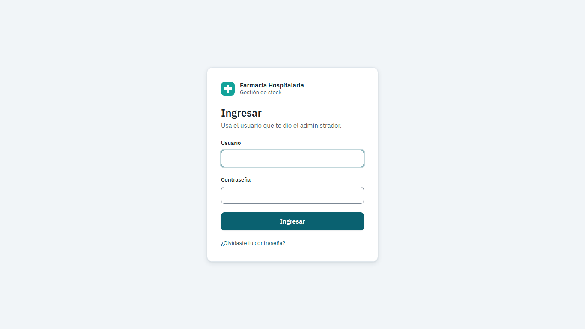

1. Abrí la dirección del sistema en el navegador.
2. Escribí tu **Usuario** y tu **Contraseña**.
3. Presioná **Ingresar** (o la tecla Enter).

Mientras verifica, el botón dice "Ingresando…". Si los datos están bien, aparece el **Panel**.

- Si ves **"Usuario o contraseña incorrectos."**: revisá que no esté activada la tecla Bloq Mayús en
  la contraseña. El usuario puede ir en mayúsculas o minúsculas.
- La sesión dura **8 horas** (un turno). **5 minutos antes** de que venza aparece un aviso: "Tu
  sesión vence a las HH:MM. Guardá lo que estés cargando." Cuando vence, el sistema te pide ingresar
  de nuevo con el mensaje "Tu sesión expiró. Volvé a ingresar." y te devuelve a la pantalla donde
  estabas.
- Si cerrás la pestaña del navegador, la sesión se cierra.

### Olvidé mi contraseña

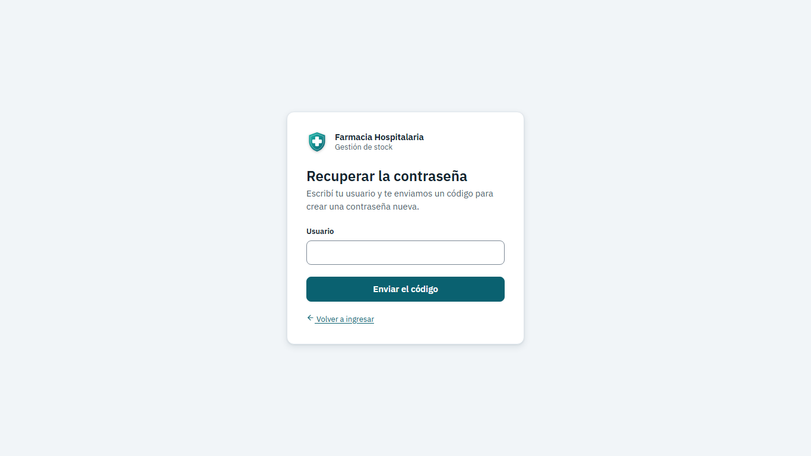

1. En la pantalla de ingreso, hacé clic en **¿Olvidaste tu contraseña?**
2. Escribí tu **Usuario** y presioná **Enviar el código**.
3. Vas a recibir un **código de 6 números**. [En la versión actual el envío por correo es simulado:
   el código se muestra en pantalla en el modo demostración. En el hospital, pedile el código o un
   restablecimiento al administrador.] [COMPLETAR según cómo se instale]
4. Escribí el **Código**, la **Contraseña nueva** y **Repetir la contraseña nueva** (entre 8 y 72
   caracteres). Presioná **Crear la contraseña nueva**.
5. Aparece "Listo, ya podés ingresar con tu contraseña nueva."

El código **vence a los 15 minutos** y sirve **una sola vez**. Si te equivocás 5 veces, deja de
servir: usá **Pedir otro código**.

---

## 3. La pantalla principal

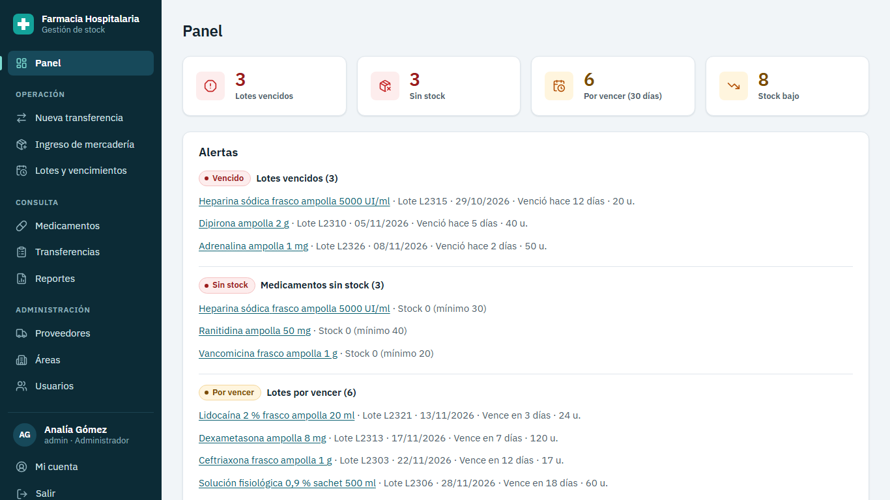

- **A la izquierda**, el menú:
  - **Panel**: resumen del día.
  - **Operación**: *Nueva transferencia*, *Ingreso de mercadería*, *Lotes y vencimientos*.
  - **Consulta**: *Medicamentos*, *Transferencias*, *Reportes*.
  - **Administración**: *Proveedores*, *Áreas*, *Usuarios*.
  - **Abajo**: tu nombre y rol, **Mi cuenta** y **Salir**.
- **A la derecha**, la pantalla elegida, con su título arriba y los botones de acción a la derecha
  del título.
- En pantallas chicas (o con mucho zoom), el menú se esconde: usá el botón **Menú** de arriba.
- Los **avisos** (por ejemplo "Se registró el lote…") aparecen abajo a la derecha. Los de éxito se
  van solos a los 5 segundos; los de error quedan hasta que los cerrás con la **X**.

### Cómo funcionan las listas

Todas las listas (medicamentos, lotes, transferencias…) funcionan igual:

- **Buscar**: escribí en el buscador; la lista se actualiza sola al dejar de escribir.
- **Filtros**: los desplegables de arriba (estado, área, fechas).
- **Incluir inactivos**: marcala para ver también lo que fue dado de baja.
- **Ordenar**: hacé clic en el título de una columna con flecha. Otro clic invierte el orden.
- **Páginas**: abajo, **Anterior** y **Siguiente**. "Mostrando 1–20 de 57" indica cuántos hay.
- Si recargás la página o volvés atrás, los filtros se mantienen. Podés copiar la dirección y
  mandársela a un compañero: va a ver la misma lista filtrada.

### Colores y estados

Los estados siempre tienen **una palabra** además del color:

| Insignia | Significado |
|---|---|
| 🔴 **Vencido** / **Sin stock** | Hay que actuar ya. |
| 🟠 **Por vencer** / **Stock bajo** | Requiere atención pronto. |
| 🟢 **OK** / **Vigente** | Todo en orden. |
| ⚪ **Agotado** / **Inactivo** | Sin unidades o dado de baja. |

---

## 4. El Panel

Es la primera pantalla después de ingresar.

- **Cuatro indicadores** arriba: **Vencidos**, **Sin stock**, **Por vencer (30 días)** y **Stock
  bajo**, con la cantidad de cada uno. Hacé clic en uno para ir a la lista filtrada.
- **Alertas**: los medicamentos y lotes con problemas, en este orden: vencidos, sin stock, por
  vencer y stock bajo. Si hay muchos, **Ver todos**. Si no hay ninguno: "No hay alertas. El stock y
  los vencimientos están en orden."
- **Últimas transferencias**: las 5 más recientes. Hacé clic en el número para ver el comprobante.
- **Unidades por área (30 días)**: cuántas unidades se entregaron a cada área en el último mes,
  con una barra para comparar.

**Rutina recomendada al empezar el turno:** mirar el Panel; si hay **Vencidos**, ir a darlos de
baja (sección 7); si hay **Sin stock** o **Stock bajo**, avisar para reponer.

---

## 5. Registrar un ingreso de mercadería

Cuando llega mercadería de un proveedor. Rol: Administrador o Farmacéutico.

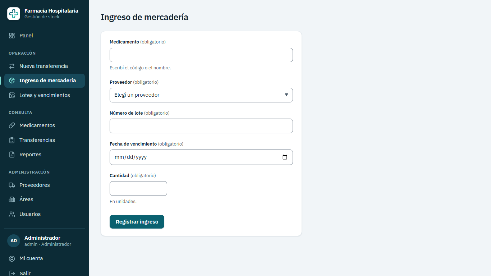

1. En el menú, **Ingreso de mercadería**. (O desde el detalle de un medicamento, **Registrar
   ingreso**: el medicamento ya viene elegido.)
2. **Medicamento**: escribí parte del código o del nombre y elegí de la lista (con el mouse o con
   las flechas y Enter). Solo aparecen medicamentos activos.
3. **Proveedor**: elegí de la lista (solo activos).
4. **Número de lote**: tal como está impreso en la caja.
5. **Vencimiento**: la fecha impresa en la caja. No se puede cargar una fecha pasada.
6. **Cantidad**: unidades recibidas (mayor a 0).
7. Presioná **Registrar ingreso**.

Aparece: "Se registró el lote L2345. Stock de *medicamento*: 340." Para cargar otra caja del mismo
proveedor, **Registrar otro lote** (el proveedor queda elegido).

- Si el lote **vence en los próximos 30 días**, el sistema te avisa ("Podés registrarlo igual."):
  no bloquea, pero conviene usarlo primero (el sistema lo hará solo por FEFO).
- Si ese número de lote **ya existe** para ese medicamento, el sistema no lo deja cargar dos veces.
  Revisá si ya lo cargó otra persona.
- Si cargaste mal una cantidad, corregila con un **Ajuste** (sección 7).

---

## 6. Hacer una transferencia a un área

Cuando un área (Guardia, UTI…) retira medicamentos. Rol: Administrador o Farmacéutico.

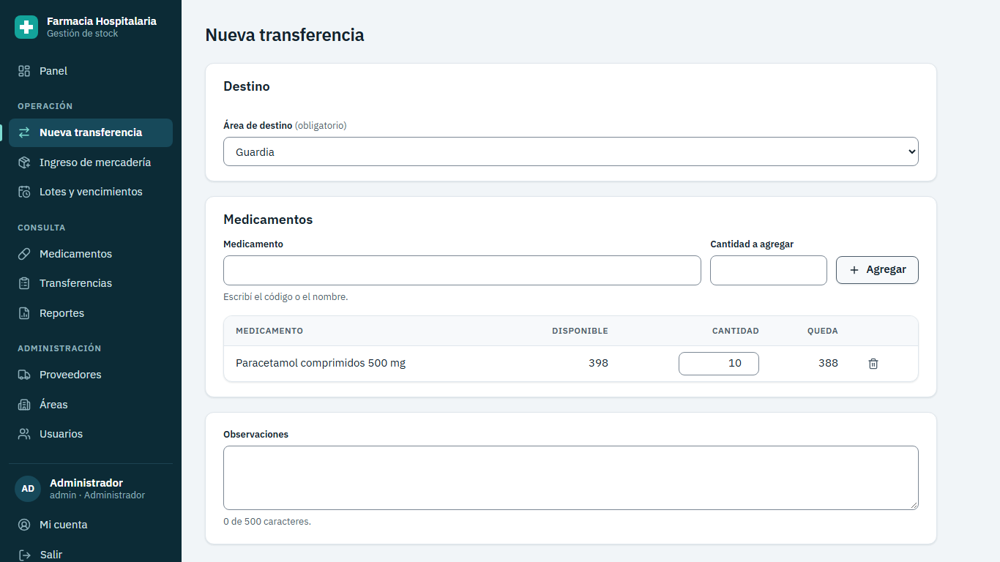

1. En el menú, **Nueva transferencia**.
2. **Área de destino**: elegí el área.
3. En **Medicamentos**, escribí el código o nombre en **Medicamento**, elegilo, poné la
   **Cantidad a agregar** y presioná **Agregar**.
4. La línea aparece en la tabla con **Disponible** (lo que hay) y **Queda** (lo que va a quedar).
   Podés cambiar la cantidad en la tabla o quitar la línea con el ícono de tacho.
5. Repetí para cada medicamento. Si agregás uno que ya está, **se suma** a su línea ("Se sumó a la
   línea de…").
6. Si querés, escribí **Observaciones** (hasta 500 caracteres; por ejemplo, quién retiró).
7. Presioná **Revisar y confirmar**. Se abre un resumen con el stock que va a quedar.
8. Presioná **Confirmar transferencia** (mientras se registra dice "Registrando…"). Aparece el **comprobante**.

**No tenés que elegir el lote:** el sistema saca automáticamente del que **vence primero**. Si un
lote no alcanza, sigue con el siguiente. El comprobante muestra de qué lote salió cada unidad.

Detalles importantes:

- **Lo que cargás no se pierde**: si cerrás la pantalla sin confirmar o se vence la sesión, la
  próxima vez que entres a *Nueva transferencia* (en la misma pestaña) vas a encontrar lo cargado.
  Para empezar de cero, **Descartar**.
- **Si mientras tanto otra persona usó ese stock** y ya no alcanza, el sistema **no descuenta
  nada**: cierra el resumen y marca cada línea con problema, por ejemplo "Disponible: 12 (pediste
  20)". Corregí las cantidades y volvé a confirmar.
- Los lotes **vencidos nunca se entregan**, aunque tengan unidades.
- Una transferencia confirmada **no se puede modificar ni anular**. Si hubo un error (por ejemplo,
  el área devolvió medicamentos), se corrige con un **Ajuste** del lote (sección 7), explicando el
  motivo.

### Imprimir el comprobante

En el comprobante, **Imprimir** muestra solo el comprobante, legible en blanco y negro, con espacio
para **la firma de quien entrega y de quien recibe**. **Descargar PDF** guarda el mismo documento.

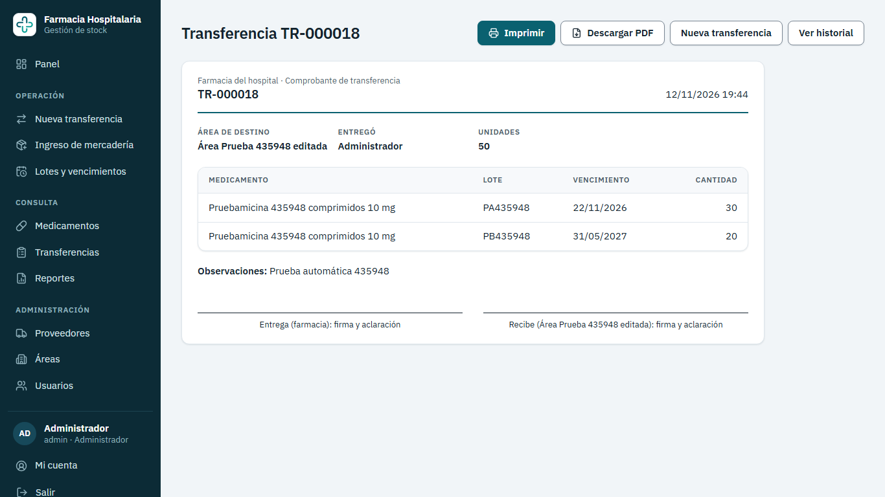

---

## 7. Lotes y vencimientos: bajas y ajustes

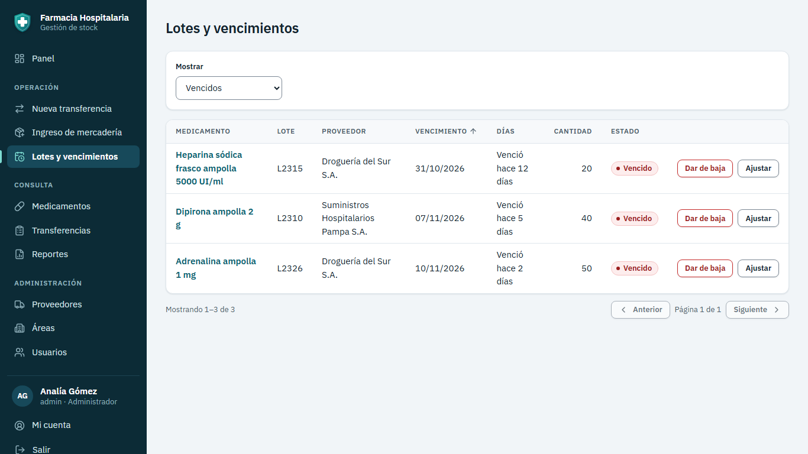

En el menú, **Lotes y vencimientos**. Con **Mostrar** elegís: **Vencidos**, **Por vencer** o
**Todos con stock**. La columna **Días** dice "Vence en N días" o "Venció hace N días".

### Dar de baja un lote vencido

Cuando se retira mercadería vencida para su destrucción. Rol: Administrador o Farmacéutico.

1. En **Mostrar**, elegí **Vencidos**.
2. En la fila del lote, **Dar de baja**.
3. Escribí el **motivo** (entre 5 y 200 caracteres; por ejemplo "Vencido, retirado para
   destrucción, acta 123").
4. Confirmá.

El lote queda en 0 y se registra el movimiento "Baja por vencimiento". Solo se pueden dar de baja
lotes **vencidos** que tengan unidades.

### Ajustar un lote

Cuando el conteo real no coincide con el sistema (rotura, pérdida, error de carga, devolución).

1. En la fila del lote, **Ajustar**.
2. Escribí la **cantidad nueva** (la que hay realmente; entre 0 y la cantidad que ingresó
   originalmente, y distinta de la actual).
3. Escribí el **motivo** (5 a 200 caracteres; por ejemplo "Rotura de 2 ampollas").
4. **Guardar ajuste**.

Queda registrado un movimiento "Ajuste" con la diferencia (+ o −), tu usuario y el motivo.

---

## 8. Medicamentos

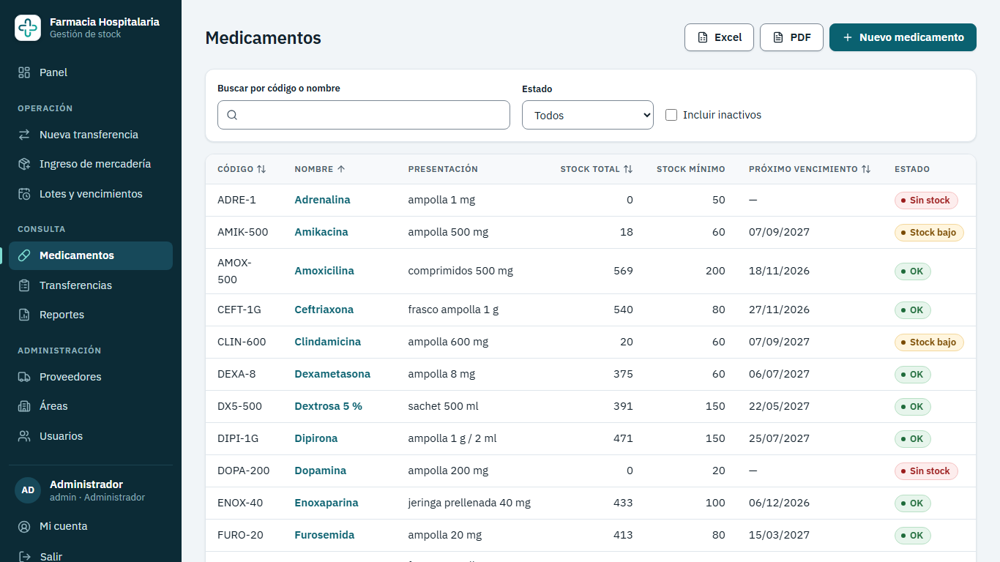

En el menú, **Medicamentos**. Columnas: código, nombre, presentación, stock total, stock mínimo,
próximo vencimiento y estado. Se puede buscar por código o nombre y filtrar por estado.

- El **stock total** solo cuenta los lotes **no vencidos**.
- **Próximo vencimiento** es la fecha del lote con unidades que vence primero.

### Ver el detalle

Hacé clic en el nombre. Vas a ver los datos, los **lotes con stock** (del que vence primero al
último) y los **movimientos de stock** (del más reciente al más antiguo): ingresos, egresos, bajas y
ajustes, con la cantidad, el saldo que quedó, quién lo hizo y el motivo o la transferencia.

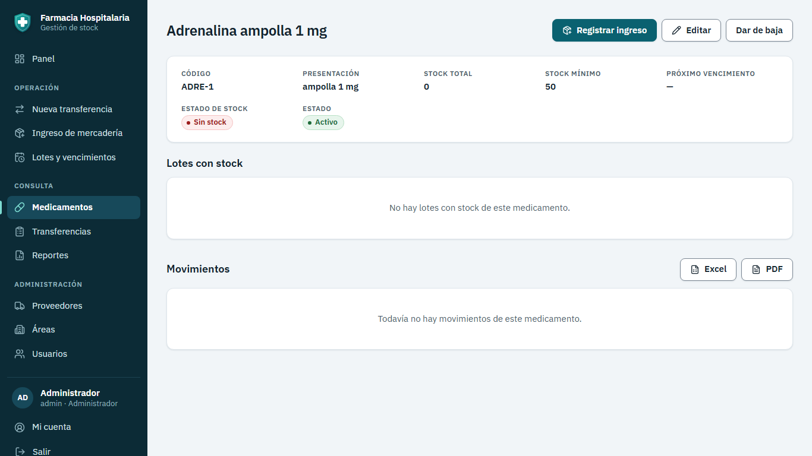

### Crear o editar

1. **Nuevo medicamento** (en la lista) o **Editar** (en el detalle).
2. Completá **Código** (único, se guarda en mayúsculas, por ejemplo `AMOX-500`), **Nombre**
   (genérico), **Presentación** (por ejemplo "comprimidos 500 mg") y **Stock mínimo** (cuando el
   stock llegue a este número o menos, aparece la alerta de stock bajo).
3. **Guardar**.

### Dar de baja o reactivar

En el detalle, **Dar de baja**, y confirmá. **No se puede** dar de baja un medicamento que tiene
unidades no vencidas: el sistema te lo explica en el mismo cuadro. Primero hay que transferirlas o
ajustarlas. Para volver a usarlo, **Reactivar**.

---

## 9. Historial de transferencias y comprobantes

En el menú, **Transferencias**. Por defecto muestra los **últimos 30 días**. Filtros: **Desde**,
**Hasta** y **Área**. Columnas: número, fecha y hora, área, usuario, ítems y unidades.

- Hacé clic en el número (`TR-000123`) para ver e imprimir el comprobante.
- **Exportar a Excel** / **Exportar a PDF** descarga todo lo filtrado (no solo la página visible).
  Hacen falta las dos fechas y el rango no puede superar 366 días.

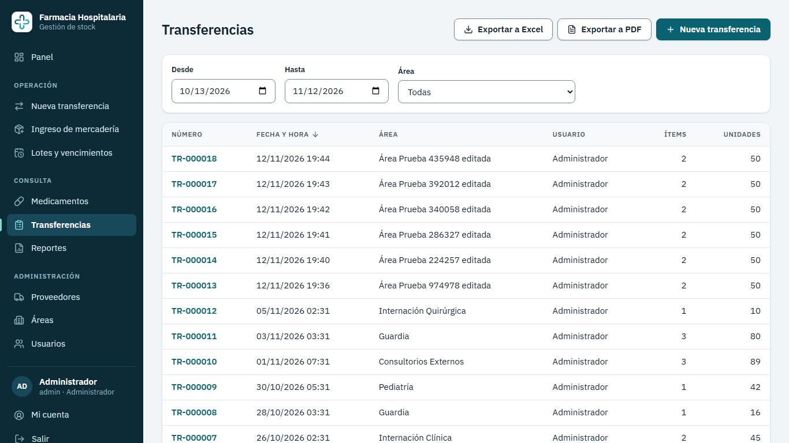

---

## 10. Reportes

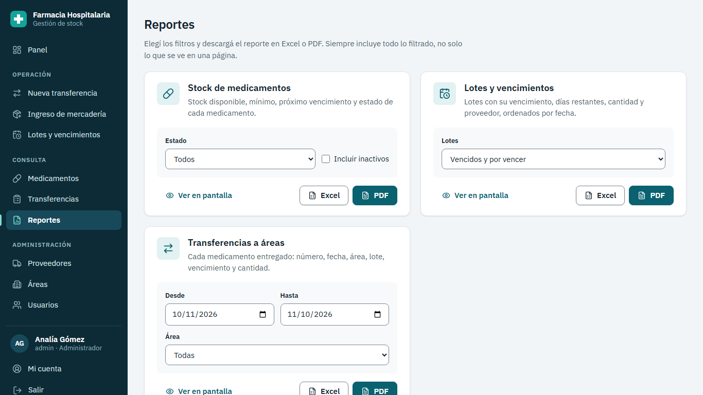

En el menú, **Reportes**. Hay tres:

| Reporte | Qué muestra | Filtros |
|---|---|---|
| **Stock de medicamentos** | Stock disponible, mínimo, próximo vencimiento y estado de cada medicamento. | Estado, Incluir inactivos. |
| **Lotes y vencimientos** | Lotes con su vencimiento, días restantes, cantidad y proveedor, ordenados por fecha. | Vencidos y por vencer, Solo vencidos, Solo por vencer, Todos con stock. |
| **Transferencias a áreas** | Cada medicamento entregado: número, fecha, área, lote, vencimiento y cantidad. | Desde, Hasta, Área. |

En cada uno:

- **Ver en pantalla** abre la lista correspondiente con esos filtros.
- **Excel** descarga una planilla `.xlsx` lista para ordenar, filtrar y sumar.
- **PDF** descarga un documento para imprimir o mandar por correo.

Mientras se genera, el botón dice "Descargando…". El archivo queda en la carpeta **Descargas**.

---

## 11. Proveedores

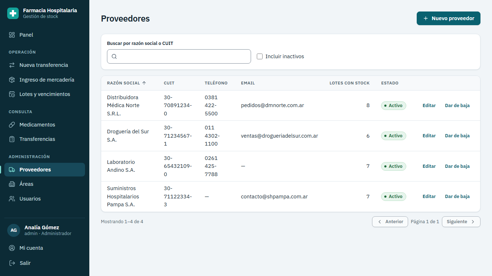

En el menú, **Proveedores**.

- **Nuevo proveedor**: **Razón social**, **CUIT** (se escribe con o sin guiones; el sistema lo
  muestra como `XX-XXXXXXXX-X` y verifica que sea un CUIT válido), **Teléfono** y **Correo**
  (opcionales). **Guardar**.
- **Editar**: cambia los datos.
- **Dar de baja**: si el proveedor tiene lotes con stock, el sistema avisa: "Tiene N lotes con
  stock. Van a seguir disponibles, pero no vas a poder elegir este proveedor en ingresos nuevos."
  Se puede **Reactivar** después.

Si el sistema dice que el CUIT no es válido, revisá los números: el último dígito es un
verificador que se calcula con los anteriores.

---

## 12. Áreas

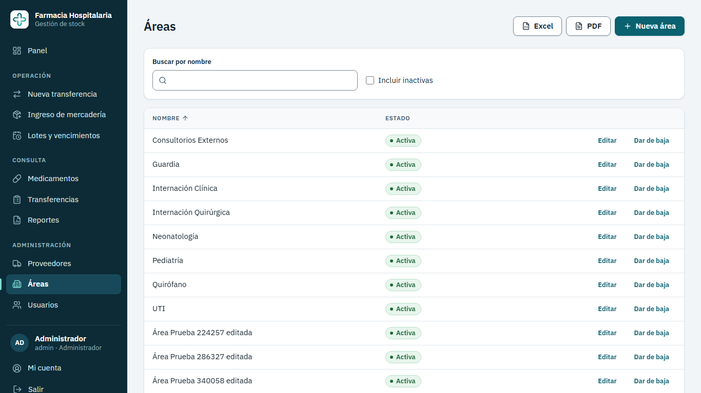

En el menú, **Áreas**. **Nueva área** para agregar (el nombre no puede repetirse), **Editar** para
renombrar y **Dar de baja** / **Reactivar**. Un área dada de baja no aparece al hacer
transferencias, pero su historial se mantiene.

---

## 13. Usuarios (solo administradores)

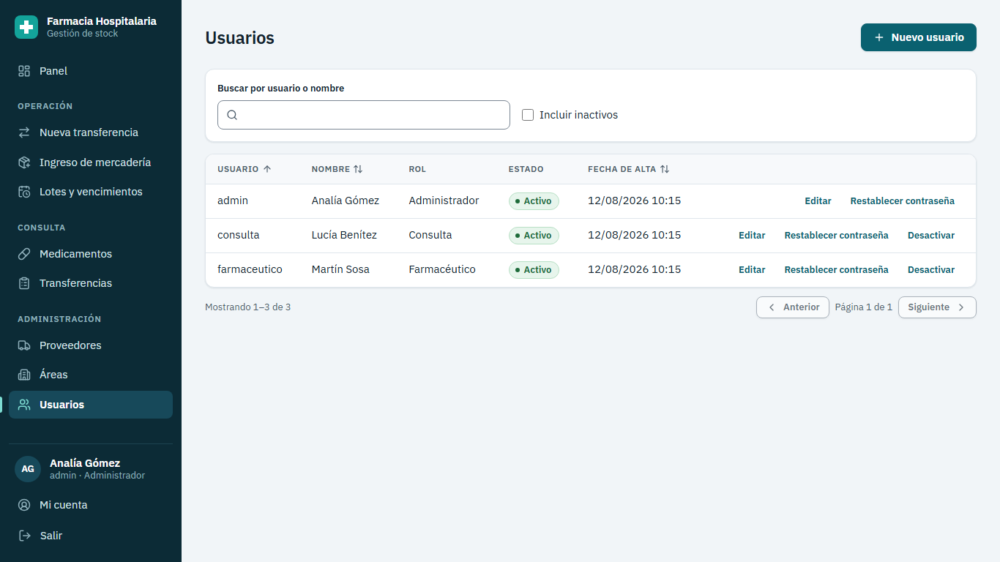

En el menú, **Usuarios**.

- **Nuevo usuario**: **Usuario** (con el que va a ingresar, no se puede repetir), **Nombre
  completo**, **Rol** (Administrador, Farmacéutico o Consulta) y **Contraseña inicial** (8 a 72
  caracteres). Comunicale la contraseña en persona y pedile que la cambie desde **Mi cuenta**.
- **Editar**: cambia el nombre completo y el rol. El cambio de rol es **inmediato**, aunque la
  persona tenga la sesión abierta.
- **Desactivar** / **Activar**: una persona desactivada pierde el acceso en su próxima acción. No
  podés desactivarte a vos mismo.
- **Restablecer contraseña**: le asignás una contraseña nueva (por ejemplo, si la olvidó).

El sistema no deja **desactivar ni quitarle el rol al último administrador activo**, para que
nunca quede sin nadie que pueda gestionar usuarios.

---

## 14. Mi cuenta y contraseña

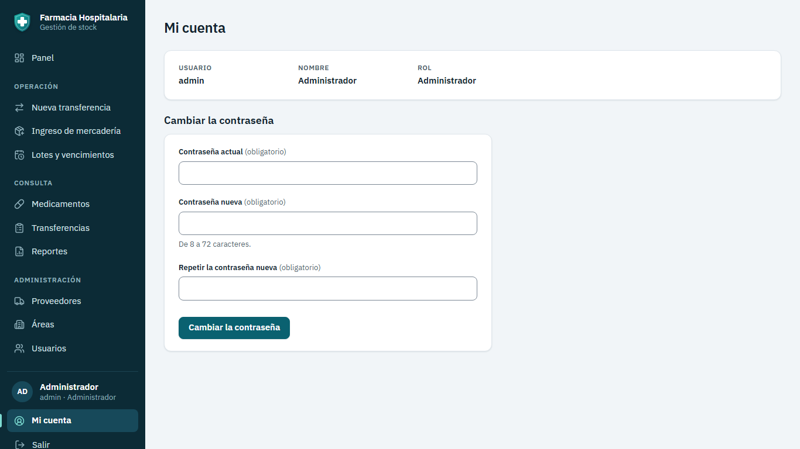

Abajo a la izquierda, **Mi cuenta**. Muestra tus datos y permite **Cambiar la contraseña**:
contraseña actual, la nueva y repetirla (8 a 72 caracteres).

Recomendaciones: usá una frase larga que recuerdes fácil (por ejemplo, tres palabras y un número),
no la compartas y no la anotes a la vista. Al terminar el turno, presioná **Salir**,
especialmente en computadoras compartidas.

---

## 15. Mensajes del sistema y qué hacer

| Mensaje | Qué pasó | Qué hacer |
|---|---|---|
| Usuario o contraseña incorrectos. | Datos mal escritos, usuario inexistente o desactivado. | Revisar Bloq Mayús; si sigue, pedir ayuda al administrador. |
| Tu sesión expiró. Volvé a ingresar. | Pasaron 8 horas o te desactivaron. | Ingresar de nuevo. Lo que estabas cargando en una transferencia se conserva. |
| No tenés permiso para esta acción. | Tu rol no permite esa tarea. | Pedírsela a quien tenga el rol adecuado. |
| No tenés permiso para ver esta página. | Entraste a una dirección que tu rol no puede ver. | Volver al Panel. |
| Stock insuficiente de *X*: disponible *N*, solicitado *M*. | No alcanzan las unidades no vencidas. | Bajar la cantidad o revisar si hay un ingreso sin registrar. |
| El área *X* está inactiva. | Alguien dio de baja el área. | Reactivarla en **Áreas** o elegir otra. |
| La fecha de vencimiento no puede ser anterior a hoy. | Fecha mal cargada. | Revisar la fecha de la caja. |
| Ya existe un medicamento con el código *X*. (y mensajes parecidos para CUIT, usuario, área o lote) | El dato tiene que ser único. | Buscar el existente en la lista (quizás está inactivo: marcá "Incluir inactivos"). |
| No se puede dar de baja *X* porque todavía tiene stock sin vencer. | El medicamento tiene unidades no vencidas. | Transferirlas o ajustarlas antes. |
| El lote *L…* todavía no venció: no se puede dar de baja. | Se intentó dar de baja un lote vigente. | Si hay que retirarlo, usar **Ajustar** con el motivo. |
| El lote *L…* ya no tiene stock. | El lote ya estaba en 0. | Nada que hacer. |
| No se pudo conectar con el servidor. | Problema de red o el sistema está caído. | Verificar la conexión; avisar a sistemas. |
| El servidor tardó demasiado en responder. | El servidor no respondió en 15 segundos. | Esperar un momento y reintentar. Revisar si la operación se hizo antes de repetirla. |
| Ocurrió un error en el servidor. Código: *xxxx*. | Error inesperado. | Anotar el código y avisar a sistemas: con ese código encuentran el problema. |

---

## 16. Preguntas frecuentes

**¿Puedo elegir de qué lote sacar en una transferencia?**
No. El sistema aplica FEFO: siempre saca del que vence primero, para que nada se venza en el
depósito. Si hay que retirar un lote puntual (por ejemplo, por un retiro del laboratorio), se usa
un **Ajuste** con el motivo.

**Me equivoqué en una transferencia, ¿cómo la anulo?**
Las transferencias no se anulan, para que el historial sea confiable. Si el área devuelve la
mercadería, hacé un **Ajuste** de cada lote sumando lo devuelto y escribí en el motivo el número de
transferencia (por ejemplo "Devolución de TR-000123").

**Cargué mal la cantidad de un ingreso.**
Hacé un **Ajuste** del lote con la cantidad correcta y el motivo "Error de carga".

**Cargué mal la fecha de vencimiento o el número de lote.**
Esos datos no se editan para no alterar la trazabilidad. Ajustá el lote a 0 con el motivo "Carga
errónea" y registrá el ingreso correcto.

**¿Por qué un lote que vence hoy no aparece como vencido?**
Porque se puede usar hasta el último día. Mañana va a aparecer como vencido.

**¿Por qué el stock total de un medicamento es menor que la suma de sus lotes?**
Porque el stock total no cuenta los lotes vencidos (no se pueden entregar). Esos aparecen en
*Lotes y vencimientos → Vencidos* para darlos de baja.

**¿Se borra algo cuando doy de baja?**
No. Dar de baja desactiva; con **Reactivar** vuelve. Nada del historial se pierde.

**¿Puedo usar el sistema desde el celular?**
Se puede abrir, pero está pensado para computadora. Para cargar transferencias conviene una pantalla
de al menos 1024 píxeles de ancho.

**¿Qué pasa si dos personas transfieren el mismo medicamento al mismo tiempo?**
El sistema las ordena: la primera se registra y la segunda solo si sigue alcanzando el stock. El
stock nunca queda negativo.

---

## 17. Atajos y accesibilidad

- Todo se puede usar **con teclado**: **Tab** para avanzar, **Shift + Tab** para retroceder,
  **Enter** para activar, **Escape** para cerrar un cuadro de diálogo.
- En el buscador de medicamentos: **flechas** para moverse, **Enter** para elegir, **Escape** para
  cerrar la lista.
- Al principio de cada página hay un enlace oculto **"Saltar al contenido"** (aparece con Tab).
- Funciona con lectores de pantalla (NVDA, JAWS, Narrador).
- Si tu sistema operativo tiene activado "reducir movimiento", el sistema no hace animaciones de
  desplazamiento.
- Para agrandar el texto: **Ctrl + +** (y **Ctrl + 0** para volver al tamaño normal).

---

**Soporte:** [COMPLETAR: contacto del área de sistemas del hospital o del responsable del sistema].
