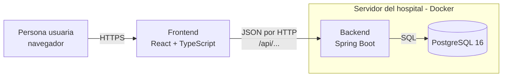
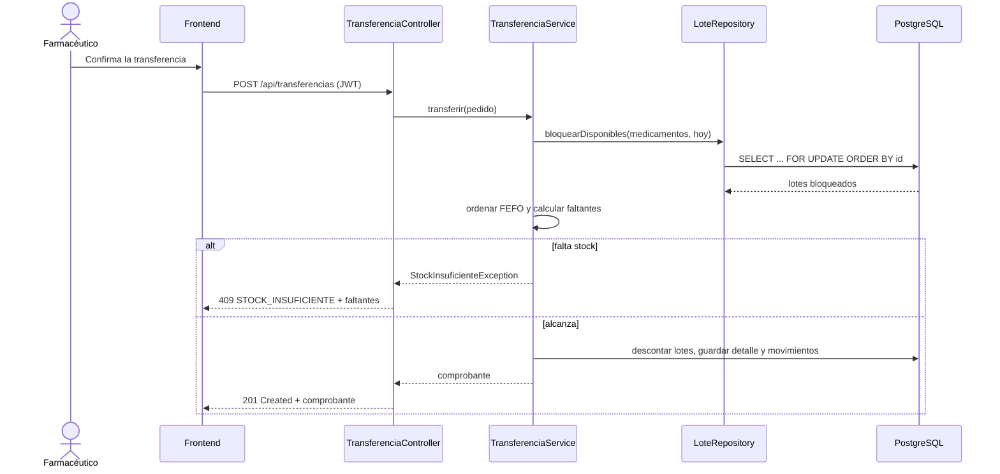
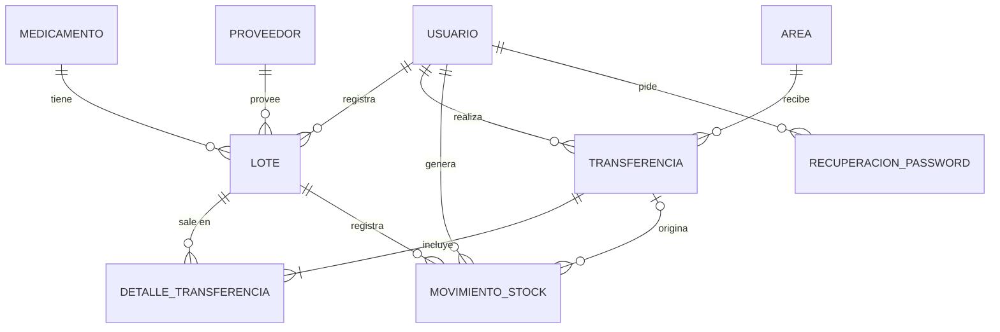
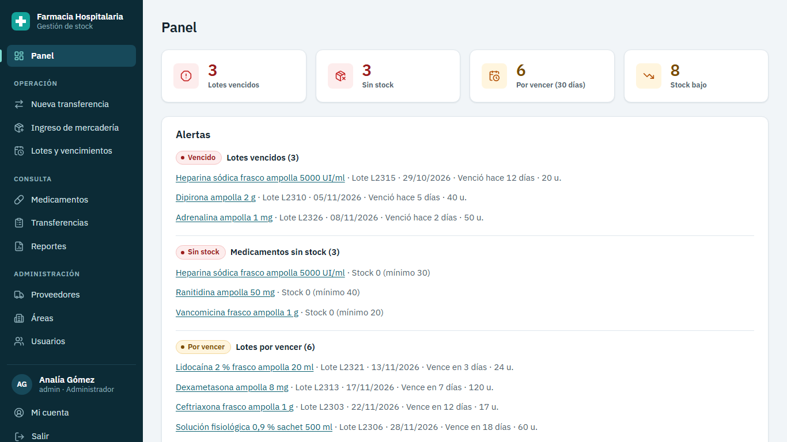
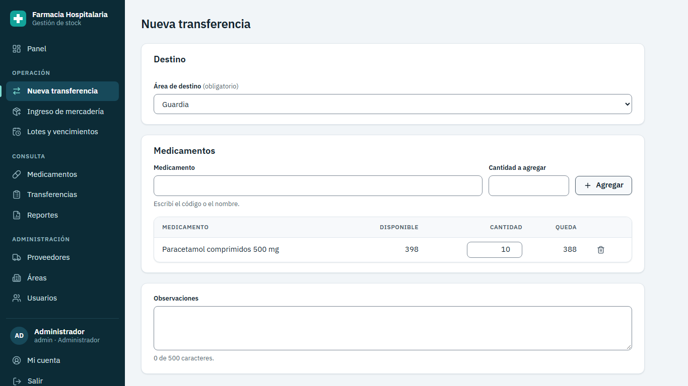
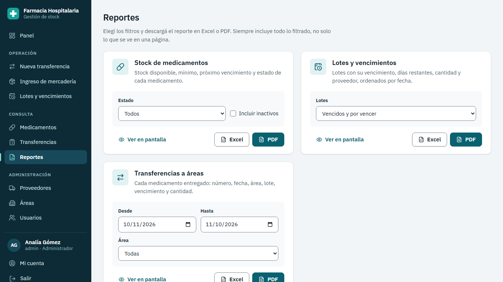

# Sistema de Gestión de Stock para la Farmacia de un Hospital Público

**Trabajo Final Integrador**
Tecnicatura Universitaria en Programación — Universidad Tecnológica Nacional

| | |
|---|---|
| Autor/a | [COMPLETAR: nombre y apellido] |
| Legajo | [COMPLETAR] |
| Comisión | [COMPLETAR] |
| Docente / tutor/a | [COMPLETAR] |
| Fecha de entrega | [COMPLETAR] (versión del sistema: noviembre de 2026) |
| Repositorio | [COMPLETAR: URL del repositorio en GitHub] |

---

## Resumen

Las farmacias de los hospitales públicos controlan medicamentos que vencen, que se entregan
todos los días a distintas áreas (Guardia, UTI, Pediatría, Quirófano…) y cuya falta puede afectar
la atención de pacientes. En muchos casos ese control se hace con planillas de cálculo o con
sistemas hechos a medida que no registran los lotes ni los vencimientos.

Este trabajo presenta un **sistema web de gestión de stock por lote** para la farmacia de un
hospital público. Permite administrar el catálogo de medicamentos, proveedores y áreas; registrar
el ingreso de mercadería por lote con su fecha de vencimiento; transferir medicamentos a las
áreas del hospital aplicando automáticamente el criterio **FEFO** (*First Expired, First Out*:
primero sale lo que vence primero); dar de baja lotes vencidos; ajustar diferencias de inventario;
ver alertas de stock bajo, sin stock, por vencer y vencido; y generar reportes en pantalla, Excel
y PDF. El acceso está protegido con usuarios, contraseñas cifradas, tokens JWT y tres roles con
permisos distintos (Administrador, Farmacéutico y Consulta). Incluye recuperación de contraseña
simulada.

El sistema se construyó con una arquitectura cliente-servidor: un **backend** en Java 21 con
Spring Boot 4.1 que expone una API REST, una base de datos **PostgreSQL 16** normalizada hasta
la tercera forma normal y versionada con Flyway, y un **frontend** en React 19 con TypeScript.
Se verificó con 100 pruebas automatizadas en el backend (unitarias y de integración contra una base
PostgreSQL real) y 101 en el frontend, además de pruebas de accesibilidad automáticas.

**Palabras clave:** gestión de stock, farmacia hospitalaria, FEFO, trazabilidad por lote,
Spring Boot, React, PostgreSQL, API REST, JWT.

---

## Índice

1. [Introducción](#1-introducción)
2. [Planteamiento del problema](#2-planteamiento-del-problema)
3. [Objetivos](#3-objetivos)
4. [Alcance y límites](#4-alcance-y-límites)
5. [Marco teórico](#5-marco-teórico)
6. [Metodología de trabajo](#6-metodología-de-trabajo)
7. [Análisis](#7-análisis)
8. [Diseño](#8-diseño)
9. [Implementación](#9-implementación)
10. [Pruebas y aseguramiento de la calidad](#10-pruebas-y-aseguramiento-de-la-calidad)
11. [Resultados](#11-resultados)
12. [Mejora propuesta y presupuesto](#12-mejora-propuesta-y-presupuesto)
13. [Conclusiones](#13-conclusiones)
14. [Trabajo futuro](#14-trabajo-futuro)
15. [Bibliografía y referencias](#15-bibliografía-y-referencias)
16. [Anexos](#16-anexos)

---

## 1. Introducción

La farmacia de un hospital público es el lugar donde se recibe, se guarda y se distribuye la
medicación que usan los servicios del hospital. Cada día llegan pedidos de las áreas (Guardia,
Unidad de Terapia Intensiva, Pediatría, Neonatología, Quirófano, Internación, Consultorios
Externos) y la farmacia les entrega los medicamentos. A su vez, la farmacia recibe mercadería de
distintos proveedores (droguerías), y cada partida llega identificada con un **número de lote** y
una **fecha de vencimiento**.

Que un medicamento venza en el depósito significa dinero público perdido. Que falte cuando la
Guardia lo necesita puede significar un problema para un paciente. Por eso el control no puede ser
solo "cuántas cajas hay": hace falta saber **de qué lote**, **cuándo vence** cada uno y **a dónde
fue** cada unidad.

Este informe describe el desarrollo de un sistema que resuelve ese control. Primero se plantea el
problema y los objetivos (secciones 2 a 4); después se presentan los conceptos teóricos en los que
se apoya (sección 5) y la forma de trabajo (sección 6); luego se describen el análisis, el diseño
y la implementación (secciones 7 a 9); se presentan las pruebas y los resultados (secciones 10 y
11); y por último se proponen una mejora con su presupuesto y las conclusiones.

## 2. Planteamiento del problema

### 2.1 Situación inicial

El punto de partida fue un **prototipo** anterior que cubría parte de la gestión de stock, pero que
tenía problemas graves de diseño y de seguridad. Al analizarlo se encontraron estos ocho:

| # | Problema del prototipo | Consecuencia |
|---|---|---|
| 1 | Los permisos dependían de un identificador de usuario que mandaba el navegador en una cabecera. | Cualquiera podía hacerse pasar por otro usuario cambiando ese valor. |
| 2 | La clave para firmar los tokens de sesión estaba escrita en el código. | Quien tuviera el código podía fabricar sesiones válidas. |
| 3 | El stock podía quedar negativo y una cantidad negativa sumaba stock. | Datos de inventario imposibles; se podía "crear" mercadería. |
| 4 | La API devolvía el hash de la contraseña dentro de los datos de los productos. | Exposición de credenciales. |
| 5 | Cualquiera podía registrarse sin estar logueado. | Acceso libre a un sistema interno. |
| 6 | Las fechas se guardaban como texto y no había alertas de vencimiento. | Imposible ordenar o calcular vencimientos; mercadería vencida sin aviso. |
| 7 | Borrar un proveedor borraba en cascada sus productos y el historial. | Pérdida irreversible de información. |
| 8 | Errores genéricos sin mensaje, sin tests y dependencias mezcladas. | Imposible diagnosticar fallas o asegurar que un cambio no rompa algo. |

### 2.2 Problema a resolver

La farmacia necesita un sistema **confiable y seguro** que:

- registre el stock **por lote**, con su vencimiento y su proveedor;
- asegure que el stock **nunca** quede en valores imposibles, aun cuando dos personas registren
  entregas al mismo tiempo;
- entregue primero lo que vence primero, sin depender de que la persona elija bien el lote;
- avise a tiempo qué está por vencer, qué venció y qué falta;
- deje **trazabilidad** completa: quién hizo cada movimiento, cuándo, de qué lote y para qué área;
- controle quién puede hacer qué;
- y permita sacar reportes para la dirección del hospital.

## 3. Objetivos

### 3.1 Objetivo general

Desarrollar un sistema web de gestión de stock por lote para la farmacia de un hospital público
que permita registrar ingresos, transferencias a áreas, bajas y ajustes con trazabilidad completa,
aplique el criterio FEFO, genere alertas de vencimiento y de stock, y produzca reportes, con
control de acceso por roles y sin repetir los problemas del prototipo anterior.

### 3.2 Objetivos específicos

1. Relevar las reglas de negocio de una farmacia hospitalaria (lotes, vencimientos, FEFO,
   transferencias, bajas) y expresarlas como requisitos verificables.
2. Diseñar un modelo de datos relacional normalizado hasta la tercera forma normal, con claves
   primarias y foráneas, restricciones de integridad y sin borrados en cascada.
3. Implementar una API REST con autenticación por JWT, autorización por permisos y manejo de
   errores uniforme.
4. Implementar las transferencias con criterio FEFO, "todo o nada" y control de concurrencia, de
   modo que el stock nunca quede negativo.
5. Implementar alertas de stock bajo, sin stock, por vencer y vencido, calculadas con la fecha de
   Argentina.
6. Construir una interfaz web clara, accesible (WCAG 2.1 AA) y difícil de usar mal.
7. Generar reportes en pantalla y exportables a Excel y PDF.
8. Verificar el sistema con pruebas automatizadas que demuestren que cada problema del prototipo
   está resuelto.
9. Proponer una mejora al sistema y presupuestar el desarrollo.

## 4. Alcance y límites

### 4.1 Incluido

- Gestión de usuarios (alta, edición, baja lógica, restablecimiento de contraseña) con tres roles.
- Inicio de sesión, cambio de contraseña propia y recuperación de contraseña simulada.
- Catálogo de medicamentos, proveedores (con validación de CUIT) y áreas, con bajas lógicas.
- Ingreso de mercadería por lote.
- Transferencias a áreas con FEFO y comprobante imprimible con lugar para firmas.
- Bajas de lotes vencidos y ajustes de inventario con motivo.
- Historial de movimientos de stock.
- Panel con indicadores, alertas, últimas transferencias y consumo por área.
- Reportes de stock, de lotes y vencimientos, y de transferencias, en pantalla, Excel y PDF.

### 4.2 Fuera de alcance (decisión explícita)

- Datos de pacientes, recetas o historia clínica: las transferencias van a **áreas**, no a personas.
- Registro especial de psicotrópicos y estupefacientes.
- Varios hospitales o varios depósitos.
- Compras y órdenes a proveedores (se propone como mejora en la sección 12).
- Anulación de transferencias: un error se corrige con un ajuste, para no borrar historial.
- Envío real de correos, segundo factor de autenticación, límite de intentos de login y tokens de
  renovación (*refresh tokens*).
- Aplicación móvil nativa e internacionalización.

## 5. Marco teórico

### 5.1 Gestión de stock en farmacia hospitalaria

- **Lote:** conjunto de unidades de un medicamento fabricadas juntas, identificadas con un número
  y con una misma fecha de vencimiento. Es la unidad de trazabilidad: si un laboratorio retira un
  lote, hay que saber dónde está cada unidad.
- **FEFO (First Expired, First Out):** criterio de despacho según el cual sale primero la
  mercadería que vence primero. Se diferencia de FIFO (*First In, First Out*), que despacha primero
  lo que entró primero: con medicamentos, puede entrar después un lote que vence antes, y FIFO lo
  dejaría vencer.
- **Stock mínimo:** cantidad por debajo de la cual hay que reponer. Sirve para generar la alerta
  de stock bajo.
- **Transferencia (o dispensa a servicio):** entrega de medicamentos desde la farmacia a un área
  del hospital. Se documenta con un comprobante firmado por quien entrega y quien recibe.
- **Baja por vencimiento:** retiro del stock de un lote vencido, que luego se destruye según la
  normativa.
- **Ajuste de inventario:** corrección del stock cuando el conteo físico no coincide con el
  sistema (roturas, pérdidas, errores de carga).

### 5.2 Arquitectura cliente-servidor y API REST

El sistema sigue una arquitectura **cliente-servidor**: el navegador (cliente) muestra la interfaz
y pide datos a un servidor, que aplica las reglas y guarda la información en una base de datos. La
comunicación usa **HTTP** con datos en formato **JSON**, siguiendo el estilo **REST**
(*Representational State Transfer*, Fielding, 2000): cada recurso tiene una URL
(`/api/medicamentos/5`) y se opera con los métodos HTTP (`GET` para leer, `POST` para crear, `PUT`
para reemplazar, `PATCH` para modificar en parte). El resultado se informa con códigos de estado
(200 correcto, 201 creado, 400 datos inválidos, 401 sin sesión, 403 sin permiso, 404 no existe,
409 conflicto con una regla, 500 error del servidor). Los errores siguen el estándar **RFC 9457
(Problem Details for HTTP APIs)**.

### 5.3 Arquitectura en capas

El backend separa responsabilidades en capas:

- **Controlador:** recibe el pedido HTTP, valida el formato y llama al servicio. No tiene lógica.
- **Servicio:** aplica las reglas de negocio dentro de una **transacción**.
- **Repositorio:** lee y escribe en la base de datos.
- **Entidad:** representa una tabla y protege sus propias reglas (invariantes).
- **DTO (Data Transfer Object):** objeto con los datos que entran o salen por la API. Nunca se
  devuelve una entidad, para no exponer datos internos (como el hash de la contraseña).

### 5.4 Bases de datos relacionales y normalización

Una base de datos relacional guarda los datos en **tablas** con filas y columnas. Cada tabla
tiene una **clave primaria** que identifica cada fila, y las relaciones entre tablas se expresan
con **claves foráneas**. La **normalización** (Codd, 1970) es el proceso de organizar las tablas
para evitar redundancias y anomalías:

- **Primera forma normal (1FN):** valores atómicos, sin grupos repetidos.
- **Segunda forma normal (2FN):** 1FN y todo atributo depende de la clave completa.
- **Tercera forma normal (3FN):** 2FN y ningún atributo no clave depende de otro atributo no clave
  (sin dependencias transitivas).

Una **transacción** agrupa operaciones que se ejecutan todas o ninguna, con las propiedades
**ACID** (atomicidad, consistencia, aislamiento y durabilidad). Para evitar que dos transacciones
simultáneas modifiquen el mismo dato de forma inconsistente se usan **bloqueos**: el *bloqueo
pesimista* (`SELECT … FOR UPDATE`) reserva las filas hasta que la transacción termina.

### 5.5 Seguridad en aplicaciones web

- **Autenticación** (quién sos) y **autorización** (qué podés hacer) son problemas distintos.
- Las contraseñas no se guardan: se guarda su **hash** calculado con **BCrypt**, un algoritmo
  lento a propósito y con sal aleatoria, para que no se puedan revertir ni probar millones por
  segundo.
- **JWT (JSON Web Token, RFC 7519):** token firmado que el servidor entrega al iniciar sesión y que
  el cliente manda en cada pedido (`Authorization: Bearer …`). La firma (HMAC-SHA256) impide
  modificarlo sin conocer la clave secreta.
- **Control de acceso basado en roles (RBAC):** cada usuario tiene un rol y cada rol, un conjunto
  de permisos.
- Riesgos considerados según **OWASP Top 10**: control de acceso roto, fallas criptográficas,
  inyección (SQL y fórmulas en CSV), XSS, configuración insegura y exposición de datos sensibles.

### 5.6 Tecnologías utilizadas

| Capa | Tecnología | Para qué |
|---|---|---|
| Lenguaje del servidor | Java 21 (LTS) | Lenguaje tipado, robusto y estándar en la industria. |
| Framework del servidor | Spring Boot 4.1 | Servidor web, inyección de dependencias, seguridad, acceso a datos. |
| Seguridad | Spring Security 7 + OAuth2 Resource Server | Validación de JWT, permisos por método. |
| Acceso a datos | Spring Data JPA + Hibernate | Mapear tablas a clases y hacer consultas. |
| Base de datos | PostgreSQL 16 | Base relacional libre, con soporte de restricciones y bloqueos. |
| Migraciones | Flyway | Versionar el esquema de la base como código. |
| Reportes | OpenPDF, fastexcel | Generar PDF y planillas Excel (.xlsx). |
| Lenguaje del cliente | TypeScript | JavaScript con tipos, para detectar errores al compilar. |
| Biblioteca de interfaz | React 19 | Construir la interfaz con componentes reutilizables. |
| Ruteo | React Router 8 | Navegar entre pantallas sin recargar la página. |
| Datos del servidor | TanStack Query 5 | Caché, carga, errores y actualización de los datos. |
| Herramienta de compilación | Vite 8 | Servidor de desarrollo y compilación del frontend. |
| Contenedores | Docker y Docker Compose | Levantar base y servidor con un solo comando. |
| Pruebas del servidor | JUnit 5, Mockito, AssertJ, MockMvc, Testcontainers | Pruebas unitarias y de integración contra PostgreSQL real. |
| Pruebas del cliente | Vitest, Testing Library, Playwright, axe-core | Pruebas de componentes, de punta a punta y de accesibilidad. |
| Calidad | Spotless, ESLint, Prettier, knip | Formato y reglas de código automáticas. |
| Control de versiones | Git y GitHub | Historial de cambios e integración continua. |

## 6. Metodología de trabajo

Se trabajó de forma **iterativa e incremental**, en **rebanadas verticales**: cada rebanada
entrega una funcionalidad completa de punta a punta (migración de base de datos, entidad,
repositorio, servicio, controlador, pantalla y pruebas) en lugar de construir primero toda la base,
después todo el servidor y al final toda la interfaz. Así cada etapa deja algo que funciona y se
puede probar.

Las rebanadas del backend fueron, en orden:

1. Esqueleto del proyecto, perfiles de configuración, formato automático y base de pruebas.
2. Manejo de errores y seguridad (login, permisos, 401/403).
3. Usuarios.
4. Áreas y proveedores (con validación de CUIT).
5. Medicamentos (con stock calculado).
6. Lotes: ingreso, baja por vencimiento, ajuste y movimientos.
7. Transferencias FEFO y concurrencia.
8. Alertas, resumen y exportación.
9. Datos de demostración, Docker, documentación de la API e integración continua.

Prácticas aplicadas:

- **Especificación antes del código:** cada endpoint y cada pantalla tiene criterios de aceptación
  verificables (`docs/spec.md`, `docs/spec-frontend.md`).
- **Desarrollo guiado por pruebas (TDD)** en la lógica crítica: FEFO, alertas, validación de CUIT
  y reglas del lote. Primero se escribe la prueba que falla y después el código.
- **Registro de decisiones:** cada decisión de diseño se anotó con su justificación en el momento
  (`docs/decisiones.md`).
- **Commits chicos** con el formato *Conventional Commits* y descripción en español
  (`feat(transferencia): descontar stock con criterio FEFO`).
- **Integración continua** con GitHub Actions: cada cambio subido compila y corre todas las pruebas.
- Durante el desarrollo se usó un **asistente de programación con inteligencia artificial** como
  herramienta, siempre con revisión, pruebas automáticas y criterios de aceptación definidos de
  antemano. [COMPLETAR o quitar según lo que indique la cátedra sobre el uso de IA].

## 7. Análisis

El detalle completo está en la carpeta del proyecto
([requisitos](../carpeta-del-proyecto/01-relevamiento-y-requisitos.md) y
[casos de uso](../carpeta-del-proyecto/02-casos-de-uso.md)). Aquí se resume.

### 7.1 Actores

| Actor | Rol en el sistema | Qué puede hacer |
|---|---|---|
| Jefe/a de farmacia o responsable del sistema | **ADMIN** | Todo, incluida la gestión de usuarios. |
| Farmacéutico/a o técnico/a de farmacia | **FARMACEUTICO** | Operar el stock: catálogo, ingresos, transferencias, bajas y ajustes. |
| Dirección, auditoría, otras áreas | **CONSULTA** | Solo consultar y sacar reportes. |

### 7.2 Requisitos funcionales principales

| Código | Requisito |
|---|---|
| RF01 | Iniciar sesión con usuario y contraseña; cerrar sesión. |
| RF02 | Recuperar la contraseña olvidada con un código de un solo uso. |
| RF03 | Cambiar la contraseña propia. |
| RF04 | Administrar usuarios y su rol (solo ADMIN). |
| RF05 | Administrar medicamentos, proveedores y áreas, con bajas lógicas y reactivación. |
| RF06 | Registrar el ingreso de un lote de un medicamento. |
| RF07 | Transferir medicamentos a un área con criterio FEFO. |
| RF08 | Ver e imprimir el comprobante de una transferencia. |
| RF09 | Dar de baja un lote vencido, con motivo. |
| RF10 | Ajustar la cantidad de un lote, con motivo. |
| RF11 | Consultar el historial de movimientos de un medicamento. |
| RF12 | Ver alertas de sin stock, stock bajo, por vencer y vencido. |
| RF13 | Ver un panel con indicadores, alertas, últimas transferencias y consumo por área. |
| RF14 | Generar reportes en pantalla, Excel y PDF: stock, lotes y vencimientos, transferencias, movimientos, alertas, proveedores, áreas y usuarios. |

### 7.3 Requisitos no funcionales principales

| Código | Requisito |
|---|---|
| RNF01 | Seguridad: contraseñas con BCrypt, sesión con JWT firmado, permisos validados en el servidor. |
| RNF02 | Integridad: el stock nunca es negativo, aun con pedidos simultáneos. |
| RNF03 | Trazabilidad: cada cambio de stock deja un movimiento con usuario, fecha y motivo. |
| RNF04 | Fecha y hora siempre de Argentina (America/Argentina/Buenos_Aires). |
| RNF05 | Accesibilidad WCAG 2.1 nivel AA. |
| RNF06 | Usabilidad: textos en español, estados siempre con palabra y color, confirmación de acciones irreversibles. |
| RNF07 | Mantenibilidad: código en capas, formato automático, pruebas automáticas. |
| RNF08 | Portabilidad: se levanta con Docker en cualquier sistema operativo. |
| RNF09 | Software libre: sin costo de licencias. |

### 7.4 Reglas de negocio clave

1. **Vencido** quiere decir que la fecha de vencimiento es **anterior** a hoy. El mismo día del
   vencimiento el lote todavía se puede usar.
2. **Por vencer**: lote con stock que vence entre hoy y dentro de 30 días (configurable).
3. **Stock bajo**: medicamento activo con stock mayor a 0 y menor o igual a su stock mínimo.
4. **Sin stock**: medicamento activo con stock 0.
5. El **stock total** de un medicamento es la suma de sus lotes **no vencidos**; no se guarda,
   se calcula.
6. Una transferencia toma los lotes en orden **FEFO**; con igual vencimiento decide la fecha de
   ingreso y después el número interno del lote.
7. Una transferencia es **todo o nada**: si falta stock de cualquier ítem, no se descuenta nada y
   se informan **todos** los faltantes.
8. Un lote vencido **nunca** se transfiere.
9. Nada se borra: usuarios, medicamentos, proveedores y áreas se **desactivan**.
10. Un medicamento con stock no vencido no se puede desactivar.
11. Nadie puede desactivarse a sí mismo ni dejar el sistema sin administradores activos.

## 8. Diseño

### 8.1 Arquitectura general



El frontend es una **aplicación de una sola página** (SPA): se descarga una vez y después solo
pide datos al backend. El backend no genera páginas; solo responde datos (JSON) o archivos (Excel,
PDF). En producción, un servidor **nginx** entrega el frontend y reenvía las llamadas `/api/` al
backend, así el navegador ve un único origen y no hace falta configurar CORS.

### 8.2 Diseño del backend

Organización **por funcionalidad** (cada carpeta es un tema del negocio) y, dentro de cada una,
**por capas**:

```
ar.edu.utn.farmacia
├── auth/           login, JWT, roles, permisos, recuperación de contraseña
├── usuario/        gestión de usuarios
├── proveedor/      proveedores y validación de CUIT
├── area/           áreas del hospital
├── medicamento/    catálogo y stock calculado
├── lote/           lotes, ingresos, bajas, ajustes y movimientos
├── transferencia/  transferencias FEFO, comprobante y exportación
├── alerta/         alertas y resumen del panel
├── common/         errores, reloj, reportes (CSV, Excel, PDF), utilidades
└── demo/           datos de demostración (solo en el perfil demo)
```

Ejemplo del flujo de un pedido de transferencia:



### 8.3 Modelo de datos

Nueve tablas: `usuario`, `proveedor`, `area`, `medicamento`, `lote`, `transferencia`,
`detalle_transferencia`, `movimiento_stock` y `recuperacion_password`.



Decisiones principales:

- **Claves primarias sustitutas** (`id` numérico autogenerado) y la clave natural protegida con
  `UNIQUE` (código del medicamento, CUIT, nombre de usuario, nombre del área, medicamento + número
  de lote).
- **Claves foráneas sin cascada**: nada se borra físicamente.
- **Restricciones `CHECK`**: `0 ≤ cantidad_actual ≤ cantidad_inicial`, cantidades positivas,
  roles y tipos de movimiento válidos, CUIT de 11 dígitos.
- **Nada calculable se guarda**: el stock total, el estado de un lote, el número de comprobante
  (`TR-000123`) y los totales de una transferencia se calculan. Esto mantiene la **3FN**.
- **Redundancia controlada**: `movimiento_stock.saldo_resultante` guarda el saldo después de cada
  movimiento como dato de auditoría inmutable.
- `detalle_transferencia` resuelve la relación **muchos a muchos** entre transferencias y lotes.

El diccionario de datos completo y la justificación de la normalización tabla por tabla están en
[`carpeta-del-proyecto/04-modelo-de-datos.md`](../carpeta-del-proyecto/04-modelo-de-datos.md).

### 8.4 Diseño de la seguridad

| Aspecto | Solución |
|---|---|
| Contraseñas | BCrypt con factor de costo 12; mínimo 8 y máximo 72 caracteres. |
| Sesión | JWT firmado con HMAC-SHA256, válido 8 horas (un turno). Solo lleva el id del usuario. |
| Clave del JWT | Variable de entorno `JWT_SECRET` de al menos 32 bytes; sin ella el sistema no arranca. |
| Permisos | Seis permisos agrupados en tres roles. Se leen de la base **en cada pedido**: dar de baja a alguien o cambiarle el rol tiene efecto inmediato. |
| Errores de acceso | 401 si no hay sesión válida; 403 si hay sesión pero falta el permiso. Siempre en JSON. |
| Datos expuestos | Las respuestas son DTO; ninguna contiene la contraseña ni su hash. |
| Registro | No existe registro público: solo un administrador crea usuarios. |
| Login | El mismo mensaje para usuario inexistente, inactivo o contraseña incorrecta (no revela qué usuarios existen). |
| Recuperación | Código de 6 dígitos, guardado con hash, vence en 15 minutos, máximo 5 intentos. |
| Frontend | Token en `sessionStorage` (se borra al cerrar la pestaña), política de seguridad de contenido (CSP) estricta en nginx, sin `innerHTML`. |
| Exportación | Protección contra inyección de fórmulas en CSV (valores que empiezan con `=`, `+`, `-`, `@`). |

Matriz de permisos:

| Permiso | Habilita | ADMIN | FARMACÉUTICO | CONSULTA |
|---|---|:-:|:-:|:-:|
| `LECTURA` | Ver todo (salvo usuarios) y sacar reportes | ✓ | ✓ | ✓ |
| `CATALOGO_EDITAR` | Alta, edición y baja de medicamentos, proveedores y áreas | ✓ | ✓ | — |
| `STOCK_INGRESAR` | Ingreso de lotes | ✓ | ✓ | — |
| `STOCK_BAJA_AJUSTE` | Bajas por vencimiento y ajustes | ✓ | ✓ | — |
| `TRANSFERENCIA_CREAR` | Crear transferencias | ✓ | ✓ | — |
| `USUARIO_GESTIONAR` | Gestionar usuarios | ✓ | — | — |

### 8.5 Diseño de la interfaz

- Menú lateral agrupado en **Operación** (nueva transferencia, ingreso de mercadería, lotes y
  vencimientos), **Consulta** (medicamentos, transferencias, reportes) y **Administración**
  (proveedores, áreas, usuarios). Cada persona ve solo lo que su rol permite.
- Estilo sobrio y hospitalario: menú oscuro, tarjetas blancas, color verde azulado como
  principal, rojo para lo vencido o peligroso, ámbar para lo que requiere atención.
- **Los estados siempre tienen palabra**, no solo color ("Vencido", "Por vencer", "Sin stock",
  "Stock bajo", "OK"), para personas con daltonismo y para impresión en blanco y negro.
- Acciones irreversibles con **confirmación** en un cuadro de diálogo.
- Filtros, orden y página guardados en la URL: se puede compartir un enlace o volver atrás sin
  perder la vista.
- Contraste de colores verificado (WCAG AA), uso completo con teclado, foco visible, animaciones
  cortas que se desactivan si el sistema operativo pide reducir el movimiento.

## 9. Implementación

### 9.1 Transferencias con FEFO y control de concurrencia

Es la parte más delicada del sistema. El algoritmo (en `TransferenciaService.transferir`) es:

1. **Sumar ítems repetidos**: si se pidió dos veces el mismo medicamento, se suman las cantidades.
2. **Validar** que el área y los medicamentos existan y estén activos.
3. **Bloquear** en una sola consulta todos los lotes candidatos (con stock y no vencidos) con
   `SELECT … FOR UPDATE`, **ordenados por id**. El orden fijo evita el *deadlock* (abrazo mortal)
   que se daría si dos transferencias bloquearan los mismos lotes en distinto orden.
4. **Ordenar en memoria con FEFO**: por fecha de vencimiento, después por fecha de ingreso y
   después por id (desempate determinístico).
5. **Calcular todos los faltantes**. Si hay alguno, se lanza una excepción, la transacción se
   revierte y se responde 409 con la lista completa. No se modificó nada.
6. Si alcanza, **descontar lote por lote**, creando un renglón de detalle y un movimiento de
   egreso por cada lote tocado.
7. Responder 201 con el comprobante.

El usuario que hace la transferencia sale del token, nunca de los datos del pedido.

La invariante "el stock nunca es negativo" se protege en **tres niveles**: la validación de los
datos de entrada (`@Positive`), los métodos de la entidad `Lote` (que lanzan una excepción si se
intenta descontar más de lo que hay) y la restricción `CHECK` de la base de datos, que es la última
barrera y no se puede saltear.

### 9.2 Fechas y zona horaria

Los contenedores Docker corren en hora UTC. A las 21:00 de Argentina, en UTC ya es el día
siguiente: si el sistema usara la hora del servidor, a esa hora mostraría vencidos lotes que
vencen ese día. Por eso **"hoy" sale siempre de un reloj (`Clock`) configurado con la zona de
Buenos Aires**, que además se reemplaza por un reloj fijo en las pruebas para poder probar los
casos borde ("vence hoy", "venció ayer", "vence en 30 días", "vence en 31 días"). En el frontend,
las fechas sin hora (`2026-11-30`) se tratan como texto y nunca pasan por `new Date()`, que las
interpretaría en UTC y mostraría el día anterior.

### 9.3 Consultas de stock calculado

El listado de medicamentos filtra y ordena por valores que no están guardados (stock total,
estado, próximo vencimiento). Se resolvió con una consulta SQL que agrupa los lotes por
medicamento (`GROUP BY`) con la fecha de hoy como parámetro, en lugar de traer todos los lotes a
memoria. Los campos por los que se puede ordenar salen de una **lista blanca**, así no hay riesgo
de inyección SQL ni de ordenar por campos internos.

### 9.4 Manejo de errores

Todos los errores salen con el mismo formato (RFC 9457) y un `codigo` que el frontend interpreta:

```json
{
  "title": "Stock insuficiente",
  "status": 409,
  "detail": "Stock insuficiente de Amoxicilina comprimidos 500 mg: disponible 12, solicitado 20.",
  "codigo": "STOCK_INSUFICIENTE",
  "faltantes": [{ "medicamentoId": 1, "medicamento": "Amoxicilina comprimidos 500 mg", "disponible": 12, "solicitado": 20 }]
}
```

Los errores de validación marcan el campo (`errors.fechaVencimiento`) y el frontend muestra el
mensaje debajo del campo correspondiente. Un error inesperado devuelve un `errorId` que también
queda en el registro del servidor, sin exponer detalles internos.

### 9.5 Reportes

Cada reporte se arma una sola vez como un modelo (título, filtros aplicados, columnas y filas) y
un `Exportador` lo convierte a **CSV**, **Excel (.xlsx)** o **PDF**. Así los tres formatos
muestran siempre lo mismo y agregar un reporte nuevo es solo armar las filas. El Excel tiene
anchos de columna, encabezado fijo, filtros y las fechas y cantidades como tipos reales para poder
ordenar y sumar. El comprobante de transferencia tiene su propio PDF con lugar para las firmas.

### 9.6 Frontend

- **Un único cliente HTTP** (`src/api/cliente.ts`) agrega el token, aplica un tiempo máximo de 15
  segundos, traduce los errores a mensajes en español y cierra la sesión si el servidor responde
  401.
- **TanStack Query** guarda en caché las respuestas y, después de cada operación, marca como
  desactualizado lo que cambió (por ejemplo, una transferencia invalida medicamentos, lotes, panel
  y alertas).
- **Formularios** con un *hook* propio (`useFormulario`) que valida al salir de cada campo y al
  enviar, y ubica los errores del servidor debajo de cada campo.
- **Borrador de transferencia** guardado en `sessionStorage`: si la sesión vence o falta stock, no
  se pierde lo cargado.
- **Rutas protegidas** que redirigen al ingreso o a "Sin permiso". Ocultar botones no reemplaza la
  seguridad: el backend valida todo igual.

### 9.7 Despliegue

`docker compose up --build` levanta la base de datos PostgreSQL y el backend. El backend se
construye en una imagen de varias etapas (compila con el JDK y corre con un JRE, con un usuario sin
privilegios de administrador). El frontend se compila a archivos estáticos y se sirve con nginx sin
privilegios, que agrega cabeceras de seguridad. El perfil `demo` carga datos de ejemplo
(medicamentos reales por nombre genérico, proveedores inventados con CUIT válido, lotes con
vencimientos relativos a hoy y transferencias de los últimos 30 días).

## 10. Pruebas y aseguramiento de la calidad

### 10.1 Estrategia

| Nivel | Herramientas | Qué se prueba |
|---|---|---|
| Unitarias del backend | JUnit 5, Mockito, AssertJ, reloj fijo | Reglas aisladas: FEFO, alertas, CUIT, invariantes del lote, CSV. |
| Integración del backend | Spring Boot Test, MockMvc, Testcontainers (PostgreSQL 16 real) | La API completa contra una base real: seguridad, errores, flujo completo, concurrencia, reportes. |
| Unitarias y de componentes del frontend | Vitest, Testing Library | Cliente HTTP, sesión, rutas protegidas, formularios, nueva transferencia, utilidades. |
| De punta a punta y accesibilidad | Playwright, axe-core | Recorre todas las pantallas, saca capturas y falla ante violaciones de accesibilidad graves. |
| Análisis estático | Spotless, ESLint, TypeScript estricto, knip | Formato, errores comunes, tipos y código sin usar. |

Total: **100 pruebas en el backend y 101 en el frontend**, todas en verde. La integración continua
corre las del backend en cada cambio.

### 10.2 Cada problema del prototipo tiene su prueba

| # | Problema | Prueba que demuestra que no está |
|---|---|---|
| 1 | Identidad falsificable con una cabecera | `SeguridadIT.laCabeceraXUserIdNoCambiaLaIdentidad`, `tokenDeUnUsuarioDesactivadoDevuelve401` |
| 2 | Clave del JWT en el código | `ConfiguracionTest.noArrancaSinJwtSecret`, `noArrancaConUnaClaveDeMenosDe32BytesYNoLaImprime` |
| 3 | Stock negativo | `TransferenciaServiceTest`, `LoteTest`, `TransferenciaConcurrenciaIT` |
| 4 | Hash expuesto | `SeguridadIT.ningunaRespuestaExponeLaContrasenaNiElHash` |
| 5 | Registro libre | `SeguridadIT.farmaceuticoNoPuedeGestionarUsuarios`, `sinTokenDevuelve401EnJsonSinRedirigir` |
| 6 | Fechas como texto, sin alertas | `AlertaServiceTest` |
| 7 | Borrado en cascada | `ProveedorServiceTest` |
| 8 | Errores genéricos, sin tests | `ErroresIT`, `./mvnw verify` |

### 10.3 Prueba de concurrencia

`TransferenciaConcurrenciaIT` crea un lote de 100 unidades y lanza **dos transferencias al mismo
tiempo** de 60 unidades cada una. Resultado esperado y obtenido: exactamente una recibe 201 y la
otra 409; el stock final es 40, nunca negativo. Se repite con dos medicamentos pedidos en orden
inverso por cada hilo, para demostrar que no hay *deadlock*.

### 10.4 Prueba del flujo completo

`FlujoCompletoIT` inicia sesión como administrador, crea un área, un proveedor y un medicamento,
ingresa dos lotes, hace una transferencia y verifica por la API el stock, el detalle por lote en
orden FEFO, los movimientos y que **la suma de los movimientos de cada lote sea igual a su
cantidad actual**. También verifica la exportación.

El plan de pruebas completo, con la matriz de trazabilidad requisito → prueba, está en
[`carpeta-del-proyecto/07-plan-de-pruebas.md`](../carpeta-del-proyecto/07-plan-de-pruebas.md).

## 11. Resultados

El sistema cumple todos los requisitos de la consigna:

| Requisito de la consigna | Resultado |
|---|---|
| ABM de usuarios | Pantalla **Usuarios** (alta, edición, baja lógica, reactivación, restablecer contraseña). |
| Login con validación de credenciales | BCrypt + JWT; mismo mensaje para todos los casos de error. |
| Roles (mínimo Administrador y Usuario) | Tres roles con seis permisos. |
| Recuperación de contraseña | Simulada, con código de un solo uso. |
| Base de datos SQL | PostgreSQL 16 con migraciones Flyway. |
| Modelo entidad-relación, PK y FK | Nueve tablas con claves declaradas y diagrama. |
| Validaciones de integridad | `CHECK`, `UNIQUE`, `NOT NULL`, invariantes en las entidades y validaciones en los DTO. |
| Normalización 3FN | Justificada tabla por tabla. |
| Arquitectura con separación de responsabilidades | Capas en el backend; `api/`, `hooks/`, `components/`, `pages/` en el frontend. |
| Manejo de errores | Formato único RFC 9457 con código; mensajes en español. |
| Reportes en pantalla y exportables | Pantalla **Reportes** con "Ver en pantalla", Excel y PDF; botones Excel y PDF en cada listado (panel, medicamentos, movimientos, lotes, transferencias, proveedores, áreas y usuarios); comprobante en PDF. |
| Mejora y presupuesto | Sección 12. |

Tamaño aproximado: unas 5.800 líneas de Java y 6.300 de TypeScript en el código de producción, más
las pruebas. Las capturas de todas las pantallas están en `docs/capturas/` y en el
[Anexo C](#anexo-c-capturas-de-pantalla).

## 12. Mejora propuesta y presupuesto

### 12.1 Mejora: órdenes de compra y reposición automática

Hoy el sistema avisa qué falta, pero el pedido al proveedor se hace por fuera (teléfono o correo)
y no queda registro. La mejora agrega:

1. **Sugerencia automática de compra:** para cada medicamento con stock bajo, cantidad sugerida =
   consumo promedio diario de los últimos 90 días × días de cobertura − stock disponible, con el
   stock mínimo como piso. Se agrupan por el último proveedor.
2. **Circuito de aprobación:** Borrador → Aprobada (solo ADMIN) → Enviada → Recibida parcial o
   total (o Anulada), con usuario y fecha en cada paso.
3. **Orden en PDF y envío por correo** al proveedor.
4. **Recepción vinculada:** al ingresar mercadería se elige la orden y se descuenta lo pendiente.
5. **Reportes nuevos:** órdenes pendientes y cumplimiento de proveedores.

Agrega dos tablas (`orden_compra` y `detalle_orden_compra`) y una clave foránea opcional en
`lote`, manteniendo la 3FN.

### 12.2 Presupuesto

Valor hora de referencia: **$25.000** (pesos argentinos, noviembre de 2026), calculado a partir
del sueldo mediano de un desarrollador semi senior (encuesta Sysarmy 2026.1) dividido por 160
horas mensuales y ajustado × 1,6 por trabajo independiente.

| Concepto | Horas | Costo |
|---|---:|---:|
| Sistema original | 444 | $11.100.000 |
| Mejora: órdenes de compra y reposición | 128 | $3.200.000 |
| **Total** | **572** | **$14.300.000** |

Todo el software usado es libre: no hay costo de licencias. No incluye hardware ni hosting. El
desglose por etapas está en
[`carpeta-del-proyecto/09-planificacion-y-presupuesto.md`](../carpeta-del-proyecto/09-planificacion-y-presupuesto.md).

## 13. Conclusiones

Se cumplió el objetivo general: el sistema registra el stock por lote, aplica FEFO
automáticamente, avisa los vencimientos y la falta de stock, deja trazabilidad de cada movimiento
y produce reportes, con un control de acceso que no se puede saltear desde el navegador.

Los aprendizajes principales fueron:

- **Las reglas importantes se protegen en más de un lugar.** El stock nunca negativo se valida en
  la entrada, en la entidad y en la base. Si una capa falla, la siguiente lo detiene.
- **La concurrencia no es un caso raro.** Dos farmacéuticos pueden confirmar una entrega en el
  mismo segundo. Sin bloqueos, el sistema entregaría stock que no existe. La prueba de
  concurrencia lo demuestra con hechos.
- **Las fechas son más difíciles de lo que parecen.** La diferencia entre la hora del servidor y la
  de Argentina hacía que un lote apareciera vencido tres horas antes.
- **No guardar lo que se puede calcular** evita que los datos se contradigan (el stock total
  siempre coincide con los lotes).
- **Las pruebas automáticas dan confianza para cambiar.** Cada mejora se pudo hacer sabiendo en
  segundos si algo se había roto.
- **La seguridad empieza por el diseño:** no confiar en lo que manda el navegador, no guardar
  secretos en el código y no devolver más datos de los necesarios.

## 14. Trabajo futuro

- Órdenes de compra y reposición automática (sección 12).
- Envío real de correos para la recuperación de contraseña.
- Renovación del token sin volver a iniciar sesión y límite de intentos de login.
- Registro de psicotrópicos y estupefacientes según la normativa vigente.
- Varios depósitos o farmacias satélite.
- Lectura de códigos de barras o códigos GS1 DataMatrix de los envases.
- Tablero con gráficos de consumo histórico y proyecciones.
- Servicio `web` en el `docker-compose.yml` para levantar también el frontend con un solo comando.

## 15. Bibliografía y referencias

- Codd, E. F. (1970). *A Relational Model of Data for Large Shared Data Banks*. Communications of
  the ACM, 13(6), 377–387.
- Elmasri, R. y Navathe, S. (2016). *Fundamentos de Sistemas de Bases de Datos* (7.ª ed.). Pearson.
- Fielding, R. T. (2000). *Architectural Styles and the Design of Network-based Software
  Architectures* (tesis doctoral). University of California, Irvine.
- Jones, M., Bradley, J. y Sakimura, N. (2015). *RFC 7519: JSON Web Token (JWT)*. IETF.
- Nottingham, M., Wilde, E. y Dalal, S. (2023). *RFC 9457: Problem Details for HTTP APIs*. IETF.
- Provos, N. y Mazières, D. (1999). *A Future-Adaptable Password Scheme* (BCrypt). USENIX.
- OWASP Foundation (2021). *OWASP Top 10*. https://owasp.org/Top10/
- W3C (2018). *Web Content Accessibility Guidelines (WCAG) 2.1*. https://www.w3.org/TR/WCAG21/
- Fowler, M. (2002). *Patterns of Enterprise Application Architecture*. Addison-Wesley.
- Beck, K. (2002). *Test-Driven Development: By Example*. Addison-Wesley.
- Documentación oficial de Spring Boot: https://docs.spring.io/spring-boot/
- Documentación oficial de Spring Security: https://docs.spring.io/spring-security/
- Documentación oficial de PostgreSQL 16: https://www.postgresql.org/docs/16/
- Documentación oficial de React: https://react.dev/
- Documentación de TanStack Query: https://tanstack.com/query/
- Documentación de Testcontainers: https://testcontainers.com/
- Encuesta de sueldos Sysarmy 2026.1: https://sysarmy.com/ [COMPLETAR: verificar URL exacta]
- [COMPLETAR: normativa de farmacia hospitalaria que indique la cátedra, si corresponde, por
  ejemplo buenas prácticas de almacenamiento de ANMAT].

## 16. Anexos

### Anexo A: Documentación técnica

La carpeta del proyecto ([`../carpeta-del-proyecto/`](../carpeta-del-proyecto/)) contiene
requisitos, casos de uso, arquitectura, diccionario de datos, API, seguridad, plan de pruebas,
instalación, planificación y glosario.

### Anexo B: Manual de usuario

[`../manual-de-usuario/manual-de-usuario.md`](../manual-de-usuario/manual-de-usuario.md).

### Anexo C: Capturas de pantalla

| Pantalla | Archivo |
|---|---|
| Recuperar contraseña | `docs/capturas/00-recuperar-contrasena.png` |
| Ingreso | `docs/capturas/01-ingreso.png` |
| Panel | `docs/capturas/02-panel.png` |
| Medicamentos | `docs/capturas/03-medicamentos.png` |
| Detalle de medicamento | `docs/capturas/04-medicamento-detalle.png` |
| Nuevo medicamento | `docs/capturas/05-medicamento-nuevo.png` |
| Ingreso de mercadería | `docs/capturas/06-ingreso-mercaderia.png` |
| Nueva transferencia | `docs/capturas/07-nueva-transferencia.png` |
| Historial de transferencias | `docs/capturas/08-transferencias.png` |
| Comprobante | `docs/capturas/09-comprobante.png` |
| Lotes vencidos | `docs/capturas/10-lotes-vencidos.png` |
| Proveedores | `docs/capturas/11-proveedores.png` |
| Áreas | `docs/capturas/12-areas.png` |
| Usuarios | `docs/capturas/13-usuarios.png` |
| Mi cuenta | `docs/capturas/14-mi-cuenta.png` |
| Reportes | `docs/capturas/15-reportes.png` |







### Anexo D: Registro de decisiones

`docs/decisiones.md`: primero las del backend y al final, en la sección Frontend, las de la interfaz.
